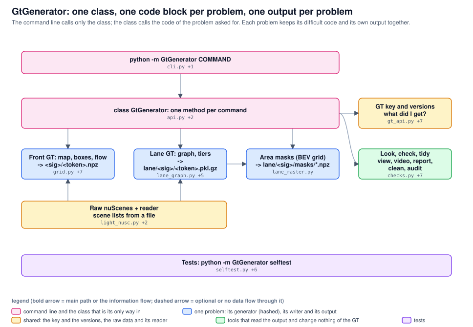

# GtGenerator - ground truth for BEV perception from nuScenes

One class, `GtGenerator`, turns a raw nuScenes folder into training-ready ground truth per keyframe for two systems: **BEV Fusion** (front camera + five radars, ego frame, grid x 0 .. 60 m, y +-26 m)
and **Spurmitte** (six cameras + five radars, lane frame, 100 x 100 m). The **front GT** holds static map layers, objects, a velocity / flow field in m/s and coverage masks; the **lane GT** the lane
graph with relevance tiers and camera visibility; **area masks** are rasterised from the lane GT. Every GT is named by a **GT key**. Everything is in seconds, never per frame; nothing here imports a
problem's code.

Agents: [`AGENTS.md`](AGENTS.md) describes every field and the rules for using it. This page: make the GT, name it, extend the generator.

## The interface
`problems/`, `autoresearch/` and `datasets/` reach the ground truth through `import GtGenerator` and its public names, or through `python -m GtGenerator COMMAND` (below), and through nothing below
them: no module or file of this folder, no folder or file name below the store root (the root itself and the folder of a key's part are answers of the interface: `store_root()`,
`key.part(name).path`), no file format, no version table. The public names are the table `_PUBLIC` in `__init__.py` (it is `GtGenerator.__all__`); the docstring there has one
contract line per name (what goes in, what comes back as numpy / dict / str), [`AGENTS.md`](AGENTS.md) section 1 says what each is for.

| kind | public names |
|---|---|
| where the GT is, which GT it is | `store_root`, `current_signature`, `lane_signature`, `current_version`, `version_of_key`, `version_names`, `gt_key`, `GtKey` |
| read stored GT | `load`, `missing`, `load_lane`, `lane_tokens`, `scene_tokens` |
| make GT | `GtGenerator` (the class: the generator object of a loader, and one static method per command), `generate`, `generate_bev_gt`, `generate_lane_gt` |
| raw nuScenes as the GT reads it | `light_nuscenes`, `pose_matrix` |
| definitions shared with a network and its tests | `GridSpec`, `AREAS`, `LINES`, `OBJECTS`, `DIST_MAX`, `cell_centres`, `occlusion`, `radar_cells`, `coverage_for`, `shares_in`, `mask_for` |
| pictures | `lane_camera_image` |
| the rule | `check_imports` |

- A cache name or a record carries the key of the STORE (`current_signature()`, `lane_signature(rig)`, `store_signature()` of a generator object), never a code signature: an edit that changes no GT
  (`same_gt_as`) then invalidates no cache and no comparison.
- A name a problem needs and the table lacks is added to the table (with its contract line and its row in `AGENTS.md`), not imported from below.
- On the class and on a key only the members of `_MEMBERS` (`__init__.py`) are the interface. The class also carries one static method per command (`versions(update=True)` writes
  `versions.csv`, `clean(delete=True)` deletes reports): those belong to the command line.
- The test is `interface_selftest.py` (`selftest --only interface`, seconds, no nuScenes): `check_imports` on a planted file with one line per way of going below the interface, the table
  against these documents, the store root and the readers on a made-up store, and the three folders of the tree. Its `PENDING` lists the lines of the tree that still reach below the
  interface; the list can only shrink. The full `selftest` runs it without the scan of the tree (it is the gate of a signature step and must not depend on a file another session edits).

## Minimal example
From the repository root (WSL, conda env `gcar`); one mini sequence:
```python
from GtGenerator import GtGenerator, scene_tokens
key = GtGenerator.generate_bev_gt("~/data/nuscenes", scenes=["scene-0061"])   # front GT + lane GT of the rig bev_fusion + masks; a rerun writes only what is missing
print(key)                                      # data identity | code signature per part | release | complete or not
token = scene_tokens("scene-0061")[8]
g = key.load(token)                             # front GT: a dict of float32 layers [ix, iy] + "meta"
lanes = key.lane(token)                         # the lane graph of the keyframe
mask = key.mask(token, "intersection", 0.5)     # (120, 104) uint8 in the BEV grid, border 0.5 m
```

## Commands
`python -m GtGenerator COMMAND ...` is exactly one method of the class (`api.py`; `COMMAND --help` lists the options). `wsl bash GtGenerator/run_nice.sh -m GtGenerator COMMAND ...` runs it at nice 15
on one thread.

| command | method | what it does |
|---|---|---|
| `generate DATAROOT` | `generate` | everything: front GT, lane GT of both systems, masks (`--set full`: trainval, 5 - 8 h on one core for the front part; `--workers N`) |
| `generate-bev DATAROOT` | `generate_bev_gt` | BEV Fusion: front GT + lane GT of the rig `bev_fusion` + masks -> GT key |
| `generate-lane DATAROOT` | `generate_lane_gt` | the lane GT (`--rig lane_center`, `bev_fusion` or `all`) -> GT key |
| `area-masks` | `area_masks` | only the packed masks of an existing BEV Fusion lane store |
| `key SYSTEM` | `gt_key` | the key of what is stored (`bev_fusion`, `lane_center`); exit 1 when incomplete; `--json` |
| `have` | `have` | is the front GT of this generator stored for these sequences (the check before a training); exit 1 when not |
| `data DATAROOT` | `check_data` | are the raw files the generator reads on disk; exit 1 when not |
| `sets`, `versions` | `sets`, `versions` | the scene sets and how much is stored; GT versions, lane versions, releases |
| `audit-lane SYSTEM` | `audit_lane` | audit a stored lane GT before its release; exit 1 on a problem |
| `check`, `digest` | `check`, `digest` | consistency checks of mini (`--holdout`: leave-one-radar-out); a digest per frame, `--compare A B` |
| `report` | `report` | all checks over all sequences, the GT stored, one PDF with samples |
| `view`, `sheets`, `video`, `lanegraph`, `masks`, `area-mask TOKEN` | the same names, `area_mask` | pictures of keyframes, a drive at 12 Hz (H.264), the lane graph, the coverage masks, one area mask |
| `clean [--reports] [--stale-caches DIR]` | `clean` | list (dry run) or `--move` reports and the stores of other generator versions; never a released store; `--delete` only for reports |
| `selftest [--only PART ...]` | `selftest` | all tests (minutes; needs nuScenes mini), or parts |

- Sequences: `--set small|full` (`sets/`: the 10 sequences of mini; all 850 of trainval), `--scenes scene-0061 ...` or `--scenes-file F`, never two of them. A problem's own split of the same name is another
  list: pass it with `--scenes-file`; its key calls it `scenes:<id>`.
- `--out ROOT` is the root of the stores (`have` and `report` call it `--data`; for `report`, `--out` is the PDF).
- Exit codes: 0 done, 1 not there or incomplete, 2 wrong arguments (a message; `GTGENERATOR_TRACEBACK=1` shows the traceback). Methods return plain data (a `GtKey`, or a dict with `ok` and `text`) and
  raise `ValueError` for wrong arguments.

## Where the data is
- Raw nuScenes: the views `~/data/nuscenes_full` (trainval) and `~/data/nuscenes` (mini), see [`datasets/nuscenes/`](../datasets/nuscenes/README.md). Never written to.
- Stores, not in git, below `<data root>/groundtruth` (`where.py`: the data root is `RESEARCH_DATA`, else `data` of the machine file, shown by `research machine`; `<repository>/data/autogt` only on a machine without any machine file: a
  machine file that is named or exists and cannot be read or names no data root is an error, never that fallback):
  `<signature>/<token>.npz` + `index.json` (front), `lane/<signature>/<token>.pkl.gz` + `masks/` (lane), `cache/` (the tables of the light nuScenes reader), `reports/`.
- Stores are derived data and can be rebuilt. One writer per folder at a time. A folder written with another resolution or supersampling is never continued.
- The `index.json` of a front store is its manifest: sequences, stride, `complete`, resolution, `gt_version`, git `commit` and `dirty`, library versions, data identity and `release` (complete, a released
  version, a clean tree and the set `full`). Report numbers from a release store.

## Versions and signatures
- A **signature** is a hash of the bytes of the files that make a GT, plus the options. It names the store folder, so GT of different code is never mixed. Front: `grid.py layers.py flow.py
  nuscenes_adapter.py nuscenes_gt.py coverage.py`. Lane (one per rig, with its parameters): `lane_graph.py road_graph.py lane_lines.py lane_tiers.py rig_cameras.py lane_gt.py`. Every other file
  (interface, writer, stores, tools, tests) changes no GT.
- A **version** names a signature for people: front `vN` (`versions.csv`, git tag `autogt/vN`), lane `lN` per rig (`lane_versions.csv`, tag `autogt/lane-lN`), a **release** = front + lane as one number
  (`releases.csv`). Current: front v13 (`a107e0b4e8`), lane l6.1 (stores `9ad1d4ce30` for `lane_center`, `8a04143278` for `bev_fusion`), release v15. `versions` prints the tables.
- **Same GT, new code:** when new code makes the GT of an older version byte for byte, its row names it in `same_gt_as` and it reads and fills that store. Proof for the front: `digest A.json` in both
  source trees, `digest --compare A.json B.json`, then the new signature under `same_as` of that store in `front_digests.json`. Lane: checked on stored frames; the digests in `lane_l6_digest.json` pin the
  current graphs. The self-test enforces the pins.
- A **GT key** (`gt_api.py`) is the data identity (`data_identity` of `datasets/nuscenes/manifest.json` as recorded by the store, not a hash of the `dataroot` given), the signature, store, version and
  commit of each part, and the release. Two keys with the same `id` are the same GT: the id is over the data identity and the stores, not over the code signatures. `complete` is never guessed
  (`key.command` is the shell line that makes what is missing); frames written under two manifests give the identity `mixed`.
- **An old version** is rebuilt from its tag: `git worktree add temp/gt_v9 autogt/v9`, then in that folder `python -m autogt generate <nuScenes> --out <folder>`. The tags v3 - v5 hold the package in
  `bev_fusion/autogt` and know only `build` (`PYTHONPATH=bev_fusion python -m autogt build --dataroot <nuScenes> --version v1.0-trainval --out <folder>`); v1 and v2 are `bev_fusion/training/gt_bev.py`.
  Check first that `import autogt; print(autogt.__file__)` points into the worktree.

## Extending it
| you add | where | then |
|---|---|---|
| a front GT layer | `nuscenes_gt.py` (rasteriser: `layers.py`): new signature | `versions --update` (adds the rows); pin the new digests in `front_digests.json`; name the key in `AGENTS.md` (the self-test checks); commit, tag `autogt/vN` (a newer row needs the older tags); rebuild; tell the owner of the training code |
| a lane GT field | the six lane files: new lane signature (the lane problem has priority on them, D61) | a row per rig in `lane_versions.csv` (by hand), then `versions --update` (the release row); new pinned digests (`lane_l6_digest.json`); `audit-lane`; rebuild |
| a derived product (not hashed) | like `lane_raster.py` (reads a store, packs its own cache) | for a mask kind of the key: `gt_api.KINDS`; bump `RASTER_VERSION` when cells change |
| a dataset | an adapter that builds `Track`, `Ego`, `RadarFrame` for `flow.estimate_flow`, and a generator for the static layers | `flow.py`, `layers.py`, `grid.py`, `coverage.py` need no nuScenes; `store.write_keyframe` / `load_keyframe` keep the files; give the generator its own signature files |
| a command | a static method in `api.py`, its parser in `cli.py` | a row above; `cli_selftest.py` |
| a public name (a problem needs something) | a row of `_PUBLIC` in `__init__.py` with its contract line in the docstring | name it in the table above and in `AGENTS.md` section 1; `selftest --only interface` |
| a module | not hashed: list it in `versions.NOT_GENERATOR` | put it in a box of `architecture.json`: `python autoresearch/reporter/archdraw.py render GtGenerator/architecture.json` |

## Architecture


The command line calls only the class; the class calls the code of the problem asked for; the tools read the output and change nothing of the GT. [`architecture.md`](architecture.md) maps every file to
its box. The self-test fails when the drawing and the code differ, and when a module is neither hashed nor listed as not shaping the GT. `.gitattributes` pins LF line ends of the hashed files (CRLF
would give another signature).
