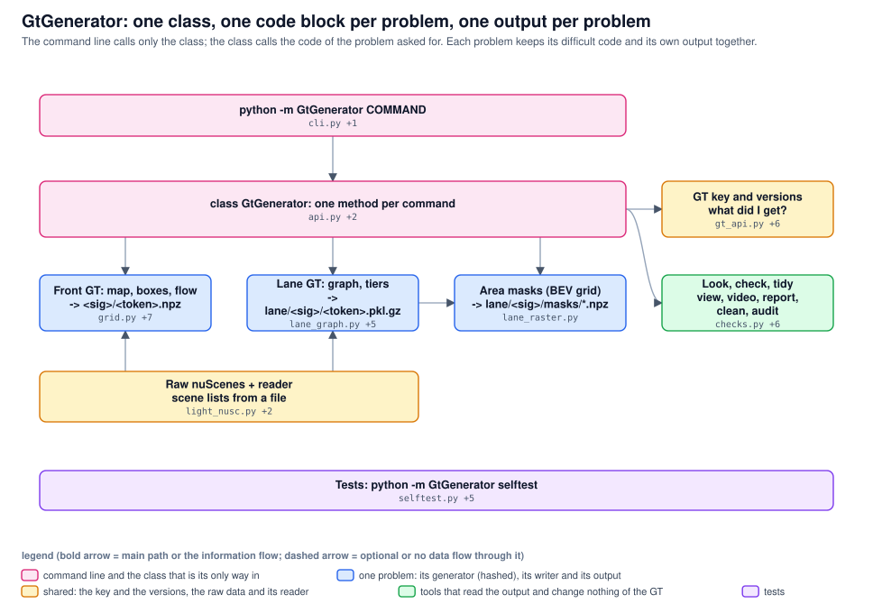

# autogt: one package, six layers

From the raw nuScenes folder to a GT key. Two hashed generators (front BEV GT, lane GT) make the content; everything else is not hashed and can change without a new GT version. Arrows are verified imports or calls. Generated from architecture.json; archdraw.py check keeps it in step with the code.

<!-- archdraw:begin: generated from architecture.json by autoresearch/tools/archdraw.py; edit the spec, then `archdraw.py render` -->
## File map: every box and the code it stands for

| box | kind | code | note |
|---|---|---|---|
| python -m GtGenerator COMMAND | command line and the class that is its only way in | `cli.py`, `__main__.py` | the parser and ONE call GtGenerator.<method>(**arguments) per command; it imports nothing else of the package (a test pins that); exit 0 done, 1 not there / incomplete, 2 wrong arguments |
| class GtGenerator: one method per command | command line and the class that is its only way in | `api.py`, `suite.py`, `__init__.py` | api.py = the static methods (generate, generate_bev_gt, generate_lane_gt, gt_key, have, check_data, audit_lane, area_masks, sets, versions, view, video, check, report, digest, clean, selftest ...), suite.py = the class (it is also the object that makes the GT of one keyframe), __init__.py = the names of the package; AutoGT is the old name |
| Front GT: map, boxes, flow -> <sig>/<token>.npz | one problem: its generator (hashed), its writer and its output | `grid.py`, `layers.py`, `flow.py`, `nuscenes_adapter.py`, `nuscenes_gt.py`, `coverage.py`, `pipeline.py`, `store.py` | BEV layers, objects, velocity / flow in m/s and coverage masks per keyframe. The six hashed files make the front signature (6a7aa7864a, v9): editing one needs a version row and a rebuild of the BEV GT cache. pipeline.py writes the files (groups of 60 sequences, resumable, workers), store.py keeps the files and the index.json manifest (complete, scenes, stride, commit, dirty, release, data identity) |
| Raw nuScenes + reader scene lists from a file | shared: the key and the versions, the raw data and its reader | `light_nusc.py`, `sets.py`, `sets` | the raw files on D: (json tables, maps, CAM_FRONT, radars; data/NuScenes/ describes and checks them), the light reader (the tables of just the sequences asked for, cached), and the scene lists: a list of sequences comes from a file (--scenes-file) or is a shipped set (small = the 10 mini sequences, full = all 850); a list is named by the id of its content |
| Tests: python -m GtGenerator selftest | tests | `selftest.py`, `cli_selftest.py`, `gt_api_selftest.py`, `generator_selftest.py`, `lane_graph_selftest.py`, `lane_tiers_selftest.py` | synthetic world with known truth, real keyframes, build + reload; every command is one method and one call; exact raster against the polygons; generator against the devkit, the map and the image; lane graph invariants; the signature guard; each new test is checked by a mutant; this drawing is checked against the code |
| Lane GT: graph, tiers -> lane/<sig>/<token>.pkl.gz | one problem: its generator (hashed), its writer and its output | `lane_graph.py`, `road_graph.py`, `lane_lines.py`, `lane_tiers.py`, `rig_masks.py`, `lane_gt.py` | the lane graph, roads, lines, areas, tiers and camera visibility per point, for lane_center (Spurmitte) and bev_fusion; the six hashed files of the lane signature; its writer and its store code are inside lane_gt.py (the difficult code stays local) |
| Area masks (BEV grid) -> lane/<sig>/masks/*.npz | one problem: its generator (hashed), its writer and its output | `lane_raster.py` | exact cell-centre raster of the lane polygons into the BEV grid, packed per frame next to the lane store; derived from the lane GT, not hashed |
| GT key and versions what did I get? | shared: the key and the versions, the raw data and its reader | `gt_api.py`, `versions.py`, `versions.csv`, `lane_versions.csv`, `releases.csv`, `lane_l4_digest.json`, `front_digests.json` | GtKey = the data identity + per part (front / lane / masks) the code signature, store, version, git commit, dirty; complete is judged by the files that are there; versions.csv maps a signature to a version (new rows are derived from git: versions --update); same_gt_as and the pinned digests prove that new code makes the same GT; gt_api.py also has generate_bev_gt / generate_lane_gt, which call the problems below |
| Look, check, tidy view, video, report, clean, audit | tools that read the output and change nothing of the GT | `checks.py`, `report.py`, `view.py`, `video.py`, `lane_graph_view.py`, `clean.py`, `store_audit.py` | consistency checks, one PDF over all sequences, pictures, H.264 video, lane graph pictures, clean (never a released store), audit of a stored lane GT before its release |
<!-- archdraw:end -->
