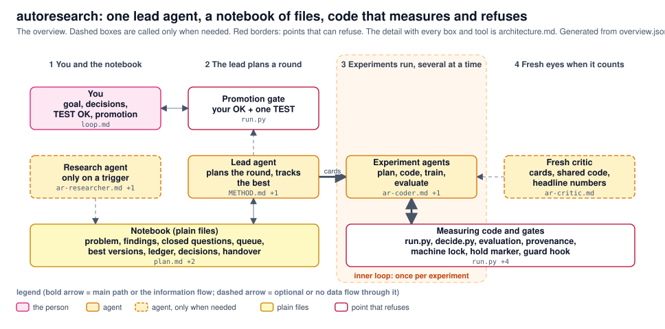

# Auto-research

A research system in which AI agents plan and run experiments on perception problems, and code decides what counts as a result. The method is problem-independent; two problems are worked on with it.

One lead agent plans a round and writes the experiment cards. Experiment agents run them, several at a time. Plain files are the memory (plan, ledger, decisions, handover). Code measures and refuses: a run that feeds a verdict goes through the launcher, a verdict comes from a rule written before the run, and the TEST split and the protected files are opened only with a recorded decision of the person.

## Folders
| folder | what it is |
|---|---|
| [`autoresearch/`](autoresearch/README.md) | the research system: method (`METHOD.md`), agent roles, templates, prompts, tools (launcher with a git tag per run, ledger, schedule, decisions, checks), evaluation and training suites |
| [`autogt/`](autogt/README.md) | the nuScenes ground-truth suite: BEV ground truth (map layers, objects, velocity) per keyframe, versioned (`autogt/vN` tags) |
| [`bev_fusion_lane_center/`](bev_fusion_lane_center/README.md) | problem 1: a lane-centre-line graph from camera + radar, attached to an SD map |
| [`bev_fusion/`](bev_fusion/README.md) | problem 2: a camera + radar BEV perception system on nuScenes: the five-layer framework and the full network (camera + radar + temporal fusion + motion block) on ground truth v8; training, evaluation, experiments, literature |
| [`data/NuScenes/`](data/NuScenes/README.md) | the nuScenes dataset family: description, manifest, download / check / link tools and the map of where raw data, caches and checkpoints live (the data itself is not in the repository) |

Not in git: the rest of `data/` (generated data), `temp/` (scratch), `wsl/` (disk image).

## Status (2026-11-02)
- **Method and tools** are in place and tested: the launcher with a git tag per run, ledger, decisions, the training suite (`status` / `health` / `stop` / `speed`), the evaluation suite (frames, videos, numbers, paired comparison, module probe, timing) and the ground-truth suite autogt (v8 release: all 850 trainval sequences, 34,149 keyframes).
- **Problem 2 (BEV system):** the five-layer framework and the full network are built; the small-set bring-up (timing, module probes, eight findings and fixes) is done; the large baseline run, its matched control and two improvement arms are training or queued. Details and the quick start: [`bev_fusion/README.md`](bev_fusion/README.md), the bring-up log: [`bev_fusion/experiments/t16_full_network/experiment.md`](bev_fusion/experiments/t16_full_network/experiment.md). Live numbers are in the ledgers and cards, not in the READMEs.
- **Problem 1 (lane centre-line graph):** [`bev_fusion_lane_center/README.md`](bev_fusion_lane_center/README.md) and its `HANDOVER.md`.
- **Data:** raw nuScenes on D:, caches and checkpoints next to it, reached through links; the map is [`data/NuScenes/README.md`](data/NuScenes/README.md).

## Where to start
- The method and its rules: [`autoresearch/METHOD.md`](autoresearch/METHOD.md) (six hard rules, everything else is a default).
- The picture and the detail drawing: [`autoresearch/overview.md`](autoresearch/overview.md), [`autoresearch/architecture.md`](autoresearch/architecture.md).
- A problem: its README, `project.json` (paths), and for the lane problem `HANDOVER.md` (where we are), `PROBLEM.md` (goal) and `experiment_execution/decisions/` (the decisions of the person); `bev_fusion/` keeps its plan in `bev_fusion/plan/`.
- Rules for agents working in this checkout: [`CLAUDE.md`](CLAUDE.md).

## Reproducing a result
A result card names the ground-truth version and mode, the evaluation code version, the frames, the raw-data manifest, the model and the environment (`autoresearch/reproducibility.md`, `autoresearch/tools/provenance.py`). Recipes for the raw data stay in git (`data/NuScenes/`).
