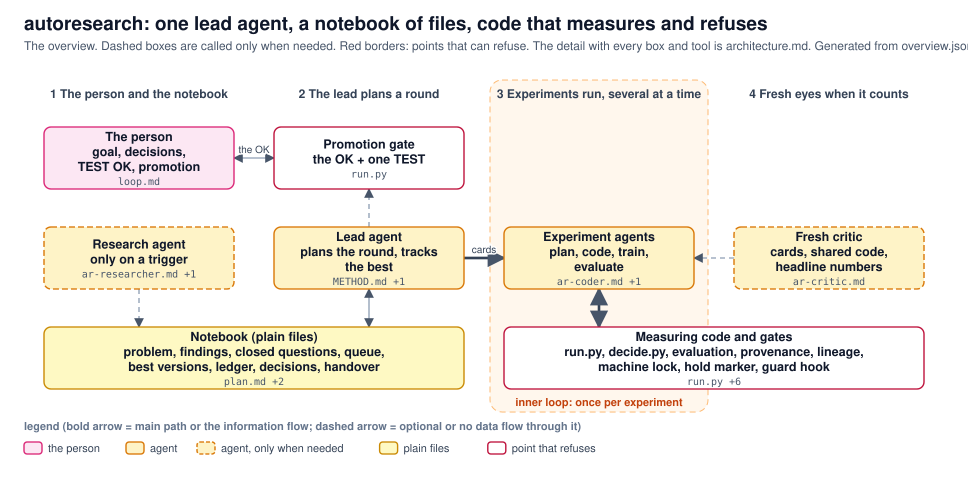

# Auto-research

A research system in which AI agents plan and run experiments on perception problems, and code decides what counts as a result. The method is problem-independent; two problems are worked on with it.



One lead agent plans a round and writes the experiment cards. Experiment agents run them, several at a time. Plain files are the memory (plan, ledger, decisions, handover). Code measures and refuses: a run that feeds a verdict goes through the launcher, a verdict comes from a rule written before the run, and the TEST split and the protected files are opened only with a recorded decision of the person.

## Folders
| folder | what it is |
|---|---|
| [`autoresearch/`](autoresearch/README.md) | the research system: method (`METHOD.md`), agent roles, templates, prompts, tools (launcher with a git tag per run, ledger, schedule, decisions, checks), evaluation and training suites |
| [`GtGenerator/`](GtGenerator/README.md) | the nuScenes ground-truth suite: BEV ground truth (map layers, objects, velocity) per keyframe, versioned (`autogt/vN` tags) |
| [`bev_fusion_lane_center/`](bev_fusion_lane_center/README.md) | problem 1: a lane-centre-line graph from camera + radar, attached to an SD map; the system of record is the token champion (`training/architecture.svg`) |
| [`bev_fusion/`](bev_fusion/README.md) | problem 2: a camera + radar BEV perception system on nuScenes: the five-layer framework and the full network (camera + radar + temporal fusion + motion block) on the current GT version; training, evaluation, experiments, literature |
| [`data/NuScenes/`](data/NuScenes/README.md) | the nuScenes dataset family: description, manifest, download / check / link tools and the map of where raw data, caches and checkpoints live (the data itself is not in the repository) |
| [`problems/`](problems/README.md) | being built (restructure plan [`autoresearch/INTEGRATION_2026-11-26.md`](autoresearch/INTEGRATION_2026-11-26.md)): one folder per problem, code and text only; holds the reference problem `toy/` today, the two problems above move in later |
| [`champions/`](champions/README.md) | being built: the facts (weights' hashes, numbers, per-scene counts, timing, drawing) of each problem's best network and its comparison networks; no code |
| [`reporter/`](reporter/README.md) | the report builder: a folder of markdown parts and result files becomes one html report with its numbers filled from the result files and checked (`reporter.py build / check / pack`) |

Not in git: the rest of `data/` (generated data), `temp/` (scratch), `wsl/` (disk image).

## Status (2026-11-21)
- **Method and tools** are in place and tested: the launcher (`run.py`: a ledger row, a done flag, the code commit and a git tag per run), the ledger, the decisions record (one neutral table, `bev_fusion_lane_center/experiment_execution/DECISIONS.md`, read by the gates of both problems), the gates (`guard_hook.py`, `testgate.py`), the four suites `GtGenerator`, `Training`, `Runner` and `Evaluation` (a class with a command line each), the job layer `jobrunner`, and the generated architecture drawings (`archdraw.py`). Each problem keeps a small design spec, `DESIGN.md` (the modules of the chain and the rules it obeys).
- **Problem 1 (lane centre-line graph):** the token champion (D113 - D120): the frozen lane head B' makes tokens, one token head wires and types them end to end; VAL topo F1 0.6682 / 0.6813, 16.2 ms per frame, 2.323 M parameters. The assignment to the SD map is built as a separate stage (E389: the route head reads the map but its gain over the matched no-map head stays below the bar, TIE; E390 builds the map as a logical road graph). Details: [`bev_fusion_lane_center/README.md`](bev_fusion_lane_center/README.md), `PROBLEM.md`, `HANDOVER.md`.
- **Problem 2 (BEV system):** the five-layer framework and the full network are built on GT release v14 (front v13 + lane l6); the experiments t16 - t26 and their outcomes are in the cards and the ledger; the state is in [`bev_fusion/README.md`](bev_fusion/README.md).
- **Ground truth:** [`GtGenerator/README.md`](GtGenerator/README.md) (front v13, lane l6, release v14).
- **Data:** raw nuScenes on D:, caches and checkpoints next to it, reached through links; the map is [`data/NuScenes/README.md`](data/NuScenes/README.md).
- **Clean-up of 2026-11-20 / 21 (D129):** the decisions record was rewritten in neutral wording and merged into one file (`experiment_execution/DECISIONS.md`, shared by the two problems); clutter and dead code were removed (the removed code is only in the git history); the READMEs and drawings were brought to the current state.
- **Layout of 2026-11-23 / 24 (D139 - D141):** each problem keeps its best network inside its own folder (`bev_fusion_lane_center/winner/`, `bev_fusion/winner/`: code copy, configs, manifest; the checkpoint itself is not in git); only the latest report stays (`bev_fusion_lane_center/results/E2E_Report_2026-11-23/`, with the result files its numbers come from in `data/`); the scratch folders `temp/` were emptied and left git; the owner's name and mail address left the tracked text. The decisions since then (new experiments included) are the last rows of `experiment_execution/DECISIONS.md`.

## Where to start
- The method and its rules: [`autoresearch/METHOD.md`](autoresearch/METHOD.md) (six hard rules, everything else is a default).
- The picture and the detail drawing: [`autoresearch/overview.md`](autoresearch/overview.md), [`autoresearch/architecture.md`](autoresearch/architecture.md).
- A problem: its README, `project.json` (paths), `DESIGN.md` (the design spec) and, for the lane problem, `HANDOVER.md` (where we are), `PROBLEM.md` (goal) and `experiment_execution/DECISIONS.md` (the decisions of the owner, one neutral table); `bev_fusion/` keeps its plan in `bev_fusion/plan/`.
- Rules for agents working in this checkout: [`CLAUDE.md`](CLAUDE.md).

## Fresh checkout: what you get and what you need
`git clone` gives the code and all text records (cards, ledgers, decisions, reports as text, the run tags `lcr/<run id>` / `bf/...` that are on origin: a tag holds the code a run started from). It does not give data, checkpoints, caches, images or the generated reports: those are rebuilt, and `bev_fusion_lane_center/data/rebuild.json` names the script that makes each one. The repository sets LF line endings itself (`.gitattributes`), so a clone on Windows with `core.autocrlf=true` works in WSL.

1. **Machine**: Windows 11 + WSL2 Ubuntu 22.04, an NVIDIA GPU for training (RTX 3060 12 GB was used; the tests and the checks below need no GPU).
2. **Python environment** `gcar` (conda, torch 2.8; the scripts expect Miniconda at `~/miniconda3` inside WSL and the clone of the GaussianCaR code at `~/work/gaussiancar`): `bash bev_fusion_lane_center/tools/env/setup/setup_gcar_env.sh` (list of packages: `bev_fusion_lane_center/tools/env/environment_gcar.yml`, `.txt`; third-party code that is cloned, not stored: `tools/env/setup/foundation_code.md`). Scripts run through `bash tools/env/_py14.sh <script>` from the problem folder.
3. **Raw data**: nuScenes is not in git and not downloaded by any tool without the owner's word; `data/NuScenes/README.md` and `data/NuScenes/manifest.json` say what is needed and how it is verified (`data/NuScenes/tools/`). The ground truth is generated from it: `wsl bash GtGenerator/run_nice.sh ...` (see `GtGenerator/AGENTS.md`).
4. **Check what works without data** (minutes, CPU only), from the problem folder `bev_fusion_lane_center/`:
   ```
   wsl python3 ../autoresearch/tools/install_agents.py            # once: copies the agent roles into .claude/agents/ (not in git; the test wrapper checks them)
   wsl python3 tools/maintenance/reproducible.py --no-clone      # git policy, imports, rebuild manifest
   wsl bash tools/maintenance/run_all_tests.sh                    # PASS / SKIP / FAIL: a SKIP names stored data that is not in git, a FAIL is a real defect
   wsl python3 ../autoresearch/tools/check_structure.py           # folder rules, dead paths in the documents
   ```
   `check_structure.py` exits 1 in a fresh clone: it also lists every path in a document that points at data or run folders, which a clone does not have (several hundred `dead path` lines); in a clone only its lines about root files, folders and missing READMEs count. `reporter.py check` runs with the system python, `reporter.py build` needs `markdown-it-py` (the `gcar` environment has it).
5. **Run tags**: a tag is pushed only when the commit it points at holds no scratch or forbidden file (`autoresearch/tools/check_git.py` lists the held-back ones). About 450 older tags are held back on the machine that ran them (their snapshots include scratch folders; backed up outside git as a bundle on the data drive, D143), so an old card's `git show lcr/<id>:<file>` can fail in a clone; the card's text, the ledger row and the code of main are what a clone has. What a clone needs to repeat a run is the base commit and the few executed files that differ from it, stored per experiment: `python3 autoresearch/tools/recipe.py show <run id>` is the brief for an AI or a person, `repeat <run id>` builds the worktree (`autoresearch/reproducibility.md`, "Repeat a run from a fresh clone").
6. **Understand the state**: this README, then `bev_fusion_lane_center/HANDOVER.md` (where we are), `PROBLEM.md`, `DESIGN.md`, `experiment_execution/DECISIONS.md`; each experiment card (`experiments/E<id>_*/experiment.md`) says what it ran, with which data and which code (the git tag of the run). Without the result folders (`runs/`) a card shows the recorded numbers but a number cannot be re-measured until the data and the checkpoint are rebuilt as `data/rebuild.json` describes.

## Reproducing a result
A result card names the ground-truth version and mode, the evaluation code version, the frames, the raw-data manifest, the model and the environment (`autoresearch/reproducibility.md`, `autoresearch/tools/provenance.py`). Recipes for the raw data stay in git (`data/NuScenes/`).
