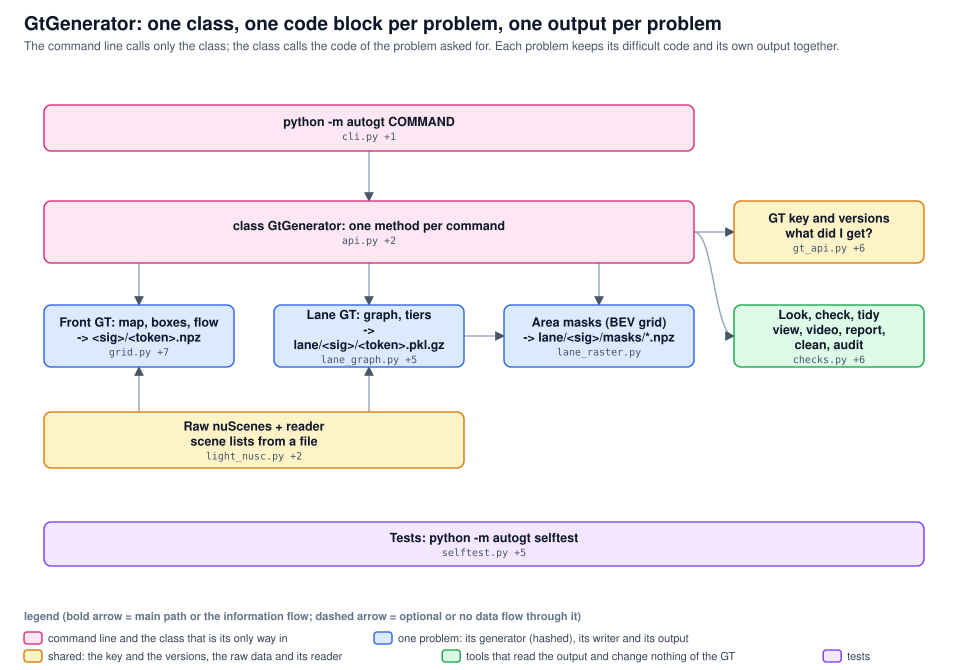

# autogt: one package, six layers

From the raw nuScenes folder to a GT key. Two hashed generators (front BEV GT, lane GT) make the content; everything else is not hashed and can change without a new GT version. Arrows are verified imports or calls. Generated from architecture.json; archdraw.py check keeps it in step with the code.

<!-- archdraw:begin: generated from architecture.json by autoresearch/tools/archdraw.py; edit the spec, then `archdraw.py render` -->
## File map: every box and the code it stands for

| box | kind | code | note |
|---|---|---|---|
| python -m autogt COMMAND | command line | `cli.py`, `__main__.py` | a thin map: the parser, and ONE call AutoGT.<method>(**arguments) per command; it imports nothing else of the suite (a test pins that); exit 0 done, 1 not there / incomplete, 2 wrong arguments |
| Tests: python -m autogt selftest | tests | `selftest.py`, `cli_selftest.py`, `gt_api_selftest.py`, `generator_selftest.py`, `lane_graph_selftest.py`, `lane_tiers_selftest.py` | synthetic world with known truth, real keyframes, build + reload; every command is one method of AutoGT and one call; exact raster against the polygons; generator against the devkit, the map and the image; lane graph invariants; the signature guard; each new test is checked by a mutant |
| Look, check, tidy view, report, clean ... | class interface AutoGT and what its methods call (not hashed) | `checks.py`, `report.py`, `view.py`, `video.py`, `lane_graph_view.py`, `clean.py`, `store_audit.py` | consistency checks, one PDF over all sequences, pictures, H.264 video, lane graph pictures, clean (never a released store), audit of a stored lane GT before its release |
| class AutoGT one method per command | class interface AutoGT and what its methods call (not hashed) | `api.py`, `suite.py`, `__init__.py` | api.py = the static methods (generate, generate_bev_gt, generate_lane_gt, gt_key, have, check_data, audit_lane, area_masks, sets, versions, view, video, check, report, digest, clean, selftest ...); suite.py = the class AutoGT (also the object that makes the GT of one keyframe), load(), the signatures; __init__.py = autogt.generate, load, missing ... |
| Writer: generate, build GT per system | class interface AutoGT and what its methods call (not hashed) | `pipeline.py`, `gt_api.py` | pipeline.py = THE front GT writer (groups of 60 sequences, resumable, workers as spawned processes); gt_api.py = generate_bev_gt / generate_lane_gt, which run the writer, the lane generator and the masks and return the GT key |
| nuScenes raw (D:, 850 sequences) | data on disk (not in git) |  | json tables, maps, CAM_FRONT (and the six cameras of the lane GT l4), five radars; data/NuScenes/ describes it and checks it (manifest.json); the data identity of the key is its hash |
| Light reader table cache | foundation data: raw nuScenes and its readers (not hashed) | `light_nusc.py` | the nuScenes tables of just the sequences asked for, as the devkit's interface; ensure_cache reads the big tables once (92 s) and a group of 60 sequences then loads in 4 s |
| Scene sets raw-file check | foundation data: raw nuScenes and its readers (not hashed) | `sets.py`, `sets` | small = the 10 sequences of mini, full = all 850; check_raw says whether every raw file the generators read is on disk |
| Front GT generator map, boxes, flow, masks | generator, hashed into the GT signature | `grid.py`, `layers.py`, `flow.py`, `nuscenes_adapter.py`, `nuscenes_gt.py`, `coverage.py` | BEV layers, objects, velocity / flow in m/s, coverage masks per keyframe; the six files whose bytes make the front signature (6a7aa7864a, v9): editing one needs a versions.csv row, a tag and a rebuild of the BEV GT cache |
| Lane GT generator graph, tiers, two rigs | generator, hashed into the GT signature | `lane_graph.py`, `road_graph.py`, `lane_lines.py`, `lane_tiers.py`, `rig_masks.py`, `lane_gt.py` | the lane graph, roads, lines, areas, tiers and camera visibility per point, for lane_center (Spurmitte) and bev_fusion; the six files of the lane signature (own versions); lane_gt.py also holds its own store code |
| Area masks (BEV grid, packed) | derived output of a generator (not hashed) | `lane_raster.py` | exact cell-centre raster of the lane polygons into the BEV grid, packed per frame below <lane store>/masks/; part of the BEV GT, not hashed |
| Stores on disk data/autogt | data on disk (not in git) |  | <signature>/<token>.npz (front), lane/<signature>/<token>.pkl.gz (+ masks/), cache/, reports/, examples/; data/autogt links to D:\Auto-research\NuScenesAdditionalGt |
| Store files index.json manifest | stored data and version key (not hashed) | `store.py` | keyframe files, the index.json of a store folder (complete, scenes, stride, resolution, commit, dirty, release, data identity), resume checks, listing by file name |
| GT key GtKey, gt_key | stored data and version key (not hashed) | `gt_api.py::GtKey` | data identity + per part (front / lane / masks) signature, store, version, commit, dirty; id over all parts; complete is never guessed; key.load / lane / mask read through it |
| Versions, releases signature -> v12 | stored data and version key (not hashed) | `versions.py`, `versions.csv`, `lane_versions.csv`, `releases.csv`, `lane_l4_digest.json` | front version, lane version and release of a signature; same_gt_as aliases (new code, same GT: the old store is used); lane_l4_digest.json pins the l4 output for the l5 / l6 comparison |

## Arrows

| from | to | carries |
|---|---|---|
| python -m autogt COMMAND | class AutoGT one method per command | AutoGT.method |
<!-- archdraw:end -->
