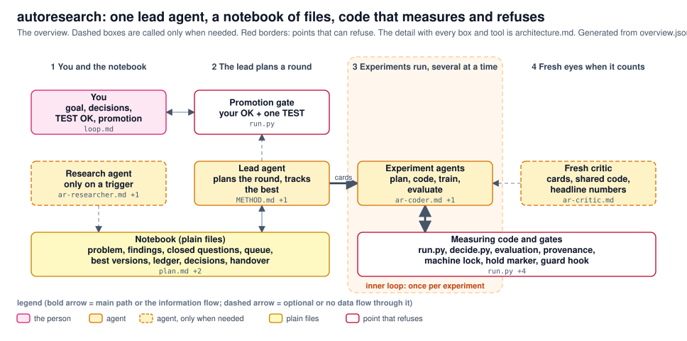
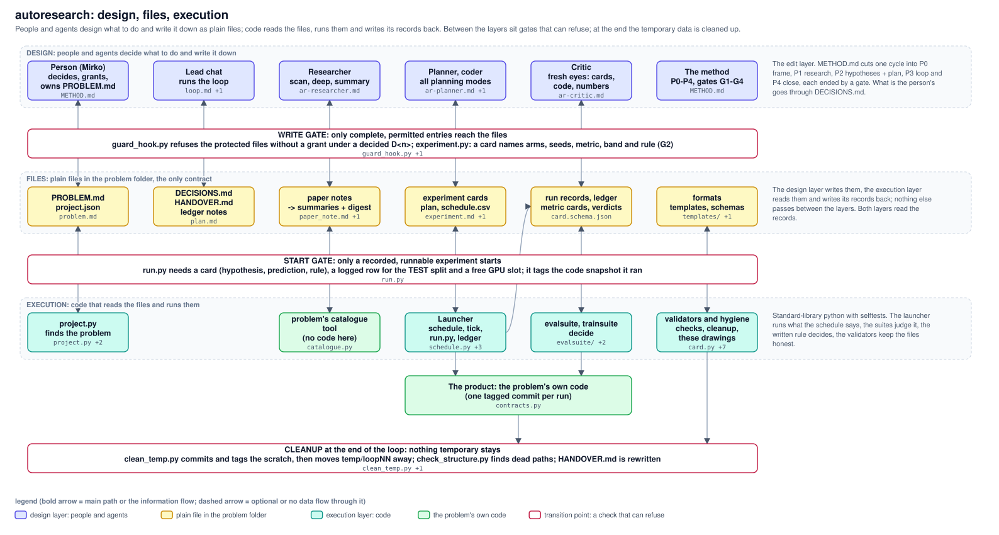
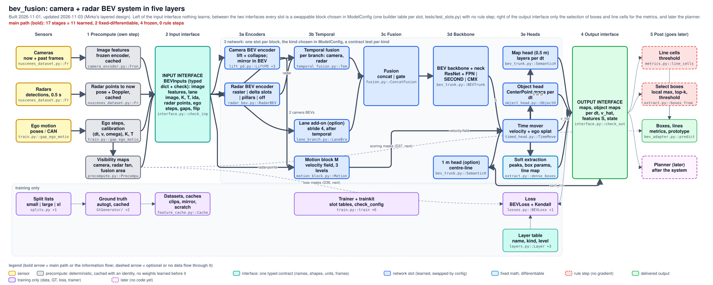
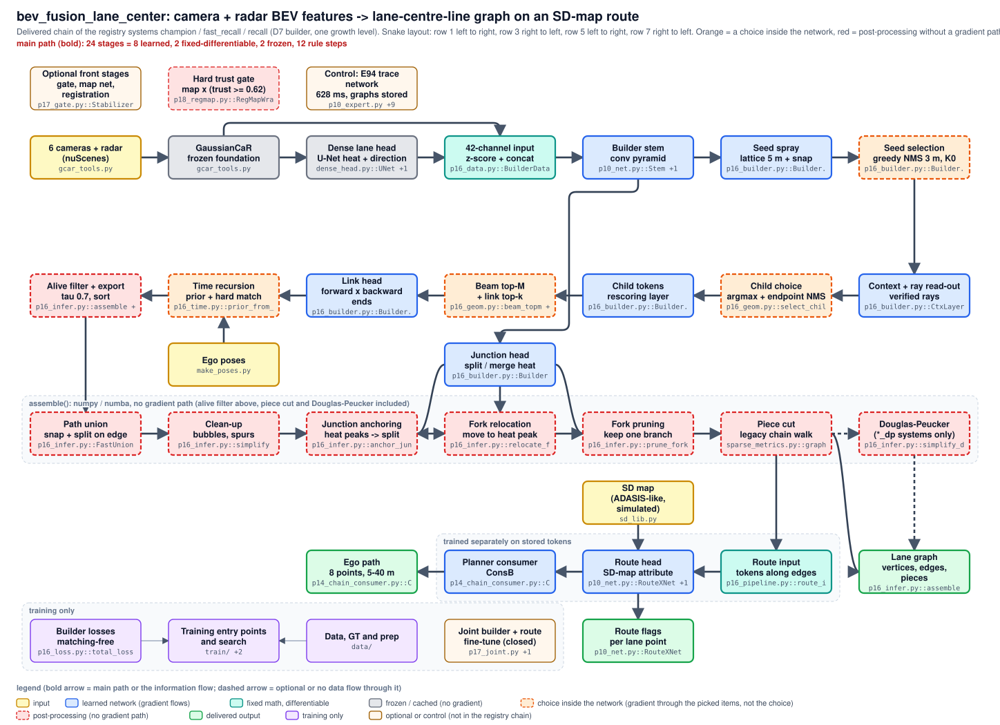

# autoresearch - a research system around a product

General and problem-independent: the method (`METHOD.md`), four agent roles (`agents/`), five templates (`templates/`), two prompts (`prompts/`) and the tools that make the method hold (`tools/`). A problem plugs in through its own folder. It is kept small on purpose: a new template, agent or tool only when the same thing has been done twice by hand (`METHOD.md`, "Code, git, size"), and only a few rules are hard (`METHOD.md`, "Hard rules and defaults").



The overview above is generated from `overview.json`; the detail with every box and every tool is [architecture.md](architecture.md) (the picture below, 26 boxes).



The architecture in one picture: four layers - the **person**, the **agents** (four roles), **plain files in the problem folder** and **code** (the tools and the two suites) - and two loops: the outer one (problem, research, branches, tracking of the n best versions, promotion, cleanup) runs one round after another, the inner one (build, train, evaluate, decide) once per experiment, several at a time. Nothing but files passes between agents and code, so every step can be read, diffed in git and resumed. The points that can refuse are drawn red: the write gate (the gate hook and the card check), the start gate (`run.py`: a card, a logged TEST row, a GPU slot, a tagged snapshot), the decision rule (`decide.py`), the promotion (the person, with one TEST check) and the cleanup (`clean_temp.py` tags the scratch and moves it away). [Each box with the code it stands for](architecture.md). The drawings are generated from `architecture.json` (and the two problems' `training/architecture.json`) by `tools/archdraw.py`, which also fails when a box names a file or symbol that does not exist, or a code file is in no box (section "Examples").

| folder / file | content |
|---|---|
| `METHOD.md` | one page: the outer loop P0 problem -> P1 research -> P2 branches -> P3 inner loop -> P4 close, the inner loop (variant and block experiments), the hard rules and the defaults an agent may change, disruptions, decisions of the person, code and git, roles |
| `agents/` | four roles (D32): `ar-planner` (modes problem, branches with six lenses, plan, detail, tracking), `ar-researcher` (scan, deep, summary), `ar-coder`, `ar-critic` (cards, code, numbers: fresh eyes) - Claude Code subagent format (the forwarding files of the old role names were removed on 2026-11-01, when the loop running at the switch had ended) |
| `templates/` | `problem`, `paper_note`, `group_summary` (with its digest), `experiment` (card block -> detail plan -> summary, all in one file), `plan` (tree + end of loop) |
| `prompts/` | `research_steps.md` (step 0 start of a round, P1 on a trigger, P2 in steps started by hand), `loop.md` (P3 + P4, pasted after `/loop`), `experiment_flow.md` (one experiment in six steps: plan card, coding, experiment, training, evaluation, store to the result folder) |
| `tools/` | `run.py` (launcher: ledger row, commit + tag per run with a code-drift check at the end, TEST guard, retries), `ledger.py`, `schedule.py`, `plan.py` (status of the plan nodes from the schedule and the ledger), `commit_paths.py` (commit exactly the named paths in the shared checkout: temporary index, compare-and-swap on HEAD, scratch and forbidden files refused), `decide.py` (the written rule as code), `check_numbers.py`, `check_structure.py`, `check_git.py` (what may go into git and be pushed: refuses staged scratch (`temp/`, `_to_delete/`) and forbidden files, unpushed commits that add them, lists the run tags that are not on the remote and the scratch that living files point at; rule: root `CLAUDE.md`), `keep3.py` (the best three networks of a problem: one slot per checkpoint, a text record `keep3.json` next to the ledger, a candidate comes in by more than the band with a ledger KEEP or "by hand: <reason>", checkpoints of the three stay complete; the push on a change is a standing instruction, root `CLAUDE.md`), `clean_temp.py`, `install_agents.py` (copies the agent definitions to `.claude/agents/` after a lint: frontmatter, English ASCII text, no paths, names, dates or run ids, existing references; `--check`, `--selftest`), `guard_hook.py` (gate hook: Write / Edit of protected files only with a grant under a decided D<n>), `machine_lock.py` (D19: one machine lock between chats; `run.py` waits while another owner holds an exclusive one), `metrics.py` (per-loop table: runs, GPU hours, verdicts, prediction hits, TEST uses), `run_report.py` (one page per training run for a person without code: state, resumes, the card's prediction and rule, curves, the numbers next to reference runs, the compute in TOPS, pictures and videos each with a review field that exports a `review.json`; `--ingest` files it; `--selftest`; BEV: `bev_suite.py RUN report`), `project.py` (finds the problem and its `project.json`), `selftest.py` |
| `tools/provenance.py` | the provenance block of a result package (GT version and mode, evaluator code hash, frames, model, environment), `compare` of two cards, `package.py` (the result package of a run in `<problem>/results/<run id>/` and the clean-up of derived data and old GT stores, D40), `manifest <run id>` (the provenance of a training run from its record and run folder, with the model bundle: the network and loss modules by import closure, hash and copy), `repro <run id>`; design `reproducibility.md` |
| `tools/lineage.py` | the chain network -> training run -> code -> data -> evaluations, every link verified (`show <name / run id / checkpoint>`, `verify [--all]` over the keep3 networks: checkpoint size + hash, run tag -> commit -> ancestor / tag, code drift, autogt version + tag, card provenance and manifest hash; OK / MISSING / MISMATCH, exit 1 on a MISMATCH), `record <run id> --ckpt --parent` writes `lineage.json` (the parent checkpoint of future networks); read-only otherwise, selftest |
| `evalsuite/` | the evaluation suite for any network: pictures (one frame, random frames, result videos), numbers (over all videos, outliers traced back to frames, paired comparison) and cost (ms and GMACs per frame, the Pareto front of quality against cost) behind three small boxes (Source / Subject / Task); one-page `README.md` with a 70-line minimal adapter, `EXTENSIONS.md` for memory, taps and probing; `stats.py` = the one paired scene bootstrap of the repository (variant - control, also used by the lane project); `comparison/` = the one reviewed place where a prediction is compared with the ground truth (pixel maps, box lists); `python -m evalsuite selftest`; adapters per problem in `bev_fusion/evaluation/` and `bev_fusion_lane_center/evaluation/` (`lane_suite.py`, the lane Task `lane_task/`, moved out of here by D24); numpy + matplotlib (scipy for the full selftest), not standard-library only |
| `trainsuite/` | see, stop and judge a training run from the files it writes (contract: `log.jsonl` metrics stream, `train.log`, `.done` only for exit 0, `CONTROL` / `STOPPED` with exit code 75): `status` table with ETA, `health` checks (crash, stall, NaN, spike, rising loss, slowdown, GPU, over-fit, comparison with a reference run), kill rules of the card (`group.lines@1000 > 1.48`), `curves`, `stop`, `watch` (one line per change, for a Monitor; `--enforce` stops on a kill hit), `early` (advisory early-stop advice from the gap to a control run, calibrated on finished pairs; it stops nothing); standard library (curves: matplotlib); one-page `README.md`, `EXTENSIONS.md`; `python -m trainsuite selftest`; the training of `bev_fusion/` is the first user (D23) |
| `trainkit/` | the project-independent training engine (D48): EMA, learning-rate schedule (an own rate per module), gradient clipping and the optimiser step with the non-finite rules, AMP with the GradScaler, atomic checkpoints with resume and warm start, the log files, and the stop protocol (`CONTROL` / `STOPPED`, exit code 75: `trainsuite/control.py` re-exports it); plain torch, no project code; the BEV trainer `bev_fusion/training/train.py` is its first user, guarded by `bev_fusion/tests/test_trainkit_equivalence.py` (the trainer from before the move against the live one: same losses, weights, files and messages); one-page `README.md` |
| `history/` | design history, not read by the tools: the long roadmap and reviews of 2026-10-25, the D22 tool-fix spec (applied), the evalsuite architecture, the repository reviews of 2026-10-31, the target design of D32 and its migration record (`TARGET_2026-11-01.md`, finished in its lean form by D34) |
| `reproducibility.md` | what a result package records (GT version and mode, evaluator code, frame list, model, environment), the gaps today and the plan: a `provenance` block and `repro.py` (design, not built) |
| `coordination.md` | design of two small mechanisms between chats: the hold marker for stopped runs and claims / freezes with a reason and a release (the hold marker is built: `tools/hold.py`, `run.py` refuses a held id, state `held`; claims are design only) |
| `fewer_files.md` | built 2026-11-01: the card is a block inside `experiment.md` (`experiment.py migrate`), the status of plan nodes comes from `plan.py status`; what was left out and why |
| `overview.json` | the overview drawing (8 boxes: you, the lead agent, the notebook, experiment agents, measuring code and gates, research and critic on demand), rendered to `overview.svg` / `overview.md` by `tools/archdraw.py`; the 26-box detail is `architecture.json` |
| `ROADMAP.md` | the open items of the system (backups, CONFIRM split, evaluation cache key, ...), what is done, and what the last reviews taught |
| `architecture.json` / `.svg` / `.md` | the drawing of this system and why it looks like this: the spec (boxes, arrows, the code each box stands for), the generated picture and the generated file map; `python tools/archdraw.py check architecture.json` keeps picture and code together |
| `config.json` | the default problem folder |

## Plug in a problem
1. Make a folder with `PROBLEM.md` (from `templates/problem.md`) and `project.json` (paths: ledger, schedule, runs, holdout log and `holdout_split`, code folders, tag prefix, scratch folder, structure rules, `headline_metrics`, `cards`). Give it one evaluator that writes a metric card per named system and split as in `schemas/card.schema.json` (an ML model on a validation split, or a code system benchmarked by a script: the loop is the same).
2. Set it as default in `config.json` or export `AR_PROJECT=<folder>` for the tools.
3. Set a git identity in the repository's own config (both the Windows and the WSL git use it): `git config user.name ...`, `git config user.email ...`.
4. `python tools/install_agents.py` copies the agents into the workspace's `.claude/agents/` (`--check` tells when the copies drift).
5. List the protected files in `project.json` ("protected") and put the gate hook into the workspace's `.claude/settings.json` (PreToolUse, matcher `Write|Edit|MultiEdit|NotebookEdit`, command `python3 autoresearch/tools/guard_hook.py` run from the workspace; on Windows through `wsl.exe --cd "$CLAUDE_PROJECT_DIR"`). Claude Code reads that file only for sessions started in the workspace folder.
6. Run the research steps by hand (`prompts/research_steps.md`), then loops (`prompts/loop.md`).

Problems using it: `../bev_fusion_lane_center/` (lane-centre-line graph from camera + radar, assignment to an ADASIS-like SD map; tag prefix `lcr`; the default problem, the only one under the gate hook) and `../bev_fusion/` (camera + radar BEV system; tag prefix `bf`, since D23; tools with `AR_PROJECT=../bev_fusion`; its `gpu_slots_dir` points at the lane problem's slot folder, so both count against the 2 slots of the one GPU).

## Tools in one line each
```
python tools/run.py --id E240.a --hyp "..." --pred "..." --rule "..." [--split test] [--after E239.a] [--gpu | --gpu-max-mb 9000] [--timeout 180] -- <command>   # snapshot + tag lcr/E240.a, heartbeat, GPU slot
python tools/ledger.py add|note|render ...   |   ledger.py tail [--loop 19] [-n 15]   # last rows + runs in progress   |   ledger.py sync   # rows of finished runs that have none
python tools/metrics.py [--loop 18] [-v] [--md]             # per-loop table (also at the head of LEDGER.md); -v shows how each row was counted
python tools/guard_hook.py grant evaluation/golden.json --decision D8 --hours 12 --note "..."   |   guard_hook.py grants | check <path>
python tools/machine_lock.py take timing --hours 2 --exclusive --idle --note "E253"   |   release timing | show | wait <owner>   # runs of other owners wait; start your own with AR_LOCK_OWNER=timing
python tools/decide.py --experiment E240 [--write]          # the rule clauses of the card of experiments/E240_*/experiment.md on the metric cards -> KEEP / CUT / TIE / INCONCLUSIVE (refused when the arms' cards differ in split / frames, or two or more seeds cannot be paired: a card's `seed` or an arm's `seeds` (identity), the experiment's `seeds` (one common order), or `"pairing": "position"`)
python tools/decide.py --variant 0.746,0.741 --control 0.725,0.722 --id E240.a --write   # typed per-seed scores (old interface)
python tools/experiment.py check E240 | show E240 | check --all   # gate G2 as code for the card block of experiment.md (an old experiment.json is still read; `migrate` moves it; schema: schemas/experiment.schema.json)
python tools/card.py check --all | check <card.json> | show <card.json>   # the evaluator contract (schemas/card.schema.json): every metric card decide.py reads
python tools/schedule.py show|next|set|add [--command "..."]    # item states are read from the run records
python tools/check_numbers.py <report> <sources ...> [--strict]   # --strict: exit 1 when a number is missing from the sources
python tools/check_structure.py
python tools/install_agents.py [--check]
python tools/clean_temp.py loopNN [--move | --delete]
python tools/archdraw.py render <spec.json> | check <spec.json> | --selftest   # architecture drawing <-> code (see "Examples")
python tools/selftest.py
```
All tools in `tools/` are standard-library Python 3 (any interpreter in the WSL or on Windows); `evalsuite/` needs numpy, scipy and matplotlib (the `gcar` environment).

## Examples: two concrete architectures, one level down

The method is the same for every problem; the product differs. Both products below are drawn the same way, and both aim at an end-to-end network: the path from the sensors to the delivered output should be learned or differentiable. The picture marks what is not: **red / orange boxes are classical steps on that path**, grey ones are frozen (cached) features that no loss reaches. The file map next to each picture names the code of every box and, for every red, orange or grey box, what the step does, what it measurably carries (where the repository documents that), which differentiable building block could stand in for it, and the catch.

**bev_fusion**: camera + radar detections + ego motion -> map layers, object maps, boxes, lines at three times. [File map and the end-to-end table](../bev_fusion/training/architecture.md).



**bev_fusion_lane_center**: camera + radar BEV features -> lane-centre-line graph attached to an SD-map route, planner path. [File map and the end-to-end table](../bev_fusion_lane_center/training/architecture.md).



| system | stages from input to output | learned | fixed, differentiable | frozen | rule steps on the path |
|---|---|---|---|---|---|
| bev_fusion (base `t8_ctl`, variant `t10_dual`) | 14 | 8 | 2 | 4 | 0 on the main path (the visibility maps are deterministic and cached); two rule steps on the consumer side: the line-cell threshold and the box selection (local maximum, top-k, threshold); the dense map outputs and the soft boxes are network layers |
| lane centre (`champion`, `fast_recall`, `recall`) | 24 | 8 | 2 | 2 | 12: 4 choices inside the builder (seed NMS, child choice, beam top-M, time recursion) and 8 post-processing steps without a gradient path (alive filter, path union, clean-up, junction anchoring, fork relocation, fork pruning, piece cut, Douglas-Peucker for `*_dp`) |

The numbers are counted by `archdraw.py` from the drawing's arrows, so they change when the drawing changes. In both systems the foundation features are frozen and cached; the lane chain's losses are per head and no gradient reaches a head from the delivered graph (its one end-to-end attempt, the joint builder + route fine-tune, was negative three times). The bev_fusion box velocity is not learned in any main-chain run (a dead layer, `bev_fusion/experiments/t11_vel_cause/experiment.md`).

### Keeping drawing and code together

```
python tools/archdraw.py render architecture.json          # spec -> architecture.svg + architecture.md (the file map)
python tools/archdraw.py check ../bev_fusion/training/architecture.json     # exit 1 on any of the following
```
`check` fails when a box names a file or `file::Symbol` that does not exist, when a code file under the covered folders is in no box (or in the spec's `not_drawn` with a reason), when two boxes share a grid cell, an arrow names a missing box, or the picture or the file map is stale against the spec. So the drawing cannot describe code that is gone, code cannot grow without a box, and nobody edits the picture by hand. The spec of each problem sits next to the code it draws (`training/architecture.json`); its `main_path` (the inputs and the outputs) makes the tool count the stages in between by class. Run the three checks after a change in a drawn folder:

```
for s in architecture.json ../bev_fusion/training/architecture.json ../bev_fusion_lane_center/training/architecture.json; do python tools/archdraw.py check $s; done
```
