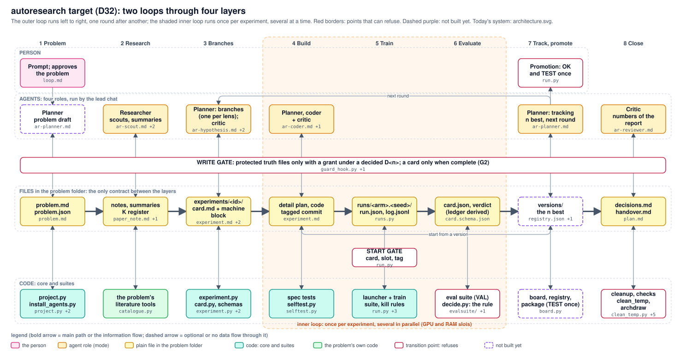

# autoresearch: the target design (D32, 2026-11-01)

The goal of the restructuring that starts here: adopted by Mirko on 2026-11-01, **not built yet**. Today's system is drawn in `architecture.svg`; this page says where it goes and in which steps. It replaces the target packages of `ROADMAP.md` once step 1 below is done.



The picture is generated from `architecture_target.json` and checked against today's code by `tools/archdraw.py` ([file map](architecture_target.md)); dashed purple boxes do not exist yet. When the migration is done, the target drawing becomes `architecture.svg`.

## Why it looks like this
- **Files are the only interface.** Agents read and write files; code reads files and writes records. A round can be resumed, reviewed in git and explained from its folder.
- **Few rules, but those in code.** A capable agent can argue its way around a rule in prose, so the five transition points below refuse in code; everything else is advice.
- **A role is a different context, not a different step.** Separate agents only for fresh eyes (critic) and parallel work (scouts, lenses).
- **The inner loop runs without a chat.** That is where the hours go.
- **Versions are first class.** Every card names the version it starts from; the set of n best is what a round updates. That is why one round can branch from several versions and the outer loop stays sequential.
- **Build on the second use, remove what is unused, clean up every round.**

## Four layers
| layer | what is in it | what it does |
|---|---|---|
| Person | Mirko, `decisions.md` | gives the prompt, approves the problem, promotes a version to champion, allows the one TEST check, grants permissions |
| Agents | four roles: **planner** (modes: problem draft, branches, run once per hypothesis lens, detail plan, tracking), **researcher** (scouts in parallel, summaries), **coder**, **critic** (fresh eyes on cards, code and numbers: the former referee and reviewer) | judgment only; an agent reads files and writes files, nothing else passes |
| Files | the problem folder (below) | the only contract between agents and code |
| Code | `core/` (launcher, gates, decision rule), `suites/train/` (supervision with kill rules), `suites/eval/` (validation, ms per frame, `package`), `report/` (board, numbers check) | rules, runs and measurements; no judgment |

Transition points between the layers, each a check that can refuse: the **write gate** (protected files, complete cards), the **start gate** (a card, a free GPU slot, a tagged snapshot; the TEST split only with a logged row), the **decision rule** (KEEP / CUT / TIE / INCONCLUSIVE from the card's clauses), **promotion** (Mirko, with one TEST check) and the **cleanup** at the end of a loop (scratch tagged, then moved away).

## Two loops
- **Outer loop**, one round per prompt: problem (drafted by the planner, approved by Mirko) -> research -> branches (experiment cards) -> the inner loop for each card -> tracking (updates the set of n best versions by the written rule) -> promotion with one TEST check -> cleanup.
- **Inner loop**, one per card: detail plan (names the boxes of the system drawing it changes) -> code (reviewed) -> train -> evaluate on VAL -> decision rule -> verdict. A variant experiment runs it without a chat.

## One unit of data: the experiment folder
```
<problem>/
  problem.md          goal, metrics, protocol, known gaps (approved by Mirko)
  problem.json        code folders, train command, evaluate command (writes a metric card), holdout split, metric directions, GPU budget
  architecture.json   the system drawing; its main path counts the rule steps between input and output
  research/           paper notes, group summaries with their digests
  experiments/<id>/   card.md (with its machine block: arms, seeds, metric, band, rule, parent version, boxes changed)
                      runs/<arm>.<seed>/run.json + card.json (metric card)   verdict.json   the summary, back in card.md
  versions/<name>.json  the n best: tagged commit, config, weights, metric card, status (best / champion / retired)
  decisions.md  handover.md  scratch/
```
Written by hand (agents or Mirko): problem, cards, versions, decisions, handover. **Derived by code and never edited:** the ledger, the board, the schedule ("what can start" = cards without a verdict whose dependencies have one), the plan status, the per-loop table. A problem plugs in with `problem.json` (about 6 keys instead of today's 25) and two commands; everything else is a fixed folder name.

## What the design must reach
Layers visible (a folder per layer, `archdraw.py check` keeps drawing and folders together) - information flows only through experiment folders and `versions/` - rules in code at every transition point - lean (4 roles, 1 core, 2 suites + report, 5 kinds of hand-written file, method on one page, one page per role) - TEST once at promotion - every state rebuilt from files after a crash - the E2E gaps of each version on the board.

## Migration, in this order
Each step ends with the selftests green, `architecture.json` redrawn to the new state and checked, and one real run through the changed path. Running chains keep working until a step replaces their path.

| step | change | needs |
|---|---|---|
| 1 | roles to four: planner modes, critic = referee + reviewer (agent texts, `install_agents.py`, METHOD.md to one page) | this decision |
| 2 | `eval package`: run a version on frames, measured ms per frame, the output format of the problem as a small adapter function; replaces `bev_fusion/evaluation/bev_prototype.py` and `bev_fusion_lane_center/tools/prototype/lane_prototype.py` | `evalsuite` free of other chats' uncommitted work |
| 3 | the experiment folder as the unit: ledger, schedule and board derived from it; `schedule.csv`, `tick.py` and the hand-kept views go | this decision |
| 4 | `versions/` replaces lane `models/registry.json` and bev_fusion `records/champion.json` | a decision: protected champion entries |
| 5 | layer folders in `autoresearch/` (`core/`, `suites/`, `report/`, `contracts/`) and `problem.json`; bev_fusion first, the lane project after one full loop on the new paths | a decision: `project.json` is protected; no chain may be running |

Not part of it: new suites, a service or daemon, templates beyond the card and the version entry.

## Status (branch `ar/layered-design`, night of 2026-11-01; nothing merged into main yet)
| step | state |
|---|---|
| 1 roles to four, METHOD.md on one page | done on the branch: `ar-planner` (5 modes), `ar-researcher`, `ar-coder`, `ar-critic`; the old names are 3-line forwarding files; METHOD.md 1,821 -> 925 words; tools selftest passes |
| 2 `eval package` | not started: its check needs a real run of both prototypes (GPU booked, RAM short that night) |
| 3 experiment folder as the unit | `tick.py` removed (0 of 61 runs). Measured before deleting `schedule.csv` (lane, 105 items): 54 derivable from the cards (8 arms, 24 evaluate, 10 summary, 6 code, 6 decide steps), 16 more once seed repeats are named by a rule (`E240.a2` = arm a, seed 2), 35 not: card steps outside the arms (diagnosis, analysis, timing: 13), round steps (agent work, prototypes, reviews, tests: 19), items without a folder (3). bev_fusion has no `schedule.csv` at all. So `schedule.csv` goes when `experiment.json` lists its extra steps and seeds, and the round's plan lists the round steps; until then it stays, with its state derived |
| 4, 5 | wait for their decisions |

## Migrating while trainings run
- **Where the work happens.** The branch `ar/layered-design` lives in its own worktree (`_wt/layered`, inside the workspace, ignored by main). Running chains keep calling `autoresearch/tools/run.py` in the main checkout and never see the branch. The old rule "worktrees need M7" is about running experiments: a worktree has no runs, data or ledger. So nothing is trained or evaluated in the worktree; selftests run there (they use a throw-away project), and the one real run each step requires happens in the main checkout after the merge.
- **Old paths keep working.** A tool that moves leaves a forwarding file at its old path for one full loop (`tools/run.py` imports and calls `core/run.py`); agent roles are installed under their new names beside the old ones, and the old names go after the loop that used them.
- **Derived before deleted.** A view that becomes derived (ledger, schedule, board) is first generated next to the hand-kept file and compared on the live records; the old file goes only when the two agree for a whole loop.
- **bev_fusion first**, the lane project after one full loop on the new paths.
- **Merge gate.** A step is merged only when no chain is running (no live `run.py` heartbeat, `pgrep -f tools/run.py` empty), its selftests pass, `archdraw.py check` passes on both drawings, and the files it touches carry no other chat's uncommitted work (today: `run.py`, `ledger.py`, `selftest.py`, `evalsuite/`). Their owners are asked first.

## Points of concern
- **RAM, not GPU,** limited the night of 2026-11-01 (2-4 GB free, swap in use) while the launcher counts only GPU slots; a parallel inner loop needs the slot to count memory too.
- **An agent-drafted problem** can make the approval a rubber stamp: the draft shows only its changes against the last approved version.
- **Problem code creeping into the core:** the board and the package qualify (two problems need them); the literature catalogue not yet.
- **Leanness is measured, not claimed:** today 16 tools with 4,400 lines, two suites with 7,400 lines, about 8,700 words of method documents. A step that makes these larger needs a reason.
- **"The inner loop runs without a chat" is tested:** a variant card goes from card to verdict in the selftest with no chat involved.
