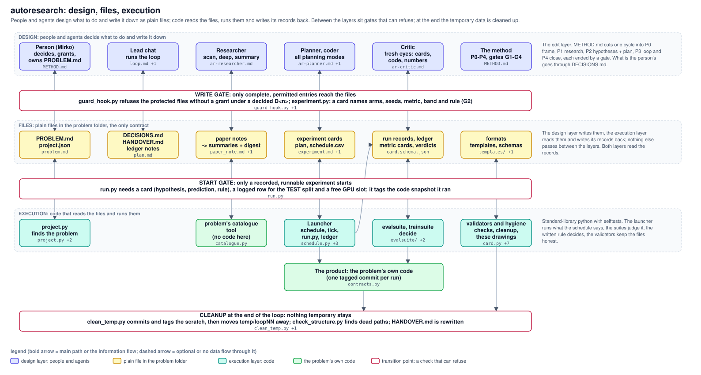

# autoresearch: architecture (target design, branch `ar/layered-design`)

**In one paragraph.** A person gives a prompt. Agents turn it into plain files: a problem, research notes, experiment cards. Code reads those files, runs the experiments, judges them by the rule written on each card, and writes its records back as files. The person decides at two points: the problem, and which version becomes the champion. An **outer loop** runs one round after another: problem, research, branches, build, train, evaluate, track, close. Inside it, an **inner loop** runs once per experiment (build, train, evaluate), several at a time. Everything a round knows is in files in the problem folder, so a crashed round resumes from them and anyone can read where it stands.

This document is the target. `METHOD.md`, `README.md` and the tools describe the system as it runs today; section 8 lists what changes from here to there and in which order. The picture is generated from `architecture.json` by `tools/archdraw.py`; the file map at the end is generated too, and `archdraw.py check architecture.json` fails when a box names a file that does not exist, or a file is in no box.

## 1. Principles: why it looks like this

1. **Files are the only interface between the layers.** Agents are stateless: they read files and write files. Code reads files and writes records. Nothing is passed by memory or by message. That is what makes a round resumable, reviewable in git, and explainable.
2. **Few rules, but those in code.** A capable agent can argue its way around any rule written in prose, and under time pressure it will. So the rules that protect the truth are code that refuses: the card before a run, the verdict by the written rule, the TEST split once, the protected files. Everything else is advice in a template.
3. **A role is a different context, not a different step.** A separate agent is worth it when it needs fresh eyes (the critic must not have written what it judges) or runs in parallel (scouts, hypothesis lenses). Planning a problem, a branch set, a detail plan and the next round are one planner in four modes.
4. **The inner loop runs without a chat.** Run, evaluate, decide and record are code. A chat is needed only to write new code (a block experiment) and to read the round. This is where the hours go, so it must not wait for anyone.
5. **Versions are first class.** The set of n best versions (each a tagged commit, a config, weights and a metric card) is what every experiment starts from and what the round updates. Several good versions, not one champion, so a branch can start from the fast one or the accurate one.
6. **One evaluator contract, one decision rule, one board.** Every number comes from a metric card; every verdict from `decide.py` applied to cards; every comparison is a row of the board.
7. **TEST once, at promotion.** Inner loops evaluate on validation. The test set is used once per finished design, when a version is promoted, with the person's OK. Choosing among many experiments by their test numbers would make the test a training set.
8. **Build on the second use, delete when unused, clean up every round.** A tool or a template exists because the same thing was done twice by hand; a tool nobody uses is removed; temporary data is tagged and moved away at the end of every round.

## 2. The four layers

| layer | what lives there | who writes it | where |
|---|---|---|---|
| Person | the prompt (stop time, permissions), approval of the problem, promotion of a champion, answers in `DECISIONS.md` | the person | the loop prompt, `DECISIONS.md` |
| Agents | four roles in modes (section 5), started by the lead chat | the lead chat | `agents/`, `prompts/` |
| Files | problem, research, branches (cards + plan), build (detail plan, tagged code), run records, metric cards and verdicts, the set of n best, handover | agents and code | the problem folder; formats in `templates/`, `schemas/` |
| Code | the core (launcher, ledger, decision rule, gates) and three suites: train, eval (with package), report checks | the coder, reviewed by the critic | `tools/`, `trainsuite/`, `evalsuite/` |

The arrows between agents and files and between files and code are two-way: each layer reads what the other wrote. The bold arrows along the files are the information that flows from step to step.

## 3. The two loops

| step | what happens | what it leaves behind | point that can refuse |
|---|---|---|---|
| 1 Problem | the planner drafts the problem from the prompt; the person approves it | `PROBLEM.md`, `project.json` | write gate (protected file) |
| 2 Research | scouts in parallel, then one summary per problem group | paper notes, summaries with digest, K ids | |
| 3 Branches | the planner writes cards, once per lens in parallel; the critic accepts, revises or rejects | cards with `experiment.json`, the round's plan | write gate: a card must be complete (G2) |
| 4 Build | for a block experiment only: detail plan, code with its spec test, critic pass | detail plan, tagged commit | |
| 5 Train | the launcher starts each arm; the train suite watches it with the card's kill rules | run record, `log.jsonl`, checkpoints | start gate: card, free slot, tag |
| 6 Evaluate | the eval suite scores on VAL; `decide.py` applies the card's rule | metric card, verdict, ledger row | the decision rule |
| 7 Track, promote | the planner updates the set of n best by the rule, proposes a promotion; the package runs the promoted version on TEST once | the set of n best, the package | promotion: the person's OK, TEST logged first |
| 8 Close | the critic checks the report's numbers; scratch is tagged and moved away; handover rewritten | handover, summary, closed questions | cleanup |

**Outer loop sequential, inner loop parallel.** The outer loop is one round after another because a round ends with decisions (verdicts, promotion, what the next round tries) that the next round needs. The inner loop runs several experiments at once, bounded by the machine (GPU slots and RAM). One could also run several outer loops in parallel, each starting from its own version; the set of n best makes that unnecessary: a single round can open branches from any of the n versions, so "where to start" is a property of each card (its parent version), not of the loop. One concurrency knob (slots) instead of two.

## 4. The points that can refuse

| point | refuses | in code | today |
|---|---|---|---|
| Write gate | a write to a protected truth file (problem, project, TEST log, golden numbers, champion entries) without a grant under a decided D<n>; an incomplete card | `tools/guard_hook.py`, `tools/experiment.py` | exists |
| Start gate | a run without a card, without a free slot, the TEST split without a logged row; it tags the code it ran | `tools/run.py` | exists (slots count GPU, not yet RAM) |
| Decision rule | a verdict by taste: KEEP / CUT / TIE / INCONCLUSIVE come from the card's rule and the cards' numbers | `tools/decide.py` | exists |
| Promotion | a champion without the person's OK and one logged TEST check | `tools/run.py` (TEST guard) + `DECISIONS.md` | exists for TEST; the package is new |
| Cleanup | a closed round with scratch left in `temp/`, dead paths, unchecked numbers | `tools/clean_temp.py`, `tools/check_structure.py`, `tools/check_numbers.py` | exists |

These five are the whole of the hard rules. A sixth check keeps the documentation honest: `archdraw.py check` on this picture.

## 5. Roles

| role | modes | reads | writes | today's agent files |
|---|---|---|---|---|
| Planner | problem draft, branches (once per lens), detail plan, tracking | problem, digests, ledger, the set of n best | problem draft, cards, plan, detail plan, next round | `ar-planner`, `ar-hypothesis` (becomes the branch mode) |
| Researcher | scan, deep extraction, summary | the web, the problem groups | paper notes, port cards, summaries | `ar-scout`, `ar-summarizer` |
| Coder | | detail plan, the code | code with its spec test | `ar-coder` |
| Critic | cards, code, numbers | what another wrote, with primary sources only | accept / revise / reject, findings | `ar-referee`, `ar-reviewer` (merged) |

The lead chat is not a role: it is the orchestrator that starts roles, reads the round's state from the files and writes the handover.

## 6. Planning a single project

One project is one folder; everything it needs to plan is there, in as few files as possible:
- `PROBLEM.md` + `project.json`: what and how it is measured;
- the round's plan: one table of branches, each row a card with its parent version, arms, seeds, rule and status (the status is read from the run records, never written twice);
- the set of n best versions;
- `DECISIONS.md` and `HANDOVER.md`.

The order of runs is the order of the plan plus the cards' dependencies; a separate schedule file is not needed for one project (today's `schedule.csv` would be derived from the plan). What two projects share is the machine: the launcher's slots count both. That is the only multi-project concept, and it lives in the launcher, not in the planning.

## 7. How the person controls it, and how to explain it

**Control.** The prompt (what to research, stop time, permissions); approving the problem; promoting a champion (with the one TEST check); answering `DECISIONS.md`; stopping a run (`trainsuite stop`); reading the board. Everything else runs by the written rules.

**Explaining it in three sentences.** People and agents write plans as files; code runs them and writes the results back as files, judged by a rule written before the run. An outer loop goes round by round from the problem to a promoted version; inside it, experiments run in parallel, each starting from one of the best versions so far. Five checks in code refuse what would make a result untrustworthy; everything else is advice.

## 8. From today to this design

| change | kind | size | needs |
|---|---|---|---|
| this picture and document | docs | done on this branch | |
| `tick.py` removed (started 0 of 61 runs) | remove | small | the tools chat's uncommitted `run.py` work committed first |
| referee + reviewer -> one critic role; hypothesis -> the planner's branch mode | merge | small (agent files, `install_agents.py`) | no round running that uses the old names |
| problem-draft mode of the planner | add | small | a decision: the agent drafts, the person approves |
| set of n best: one registry format for both problems | add | medium | a decision (the champion entries are protected) |
| `evalsuite package`: run a version on a split, write its results, measure ms, bundle it; the two prototype scripts become problem adapters | add | medium | the evalsuite owner's work committed; the TEST rule unchanged |
| the plan table replaces `schedule.csv` for one project | merge | medium | a decision; tools `schedule.py`, `tick.py` |
| slots count RAM as well as GPU | change | small | `run.py` owner |
| `METHOD.md` rewritten to the two loops (shorter), `ROADMAP.md` to `history/` | docs | small | after the steps above |
| folders mirror the layers (`core/`, suites) | move | medium | only after all running chains end; every launcher calls `autoresearch/tools/run.py` |

Order: documents and removals first (cheap, no running work touched), then the critic / planner merge, then the versions registry and the package (they need decisions), then the method rewrite, the folder move last or never.

## 9. Points of concern

1. **Running work.** The overnight round calls `autoresearch/tools/run.py` and the agent names; nothing on this branch may change paths or names while it runs. Merge after it ends.
2. **Other chats' uncommitted work** in `tools/` (`run.py`, `decide.py`, `ledger.py`, `selftest.py`) and in `evalsuite/`: the changes that touch those files wait until it is committed, or are made by that chat.
3. **Protected files.** A common versions registry touches the champion entries of `models/registry.json` and the gate list in `project.json`: decisions, not edits.
4. **Leanness can be overdone too.** Merging roles and files saves reading only if each step is measured: tools 16 files / 4,400 lines, suites 7,400 lines, method documents about 8,700 words today. Each step should make these smaller or keep them, and the design stops when the rating below is met, not when every idea is in.
5. **RAM, not GPU, was the bottleneck tonight** (2-4 GB available, swap in use) while the launcher counts only GPU slots. A parallel inner loop on one machine needs the slot to count memory.
6. **An agent-drafted problem** can turn the person's approval into a rubber stamp. The draft should show only the changes against the last approved version.
7. **Problem code creeping into the core.** Literature tools, prototypes and boards move up into `autoresearch/` only when the second problem needs the same thing (the board and the package qualify now; the literature catalogue not yet).
8. **"Inner loop without a chat" is a claim until tested.** It is met when a variant experiment goes from card to verdict with no chat involved; that test belongs in `selftest.py`.

## 10. Rating: today and this design

| criterion | today | this design | what makes it 5 |
|---|---|---|---|
| Layers visible | 2 | 5 | the picture, one folder per layer, files as the only interface |
| Information flow, loop closed | 3 | 5 | the bold file row; the set of n best feeds the next round |
| Rules enforced in code | 5 | 5 | the five points of section 4, unchanged |
| Lean | 2 | 4 | 4 roles instead of 7, one registry, one package, no `tick.py`, a plan instead of plan + schedule; 5 once `METHOD.md` is rewritten short |
| Honest evaluation | 5 | 5 | TEST once, at promotion |
| Resumable from files | 5 | 5 | unchanged |
| E2E gaps visible (products) | 3 | 4 | the product drawings and the "boxes changed" line on every card |

<!-- archdraw:begin: generated from architecture.json by autoresearch/tools/archdraw.py; edit the spec, then `archdraw.py render` -->
## File map: every box and the code it stands for

| box | kind | code | note |
|---|---|---|---|
| Prompt; approves the problem | the person | `prompts/loop.md` | the person starts a round with a prompt (the filled loop prompt: stop time, permissions) and approves the problem the planner drafted |
| Planner problem draft | not built yet | `agents/ar-planner.md` | new mode of the planner: drafts PROBLEM.md from the prompt; the file stays protected |
| WRITE GATE: protected truth files only with a grant under a decided D<n>; a card only when complete (G2) | transition point: refuses | `tools/guard_hook.py`, `tools/experiment.py` | transition agents -> files |
| PROBLEM.md project.json | plain file in the problem folder | `templates/problem.md` |  |
| project.py install_agents.py | code: core and suites | `tools/project.py`, `tools/install_agents.py`, `config.json` |  |
| Researcher scouts, summaries | agent role (mode) | `agents/ar-scout.md`, `agents/ar-summarizer.md`, `prompts/research_steps.md` | scouts in parallel, one per topic, then a summary with its digest per problem group |
| notes, summaries K register | plain file in the problem folder | `templates/paper_note.md`, `templates/group_summary.md` |  |
| the problem's literature tools | the problem's own code | `../bev_fusion_lane_center/tools/literature/catalogue.py` | no code in autoresearch/ yet; the lane problem's catalogue would move up once a second problem uses it |
| Planner: branches (one per lens); critic | agent role (mode) | `agents/ar-hypothesis.md`, `agents/ar-referee.md`, `agents/ar-planner.md` | the planner writes cards once per lens, in parallel; the critic (fresh context) accepts, revises or rejects each card |
| cards + plan experiment.json | plain file in the problem folder | `templates/experiment.md`, `templates/plan.md`, `schemas/experiment.schema.json` | the round's plan: one table of branches; each card names its parent version and its decision rule |
| experiment.py card.py, schemas | code: core and suites | `tools/experiment.py`, `tools/card.py`, `schemas/` |  |
| Planner, coder + critic | agent role (mode) | `agents/ar-coder.md`, `agents/ar-reviewer.md` | only for a block experiment (new code): detail plan naming the boxes it changes, code with its spec test, a critic pass on shared code; a variant needs no agent |
| detail plan, code tagged commit | plain file in the problem folder | `templates/experiment.md` |  |
| spec tests selftest.py | code: core and suites | `tools/selftest.py` |  |
| run record log.jsonl | plain file in the problem folder | `trainsuite/runs.py` | written by the launcher and the training; read by the train suite |
| START GATE card, slot, tag | transition point: refuses | `tools/run.py` | run.py starts a run only with a card (hypothesis, prediction, rule), a free GPU / RAM slot, the TEST split only with a logged row; it tags the code it ran |
| launcher + train suite, kill rules | code: core and suites | `tools/run.py`, `tools/schedule.py`, `tools/ledger.py`, `trainsuite/` | a training is watched by code: the card's kill rules stop it; an alarm wakes the lead chat, no agent watches |
| metric card verdict, ledger | plain file in the problem folder | `schemas/card.schema.json` |  |
| eval suite (VAL) decide.py: the rule | transition point: refuses | `evalsuite/`, `tools/decide.py` | numbers, pictures and ms on VAL; decide.py turns the cards into KEEP / CUT / TIE / INCONCLUSIVE by the card's written rule |
| Promotion: OK and TEST once | transition point: refuses | `tools/run.py` | the person's: a version becomes the deployed champion only with their OK and one TEST check, logged before it runs (run.py refuses otherwise) |
| Planner: tracking n best, next round | agent role (mode) | `agents/ar-planner.md` | reads the verdicts, updates the set of n best by the written rule, proposes a promotion, plans the next branches |
| set of n best versions | not built yet | `../bev_fusion_lane_center/models/registry.json`, `../bev_fusion/records/champion.json` | new: one registry per problem (tagged commit, config, weights, metric card per version) in place of the two formats of today |
| board, registry, package (TEST once) | not built yet | `../bev_fusion/evaluation/board.py` | new in autoresearch: evalsuite package (run a version on the test set, write its results, measure ms, bundle it) and one board; today these are per-problem scripts (bev_fusion board.py; the two prototype scripts of 2026-11-01 are not committed yet) |
| Critic numbers of the report | agent role (mode) | `agents/ar-reviewer.md` | a fresh reviewer checks the round's report against the primary sources |
| handover, summary closed questions | plain file in the problem folder | `templates/plan.md` |  |
| cleanup, checks clean_temp, archdraw | transition point: refuses | `tools/clean_temp.py`, `tools/check_structure.py`, `tools/check_numbers.py`, `tools/metrics.py`, `tools/archdraw.py`, `architecture.json` | tags the scratch and moves temp/ away, finds dead paths, checks the report's numbers, the per-round table, these drawings |

## Arrows

| from | to | carries |
|---|---|---|
| Planner: tracking n best, next round | Promotion: OK and TEST once | proposal |
| set of n best versions | detail plan, code tagged commit | start from a version |
| Planner: tracking n best, next round | Planner: branches (one per lens); critic | next round |
<!-- archdraw:end -->
