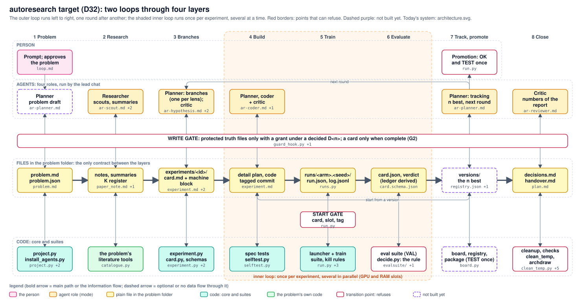

# autoresearch: two loops through four layers

The outer loop runs left to right, one round after another; the shaded inner loop runs once per experiment, several at a time. Red borders: points that can refuse. Dashed purple: not built yet.

<!-- archdraw:begin: generated from architecture_target.json by autoresearch/tools/archdraw.py; edit the spec, then `archdraw.py render` -->
## File map: every box and the code it stands for

| box | kind | code | note |
|---|---|---|---|
| Prompt; approves the problem | the person | `prompts/loop.md` | the person starts a round with a prompt (the filled loop prompt: stop time, permissions) and approves the problem the planner drafted |
| Planner problem draft | not built yet | `agents/ar-planner.md` | new mode of the planner: drafts PROBLEM.md from the prompt; the file stays protected |
| WRITE GATE: protected truth files only with a grant under a decided D<n>; a card only when complete (G2) | transition point: refuses | `tools/guard_hook.py`, `tools/experiment.py` | transition agents -> files |
| problem.md problem.json | plain file in the problem folder | `templates/problem.md` |  |
| project.py install_agents.py | code: core and suites | `tools/project.py`, `tools/install_agents.py`, `config.json` |  |
| Researcher scouts, summaries | agent role (mode) | `agents/ar-researcher.md`, `prompts/research_steps.md` | scouts in parallel, one per topic, then a summary with its digest per problem group |
| notes, summaries K register | plain file in the problem folder | `templates/paper_note.md`, `templates/group_summary.md` |  |
| the problem's literature tools | the problem's own code | `../bev_fusion_lane_center/tools/literature/catalogue.py` | no code in autoresearch/ yet; the lane problem's catalogue would move up once a second problem uses it |
| Planner: branches (one per lens); critic | agent role (mode) | `agents/ar-planner.md`, `agents/ar-critic.md` | the planner writes cards once per lens, in parallel; the critic (fresh context) accepts, revises or rejects each card |
| experiments/<id>/ card.md + machine block | plain file in the problem folder | `templates/experiment.md`, `templates/plan.md`, `schemas/experiment.schema.json` | the round's plan: one table of branches; each card names its parent version and its decision rule |
| experiment.py card.py, schemas | code: core and suites | `tools/experiment.py`, `tools/card.py`, `schemas/` |  |
| Planner, coder + critic | agent role (mode) | `agents/ar-coder.md`, `agents/ar-critic.md` | only for a block experiment (new code): detail plan naming the boxes it changes, code with its spec test, a critic pass on shared code; a variant needs no agent |
| detail plan, code tagged commit | plain file in the problem folder | `templates/experiment.md` |  |
| spec tests selftest.py | code: core and suites | `tools/selftest.py` |  |
| runs/<arm>.<seed>/ run.json, log.jsonl | plain file in the problem folder | `trainsuite/runs.py` | written by the launcher and the training; read by the train suite |
| START GATE card, slot, tag | transition point: refuses | `tools/run.py` | run.py starts a run only with a card (hypothesis, prediction, rule), a free GPU / RAM slot, the TEST split only with a logged row; it tags the code it ran |
| launcher + train suite, kill rules | code: core and suites | `tools/run.py`, `tools/schedule.py`, `tools/ledger.py`, `trainsuite/` | a training is watched by code: the card's kill rules stop it; an alarm wakes the lead chat, no agent watches |
| card.json, verdict (ledger derived) | plain file in the problem folder | `schemas/card.schema.json` |  |
| eval suite (VAL) decide.py: the rule | transition point: refuses | `evalsuite/`, `tools/decide.py` | numbers, pictures and ms on VAL; decide.py turns the cards into KEEP / CUT / TIE / INCONCLUSIVE by the card's written rule |
| Promotion: OK and TEST once | transition point: refuses | `tools/run.py` | the person's: a version becomes the deployed champion only with their OK and one TEST check, logged before it runs (run.py refuses otherwise) |
| Planner: tracking n best, next round | agent role (mode) | `agents/ar-planner.md` | reads the verdicts, updates the set of n best by the written rule, proposes a promotion, plans the next branches |
| versions/ the n best | not built yet | `../bev_fusion_lane_center/models/registry.json`, `../bev_fusion/records/champion.json` | new: one registry per problem (tagged commit, config, weights, metric card per version) in place of the two formats of today |
| board, registry, package (TEST once) | not built yet | `../bev_fusion/evaluation/board.py` | new in autoresearch: evalsuite package (run a version on the test set, write its results, measure ms, bundle it) and one board; today these are per-problem scripts (bev_fusion board.py; the two prototype scripts of 2026-11-01 are not committed yet) |
| Critic numbers of the report | agent role (mode) | `agents/ar-critic.md` | a fresh reviewer checks the round's report against the primary sources |
| decisions.md handover.md | plain file in the problem folder | `templates/plan.md` |  |
| cleanup, checks clean_temp, archdraw | transition point: refuses | `tools/clean_temp.py`, `tools/check_structure.py`, `tools/check_numbers.py`, `tools/metrics.py`, `tools/archdraw.py`, `architecture.json` | tags the scratch and moves temp/ away, finds dead paths, checks the report's numbers, the per-round table, these drawings |

## Arrows

| from | to | carries |
|---|---|---|
| Planner: tracking n best, next round | Promotion: OK and TEST once | proposal |
| versions/ the n best | detail plan, code tagged commit | start from a version |
| Planner: tracking n best, next round | Planner: branches (one per lens); critic | next round |
<!-- archdraw:end -->
