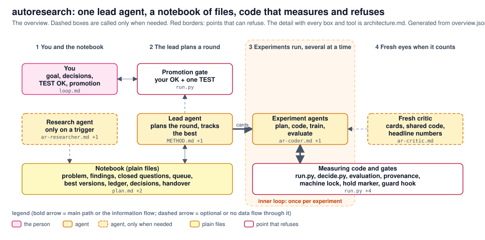

# autoresearch: one lead agent, a notebook of files, code that measures and refuses

The overview. Dashed boxes are called only when needed. Red borders: points that can refuse. The detail with every box and tool is architecture.md. Generated from overview.json; archdraw.py check keeps it in step with the code.

<!-- archdraw:begin: generated from overview.json by autoresearch/tools/archdraw.py; edit the spec, then `archdraw.py render` -->
## File map: every box and the code it stands for

| box | kind | code | note |
|---|---|---|---|
| You goal, decisions, TEST OK, promotion | the person | `prompts/loop.md` | gives the prompt, answers decisions in chat; nothing of yours is acted on unless it is recorded with your words |
| Research agent only on a trigger | agent, only when needed | `agents/ar-researcher.md`, `prompts/research_steps.md` | runs when the open branches are used up, two rounds were flat, a card needs an unknown technique, a gap changed, or you ask; writes notes only |
| Notebook (plain files) problem, findings, closed questions, queue, best versions, ledger, decisions, handover | plain files | `templates/plan.md`, `templates/experiment.md`, `templates/problem.md` | the only memory across sessions and chats; what a new chat reads first is the handover |
| Promotion gate your OK + one TEST | point that refuses | `tools/run.py` | a version becomes the champion only with your recorded OK and one TEST check; run.py refuses otherwise |
| Lead agent plans the round, tracks the best | agent | `METHOD.md`, `agents/ar-planner.md` | reads the notebook, says in ten lines what the round is, writes the cards, updates the best versions; does small planning and coding inline |
| Experiment agents plan, code, train, evaluate | agent | `agents/ar-coder.md`, `templates/experiment.md` | one per card, in parallel (GPU slots); a variant needs no agent at all |
| Measuring code and gates run.py, decide.py, evaluation, provenance, lineage, machine lock, hold marker, guard hook | point that refuses | `tools/run.py`, `tools/decide.py`, `tools/provenance.py`, `tools/lineage.py`, `tools/machine_lock.py`, `tools/hold.py`, `tools/guard_hook.py` | a run starts only with a card, a free slot, no other chat's lock; the verdict comes from a rule written before the run; protected files only with your decision |
| Fresh critic cards, shared code, headline numbers | agent, only when needed | `agents/ar-critic.md` | fresh context; accepts, revises or rejects; never judges what it wrote |

## Arrows

| from | to | carries |
|---|---|---|
| You goal, decisions, TEST OK, promotion | Promotion gate your OK + one TEST | your OK |
| Lead agent plans the round, tracks the best | Promotion gate your OK + one TEST | proposal (no data flow in training) |
| Lead agent plans the round, tracks the best | Experiment agents plan, code, train, evaluate | cards |
<!-- archdraw:end -->
