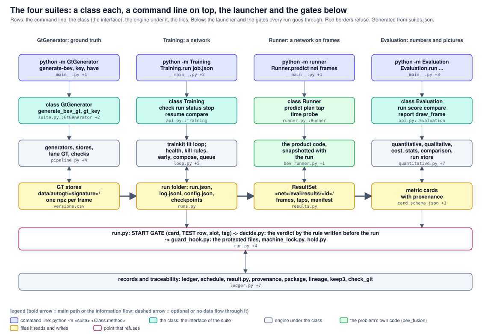

# The four suites: a class each, a command line on top, the launcher and the gates below

Columns: GtGenerator (the data), Training, Runner, Evaluation. Rows: the command line (every method of a class is one command), the class (the interface), the engine under it, the files it reads and writes. Below: the launcher and the gates every run goes through. Red borders: points that can refuse. Generated from suites.json; archdraw.py check keeps it in step with the code.

<!-- archdraw:begin: generated from suites.json by autoresearch/tools/archdraw.py; edit the spec, then `archdraw.py render` -->
## File map: every box and the code it stands for

| box | kind | code | note |
|---|---|---|---|
| python -m GtGenerator generate-bev, key, have | command line: python -m <suite> <Class.method> | `../GtGenerator/__main__.py`, `../GtGenerator/cli.py` | its own command line of the same pattern (every command is one method call of the class); not yet generated by suitecli.py |
| class GtGenerator generate_bev_gt, gt_key | the class: the interface of the suite | `../GtGenerator/suite.py::GtGenerator`, `../GtGenerator/api.py::Interface`, `../GtGenerator/gt_api.py` | reads a nuScenes folder and writes the BEV GT of every keyframe (map layers, objects, velocity / flow in m/s); names what it wrote with a GT key. Until 2026-11-10 the package was called autogt (D76); the old class name AutoGT stays as an alias |
| generators, stores, lane GT, checks | engine under the class | `../GtGenerator/pipeline.py`, `../GtGenerator/store.py`, `../GtGenerator/lane_gt.py`, `../GtGenerator/checks.py`, `../GtGenerator/versions.py` | the signature of a store is a hash of the generator's source; versions.csv names the versions (git tags autogt/vN), a faster generator that makes the same GT shares the store of the older version |
| GT stores data/autogt/<signature>/ one npz per frame | files it reads and writes | `../GtGenerator/versions.csv` | derived data, not in git; regenerated from the tag and the options of index.json. The stores live on D: behind links |
| run.py: START GATE (card, TEST row, slot, tag)  ->  decide.py: the verdict by the rule written before the run ->  guard_hook.py: the protected files, machine_lock.py, hold.py | point that refuses | `tools/run.py`, `tools/decide.py`, `tools/guard_hook.py`, `tools/machine_lock.py`, `tools/hold.py` | a training or an evaluation that may feed a verdict is started through run.py (Training.run builds the exact run.py command; Runner and Evaluation.run called directly are diagnostics, a verdict-feeding run takes their command to run.py) |
| records and traceability: ledger, schedule, result.py, provenance, package, lineage, keep3, check_git | engine under the class | `tools/ledger.py`, `tools/schedule.py`, `tools/result.py`, `tools/provenance.py`, `tools/package.py`, `tools/lineage.py`, `tools/keep3.py`, `tools/check_git.py` | the ledger holds the judgement of every run, results.md the decided experiment, the result package the numbers and the provenance, keep3 the best three networks complete |
| python -m trainsuite Training.run job.json | command line: python -m <suite> <Class.method> | `trainsuite/__main__.py`, `trainsuite/cli.py`, `suitecli.py` | suitecli.py generates the commands from the methods of the class; the older words (status, health, watch, queue, ...) keep their own output |
| class Training check run status stop resume compare | the class: the interface of the suite | `trainsuite/api.py::Training` | a job is a json file or the same dict; the rules of the project stay rules (a run that feeds a verdict needs its card, the TEST split its logged row, a resume the person's words) |
| trainkit fit loop; health, kill rules, early, compose, queue | engine under the class | `trainkit/loop.py`, `trainsuite/health.py`, `trainsuite/kill.py`, `trainsuite/early.py`, `trainsuite/compose.py`, `trainsuite/queue_api.py::QueueMixin` | trainkit is the project-independent loop (accumulation, EMA, schedule per module, clipping, AMP, atomic checkpoints, resume, the stop request); the suite watches the files it writes and never imports the project's network |
| run folder: run.json, log.jsonl, config.json, checkpoints | files it reads and writes | `trainsuite/runs.py` | the only contract between the training and everything that watches or evaluates it: log.jsonl, train.log, .done only for exit 0, CONTROL / STOPPED with exit code 75 |
| python -m runner Runner.predict net frames | command line: python -m <suite> <Class.method> | `../bev_fusion/runner/__main__.py`, `suitecli.py` | run from bev_fusion/; the same generator |
| class Runner predict plan tap time probe | the problem's own code (bev_fusion) | `../bev_fusion/runner/runner.py::Runner` | runs a trained network on frames that are not stored yet and stores what it predicts: no ground truth, no loss, a network with a memory always warm (D70, D72) |
| the product code, snapshotted with the run | the problem's own code (bev_fusion) | `../bev_fusion/runner/bev_runner.py`, `../bev_fusion/training/` | bev_runner.py is the shell around the pinned copy of training/ in the run folder; the Runner holds no model logic |
| ResultSet <net>/eval/results/<id>/ frames, taps, manifest | files it reads and writes | `evalsuite/store.py` | one per identity (network, checkpoint, inputs); any question reuses its frames |
| python -m evalsuite Evaluation.run ... | command line: python -m <suite> <Class.method> | `evalsuite/__main__.py`, `evalsuite/apicli.py`, `evalsuite/cli.py`, `suitecli.py` | the methods of Evaluation are generated; the adapter commands (qual, quant, list, probe, selftest) keep their words |
| class Evaluation run score compare report draw_frame | the class: the interface of the suite | `evalsuite/api.py::Evaluation` | the front door: scores stored predictions against the ground truth, reads the numbers (worst frames, paired comparison, cost), draws frames; asks the Runner for predictions it does not have |
| quantitative, qualitative, cost, stats, comparison, ResultSet | engine under the class | `evalsuite/quantitative.py`, `evalsuite/qualitative.py`, `evalsuite/cost.py`, `evalsuite/stats.py`, `evalsuite/comparison/`, `evalsuite/results.py`, `../bev_fusion/evaluation/bev_eval.py`, `../bev_fusion_lane_center/evaluation/lane_suite.py` | one paired scene bootstrap for the whole repository (stats.py); the adapters of each problem in bev_fusion/evaluation/ and bev_fusion_lane_center/evaluation/ say what a Subject, a Source and a Task are |
| metric cards with provenance | files it reads and writes | `schemas/card.schema.json`, `tools/card.py` | what decide.py reads; the BEV evaluator writes a provenance block into the card (GT version, evaluator code hash, frames, model: reproducibility.md), the lane evaluator and evalsuite write none yet |

## Arrows

| from | to | carries |
|---|---|---|
| GT stores data/autogt/<signature>/ one npz per frame | run folder: run.json, log.jsonl, config.json, checkpoints | trains on |
| run folder: run.json, log.jsonl, config.json, checkpoints | ResultSet <net>/eval/results/<id>/ frames, taps, manifest | checkpoint |
| ResultSet <net>/eval/results/<id>/ frames, taps, manifest | metric cards with provenance | predictions |
| run folder: run.json, log.jsonl, config.json, checkpoints | run.py: START GATE (card, TEST row, slot, tag)  ->  decide.py: the verdict by the rule written before the run ->  guard_hook.py: the protected files, machine_lock.py, hold.py | run.py |
| metric cards with provenance | run.py: START GATE (card, TEST row, slot, tag)  ->  decide.py: the verdict by the rule written before the run ->  guard_hook.py: the protected files, machine_lock.py, hold.py | cards |
<!-- archdraw:end -->
