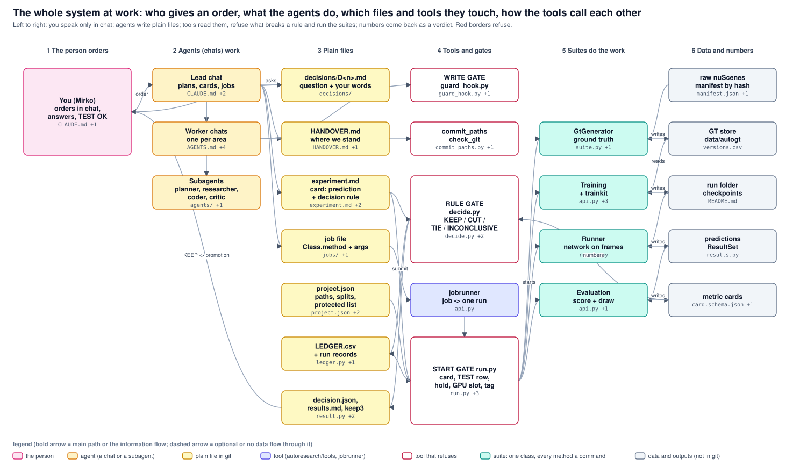

# The whole system at work: who gives an order, what the agents do, which files and tools they touch, how the tools call each other

Read left to right. The person speaks only in chat; agents write plain files; tools read those files, refuse what breaks a rule, and run the suites; the suites write data and numbers that come back as a verdict. Red borders refuse. Generated from system.json; archdraw.py check keeps it in step with the code.

<!-- archdraw:begin: generated from system.json by autoresearch/tools/archdraw.py; edit the spec, then `archdraw.py render` -->
## File map: every box and the code it stands for

| box | kind | code | note |
|---|---|---|---|
| You (Mirko) orders in chat, answers, TEST OK | the person | `CLAUDE.md`, `autoresearch/METHOD.md` | an order is a chat message to one chat; nothing is a decision until it is written as a D<n> with your words |
| Lead chat plans, cards, jobs | agent (a chat or a subagent) | `bev_fusion_lane_center/CLAUDE.md`, `autoresearch/prompts/loop.md`, `autoresearch/prompts/research_steps.md` | one per problem (BEV system, Spurmitte); it owns the code of its loop and hands areas to worker chats |
| Worker chats one per area | agent (a chat or a subagent) | `GtGenerator/AGENTS.md`, `autoresearch/Training/README.md`, `autoresearch/Evaluation/README.md`, `bev_fusion/runner/README.md`, `autoresearch/README.md` | a fork of the lead with its own area; peers talk by cross-session messages, never edit each other's uncommitted files |
| Subagents planner, researcher, coder, critic | agent (a chat or a subagent) | `autoresearch/agents/`, `autoresearch/tools/install_agents.py` | fresh eyes: the critic reviews code and numbers it did not write |
| decisions/D<n>.md question + your words | plain file in git | `bev_fusion_lane_center/experiment_execution/decisions/` | a line 'Decided: <date>' makes D<n> decided; only a decided D<n> opens a protected file |
| HANDOVER.md where we stand | plain file in git | `bev_fusion_lane_center/HANDOVER.md`, `bev_fusion/records/README.md` |  |
| experiment.md card: prediction + decision rule | plain file in git | `autoresearch/templates/experiment.md`, `autoresearch/schemas/experiment.schema.json`, `autoresearch/tools/experiment.py` | written BEFORE the run: its rule hash is stored at launch |
| job file Class.method + args | plain file in git | `bev_fusion/records/jobs/`, `autoresearch/jobrunner/catalogue.py` |  |
| project.json paths, splits, protected list | plain file in git | `bev_fusion/project.json`, `bev_fusion_lane_center/project.json`, `autoresearch/tools/project.py` |  |
| LEDGER.csv + run records | plain file in git | `autoresearch/tools/ledger.py`, `bev_fusion/records/LEDGER.csv` | written by the tools only |
| decision.json, results.md, keep3 | plain file in git | `autoresearch/tools/result.py`, `autoresearch/tools/keep3.py`, `bev_fusion/records/keep3.json` |  |
| WRITE GATE guard_hook.py | tool that refuses | `autoresearch/tools/guard_hook.py`, `.claude/settings.json` | refuses a protected file without a grant under a decided D<n> |
| commit_paths check_git | tool that refuses | `autoresearch/tools/commit_paths.py`, `autoresearch/tools/check_git.py` |  |
| RULE GATE decide.py KEEP / CUT / TIE / INCONCLUSIVE | tool that refuses | `autoresearch/tools/decide.py`, `autoresearch/tools/card.py`, `autoresearch/tools/provenance.py` |  |
| jobrunner job -> one run | tool (autoresearch/tools, jobrunner) | `autoresearch/jobrunner/api.py` |  |
| START GATE run.py card, TEST row, hold, GPU slot, tag | tool that refuses | `autoresearch/tools/run.py`, `autoresearch/tools/testgate.py`, `autoresearch/tools/hold.py`, `autoresearch/tools/machine_lock.py` |  |
| GtGenerator ground truth | suite: one class, every method a command | `GtGenerator/suite.py`, `GtGenerator/gt_api.py` |  |
| Training + trainkit | suite: one class, every method a command | `autoresearch/Training/api.py`, `autoresearch/trainkit/loop.py`, `bev_fusion/tools/run_ar.sh`, `bev_fusion/training/train.py` |  |
| Runner network on frames | suite: one class, every method a command | `bev_fusion/runner/runner.py` |  |
| Evaluation score + draw | suite: one class, every method a command | `autoresearch/Evaluation/api.py`, `bev_fusion/evaluation/bev_eval.py` |  |
| raw nuScenes manifest by hash | data and outputs (not in git) | `data/NuScenes/manifest.json`, `data/NuScenes/README.md` |  |
| GT store data/autogt | data and outputs (not in git) | `GtGenerator/versions.csv` |  |
| run folder checkpoints | data and outputs (not in git) | `bev_fusion/runs/README.md` |  |
| predictions ResultSet | data and outputs (not in git) | `autoresearch/Evaluation/results.py` |  |
| metric cards | data and outputs (not in git) | `autoresearch/schemas/card.schema.json`, `bev_fusion/results/` |  |

## Arrows

| from | to | carries |
|---|---|---|
| You (Mirko) orders in chat, answers, TEST OK | Lead chat plans, cards, jobs | order |
| Lead chat plans, cards, jobs | decisions/D<n>.md question + your words | asks |
| job file Class.method + args | jobrunner job -> one run | submit |
| experiment.md card: prediction + decision rule | START GATE run.py card, TEST row, hold, GPU slot, tag | hyp, pred, rule |
| START GATE run.py card, TEST row, hold, GPU slot, tag | Training + trainkit | starts |
| GtGenerator ground truth | GT store data/autogt | writes |
| GT store data/autogt | Training + trainkit | reads |
| Training + trainkit | run folder checkpoints | writes |
| Runner network on frames | predictions ResultSet | writes |
| Evaluation score + draw | metric cards | writes |
| metric cards | RULE GATE decide.py KEEP / CUT / TIE / INCONCLUSIVE | numbers |
| experiment.md card: prediction + decision rule | RULE GATE decide.py KEEP / CUT / TIE / INCONCLUSIVE | the rule |
| RULE GATE decide.py KEEP / CUT / TIE / INCONCLUSIVE | decision.json, results.md, keep3 | verdict |
| decision.json, results.md, keep3 | You (Mirko) orders in chat, answers, TEST OK | KEEP -> promotion |
<!-- archdraw:end -->
