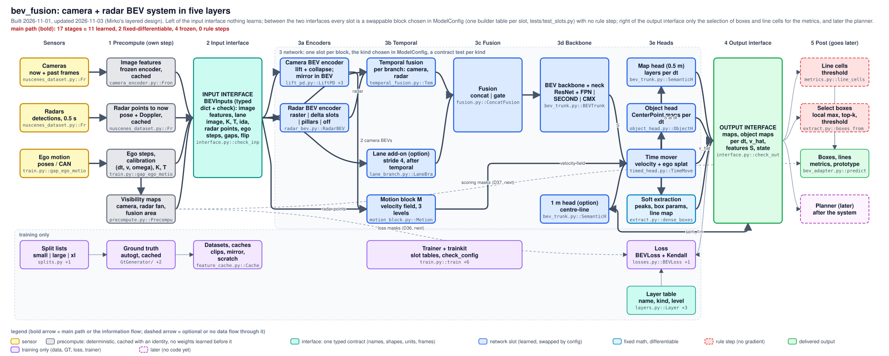

# bev_fusion - camera + radar BEV system

The second problem of this repository: a camera + radar BEV perception system (lift with depth weight, radar raster, temporal fusion with ego motion and a world memory, semantic / object / motion heads at any dt) on nuScenes. Plan and decisions in `plan.md`; code in `training/`; ground truth from the repository-level suite `../autogt/`; evaluation in `evaluation/` (the BEV adapter of `../autoresearch/evalsuite/`); trained runs in `runs/` (`t1`-`t10`). Since decision D23 (2026-10-31) it is a problem of `../autoresearch/`: a training starts through the launcher `run.py` (card, ledger row, code tag `bf/<id>`; start line in `records/README.md`); the runs before (and the queue scripts of `temp/study/`) were launched by `temp/train/run_cfg.sh` from a pinned commit. Experiments are compared by cards in `experiments/` (reviews: `temp/review/` of 2026-10-30, `../autoresearch/history/repo_review_2026-10-31.md` and its second pass `repo_review_2026-10-31_pass2.md`).

The architecture, drawn from the code ([file map and end-to-end table](training/architecture.md)): the base chain is learned from the cached camera features to the dense head outputs; the red boxes (radar preprocessing and hard raster, memory re-centring, box decode, line extraction) and the frozen camera heads are the places where the path from input to output is not yet network-only. `python ../autoresearch/tools/archdraw.py check training/architecture.json` fails when picture and code disagree.

| file / folder | content |
|---|---|
| `plan/` | the written plan (tidied out of the root on 2026-11-01, names unchanged): `plan/requirements.md` (what the system must satisfy, set by Mirko, each with its check and status), `plan/plan.md` (the current plan, draft 3: paper and code basis per block, the GT generation and viewer, the tests), `plan/radar_encoding.md` (radar grid encoding ideas, discussed separately until one is chosen) - see `plan/README.md`; the previous draft is in `_to_delete/root_docs_2026-11-01/` |
| `training/` | code (plain PyTorch, a self-test per module): the blocks (camera lift, camera encoder with pre-trained DualBEV heads, radar block, splat, temporal fusion, fusion, BEV trunk, time-decoded heads, object head), the paper fallbacks, the losses, the nuScenes loader and the whole-chain assembly `model.py` - see `training/README.md` |
| `../autogt/` (repository root) | the standalone autoGT suite (moved out of this folder on 2026-11-01; output in `../data/autogt/`): automatic GT from nuScenes (static BEV layers, objects, masks, radar-corrected velocity / flow field in m/s). One entry point reads a nuScenes folder and writes the GT of every keyframe: `autogt.generate("~/data/nuscenes_full")` or `python -m autogt generate DATAROOT [--out DIR]` (default `data/autogt/<signature>/`, not in git); with its own check, view, video and report commands and self-tests - agents read `../autogt/AGENTS.md` first, the reference is `../autogt/README.md` |
| `evaluation/` | the evaluation of a run: qualitative + quantitative suite (the BEV adapter of `../autoresearch/evalsuite/`: frames, random frames, network-part debug views, videos, numbers over all videos with outlier trace-back, paired comparison) and the metric library (tolerant IoU, nuScenes-style AP) with known-answer self-tests - see `evaluation/README.md` |
| `tests/` | synthetic gates per block (`tests/run_gates.sh`) - see `tests/README.md` |
| `models/` | weights (not in git): `pretrained/dualbev-r50-cbgs.pth` with source and checks - see `models/README.md` |
| `literature/papers.csv`, `literature/papers/` | the papers of the scans of 2026-10-25 and later (lift, radar, temporal, heads, SDF, polar radar; about 216 notes), partly moved here from `../bev_fusion_lane_center/literature/` - see `literature/README.md` |
| `literature/code/front_bev_code_sources.md` | repository, licence and module per block (read on the repository pages) |
| `temp/scout_tables/` | the raw tables of the scouts |
| `temp/` | scripts of the studies and of the setup; some of them are used as launchers and recipes (`temp/train/run_cfg.sh`, the cache builders of `temp/setup/`) - see `temp/README.md` |
| `runs/` | one folder per training run (not in git) - see `runs/README.md` |
| `project.json`, `records/` | since D23 (2026-10-31) a problem of `../autoresearch/`: trainings start through `run.py` (card, ledger row, code tag `bf/<id>`, GPU slot shared with the lane problem); the ledger and the launcher's run records are in `records/`, the start line in `records/README.md` |
| `_to_delete/` | what was taken out of the live tree, listed in `_to_delete/README.md` |
| `experiments/` | one folder per experiment (card, detail plan, summary); first: `s1a_lift_pd_vs_p/` (camera-only real-data run, its synthetic unit test, idle-GPU timing) - see `experiments/README.md` |

Shared data (nuScenes) is described in `../datasets/NuScenes/README.md`.
