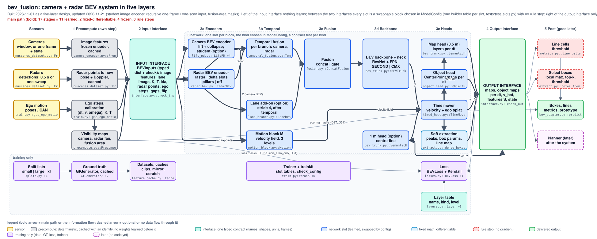

# bev_fusion: camera + radar BEV system in five layers

Built 2026-11-01 as a five-layer design (updated 2026-11-21: see "Changes since 2026-11-03"); the design record with its corrections is the git history of `training/architecture_target.*` (commits 91d4b92 to 08377e5), which this drawing replaces. `archdraw.py check training/architecture.json` confirms that the code every box names exists and that every `.py` of `training/` is in a box; it does not check the wiring between the boxes.

## Five layers
| layer | code | what it holds | its rule |
|---|---|---|---|
| 1 Precompute | `precompute.py` (also on its own: `python runner/bev_runner.py check / precompute <config>`), the dataset and feature caches | calibration, ego steps and gaps, radar detections compensated to now, frozen image features, the **visibility maps** (camera now, radar now) | everything before the first learned weight: deterministic, no gradient; the camera map is cached per calibration (the same function runs live in a car) |
| 2 Input interface | `interface.py` (`INPUTS`, `CALL`, `check_inputs`) | the batch dict and the forward arguments, each named with shape, unit and frame | the only thing the network reads; the flip flag travels with it, the mirror is a BEV operation after the camera slot |
| 3 Network | `model.py` (builder tables, `check_config`) and the block files | slots: camera encoder, radar encoder, temporal fusion per branch, lane add-on (option), motion block (option), fusion, backbone + neck, heads (maps, 1 m centre-line head (option), objects, time mover), soft extraction | one kind per slot chosen in `ModelConfig`; no rule step between the interfaces; `tests/test_slots.py` builds every kind |
| 4 Output interface | `interface.py` (`OUTPUTS_PER_DT`, `check_outputs`), `extract.py` | per dt: maps, object maps, the dense box output (peak weight + box per cell), the soft line map; `v_hat`, features S, the temporal state | dense and differentiable: the loss, the post-processing and later the planner read only this |
| 5 Post-processing | `extract.select_boxes`, the line threshold (`evaluation/metrics.line_cells` stays the metric's definition) | the selection of boxes and line cells | for the metrics and the prototype only; with the hard gate it gives exactly the boxes of `object_head.decode` |

The **planner** is not part of the system: it comes after it and reads the output interface; because that interface is dense and differentiable, a later joint training lets its loss flow back into the fusion.

## Changes of 2026-11-03 (D48), drawn in the picture
- **Layer table** (`layers.py`): a head layer is a row (name, kind, level); channels, targets and loss follow the kind, so a new layer is a row. The 1 m centre-line head is one row at level 1m.
- **In the chain since t15 / t16**: the motion block M (the velocity field), the delta-slot radar encoder, the stride-4 lane branch (now also on the dual camera features).
- **Split lists** (`splits/`, `training/splits.py`): a config names its scenes (`"split": "large"`); the run records them in `config.json` and `manifest.json`.
- **Trainer**: `train.py` builds model, loss and data, the loop is the project-independent `autoresearch/trainkit/`; evaluation has one front door, `evaluation/evaluate.py`.
- Drawing note: the arrow from the input interface to the temporal block runs behind the camera encoder box; what enters the temporal block are the camera BEVs.

## Changes since 2026-11-03, drawn in the picture (all options, off by default unless a config says otherwise)
- **Temporal input** (t21, D51; t25, D91): `cam_buffer` "pair" / "recurrent" carries ONE buffered frame or the previous fused state instead of the window of frames; `radar_per_frame` gives the radar branch one sweep per camera frame inside the recurrent unroll (it needs `cam_buffer` "recurrent" and `rad_temporal` "window_memory"). The window stays the default; the radar memory of the temporal block has not trained successfully so far, and the t25 arms are not started.
- **Student image encoder** (t22, t26): `camera_student` ("evit_b1" / "resnet18", `student_encoder.py`) replaces the cached DualBEV / BEVFusion teacher outputs of the current frame, with `student_frames` "all" (t26) of every frame of the window; it can be trained on the task (`student_trainable`). It is drawn inside the camera encoder box.
- **Lane branch** (L4): off for new from-scratch base runs (D65, `configs/t20_base_nol4.json`); the box stays because the stored base `t20_base_s0` has it.
- **Masks and ground truth**: the evaluation's headline rows are scored on the fusion area (D31, default on since 2026-11-11) and `loss.fusion_area_only` restricts the loss of the fused heads to it (option, on in `t20_base_nol4.json`); the ground truth is GT release v14 (front v13 + lane l6, merged under D83).

## The visibility maps: made once, used three times (D36)
| map | the network | the training | the evaluation |
|---|---|---|---|
| camera now (`vis_cam`) | write mask of the camera memory (mirrored with the camera BEV) | loss weight `w_cam` of the camera outputs (lines, areas) built in `losses.py`; `loss.fusion_area_only` (D31, option) restricts the fused heads to the fusion area | scoring mask of the camera outputs (the fusion-area rows are the headline since D31) |
| radar fan (`vis_radar`, D36: "obs_radar stays the fan") | - | loss weight `w_radar` of the radar outputs (velocity, radar aux) built in `losses.py` | coverage classes |
| fusion area (`vis_fusion` = camera x radar, D37) | - | `w_fusion`: the fused heads are masked to it when `loss.fusion_area_only` is on (D31) | the area fusion results are reported on (camera-only baselines on the same area); the cells hidden behind a GT box are removed on top |
| radar hits (`radar_hits`, cells with detections now) | write mask of the radar memory | - | - |

`vis_radar` is the real fan geometry: `Precompute.radar_fan` runs `GtGenerator.coverage.radar_cells` (+-60 deg / 70 m per radar, the definition the ground truth uses) on the five calibrated radar poses the dataset carries (`batch["radar_poses"]`), once per rig; no constant stands in for it and a batch without poses is refused. On real val frames it covers 99.6 % of this grid (4 frames), as the sensor-coverage record found, so today it restricts little: the point is the geometry, and the fusion area `vis_fusion` follows the camera.

## Network slots
| slot | contract | kinds (builder table) |
|---|---|---|
| camera encoder | `BEVInputs` -> BEVs (B, F, C_cam, X, Y); visibility from layer 1 | `camera_features` dualbev / bevfusion / dual (the `CAMERAS` table); `LIFTS` pd / p / s; `COLLAPSES` zconv / zsum; option `camera_student` (t22 stage B, off): a small trained image encoder (`STUDENTS` evit_b1 / resnet18) replaces the cached teacher outputs of the CURRENT frame of both sources from `lane_img`, older frames keep the cached ones |
| radar encoder | radar points -> (B, C_rad, X, Y); the raster is its first op, before any weight | `RADARS` raster / delta_slots (lossless slot raster + side loss, `radar_encoder.py`) / pillars / off |
| temporal fusion | (BEV now, past BEVs with their ego steps, state, step, visibility) -> (BEV, state); the memory re-centre is a whole-cell roll, the gradient passes | `TEMPORALS` window_memory / ego_gru / none, one block per branch (`cam_temporal`, `rad_temporal`) |
| lane add-on | (lane image, K, T, ida, the camera depth) -> a BEV added after the camera's temporal block | `lane_branch` res4 / rgb / off, with `camera_features` dualbev or dual (t20) |
| motion block | (two camera BEVs, ego steps, radar points) -> the velocity field in a 3-level pyramid; the time mover reads it instead of its 1 x 1 head | `motion_block` off / on (`motion_strides`, `box_vel_from_field`) |
| fusion | (camera BEV, radar BEV) -> (B, C_fuse, X, Y), modality dropout | `FUSIONS` concat / gate (cmx: see backbone) |
| backbone + neck | fused BEV -> S | `BACKBONES` dualbev / second / cmx (cmx takes both branch BEVs and replaces fusion and backbone) |
| heads | S moved to each dt by the shared time mover -> maps, object maps | maps (channels from the layer table `layers.py`), 1 m centre-line head (`centreline_1m`: presence, distance, direction at 1 m cells, targets pooled from the 0.5 m GT), objects (`object_direction`, `object_moving`, refiner option) |
| soft extraction | head maps -> dense boxes (peak weight, box, heading vector), soft line map (fixed math) | `dense_outputs` off (default; nothing reads the outputs yet, only `tests/test_slots.py` switches it on) |

## Checks of the build (2026-11-01)
- **Equivalence** (`tests/support/equivalence.py`, CPU, deterministic; the code before the build against the final tree): the `t10_dual_s0` checkpoint (step 3000) on 4 val frames, all 29 outputs identical (max abs difference 0.0); the hurdle model of the stopped long run (`t10_dual_long_s0`, step 5030, `object_moving`) on 3 frames, all 32 outputs identical; the state-dict keys identical in both (every checkpoint loads). On the GPU the same code differs from itself by up to 3e-3 between runs (scatter order), so the GPU cannot show bit equality. The dense outputs are off by default (`dense_outputs`: nothing reads them yet, only `tests/test_slots.py` switches it on), so training, timing and op counts compute what they did before.
- **Slots** (updated after the build: 7 combinations incl. both `delta_slots` ones, every build also runs the precompute step with all maps, and the dense boxes and soft lines must keep the gradient of the maps they are built from - a loss on them reaches every parameter that a loss on the heat map, box parameters and distance channels reaches): `tests/test_slots.py` (CPU, 25 s at the time of the build, 96 s now): 28 kinds and switches build, pass both interfaces, give finite dense outputs, send a nonzero gradient through the trained outputs to every trainable parameter (zero-start layers given small values first) and carry state; 6 invalid combinations refused; the parts that cannot train are named with their reason (the radar memory's window part, the blocks of `camera_off` and `radar_kind` off).
- **Extraction:** `training/extract.py` self-test: the selection equals `object_head.decode` box by box (120 boxes; also on float32 maps), every head map gets a real gradient through the dense output (the direction class through the heading vector, also at logit 0), the soft line map >= 0.5 equals `line_cells` (exact ties and clamped negative distances included).
- **Fresh critic pass** (mode code) on the build: 10 findings, all fixed (the zero gradient of the soft direction sign, the unclamped line map, extra work on the training and timing paths, a weak gradient test, float32 selection, mixed frames of the maps for flipped samples, a radar-less batch, dead code).
- **Finding:** with no past radar frames the radar memory block's window part and velocity head get no gradient (named in `tests/test_slots.py`): the radar memory needs its own static gate (the measured Doppler) or past radar BEVs before it is a fair arm. **Built since:** `ModelConfig.rad_static_gate` (off by default) makes the radar memory write only where the measured Doppler calls the detections static (`precompute.radar_static`, weight exp(-(vr / rad_static_vr)^2), mean per cell), so a moving car is not remembered; `tests/test_slots.py` checks it with a known answer (the same detections static: confidence written as without the gate; moving at 6 m/s: below 1e-3 of it). The window part and the velocity head of the radar memory stay without a gradient inside one call (no past radar frames: the 0.5 s of sweeps are already points); no run has used the gate yet.

## Bug hunt before the first training (2026-11-01, two fresh critics + a real-data dry run)
Fixed:
- **bf16 crashed the GPU** (`splat.py`, a bug older than the build): the cell index was computed in the feature dtype, and bf16 is exact for integers only up to 256, so indices ran past the grid (device-side assert). Positions now float32, indices integer. Every stored config runs `amp: off`, so no number of a past run is affected.
- **bf16 geometry was cached** (`lift_pd.build_table`): under autocast the projection tables and the camera visibility were built in bf16 (about 4 px error) and reused by float32 calls. Now always float32; the visibility cache key also holds the depth range.
- **unequal temporal arms:** the ego-GRU control never got the visibility mask the window memory gets; every memory kind gets its write mask now (no stored config uses a changed path's numbers: old runs evaluate from their own code snapshot).
- `flip_batch` mirrors precomputed maps; a radar-less batch no longer breaks the radar memory; `interface.py` names the radar fields (`RADAR_FIELDS`), requires `v_hat` at dt 0 and checks the dense boxes for finiteness; the contracts now run on the first real batch of every process (`train.forward_loss`: training, validation and the evaluation adapter); stale references and the model docstring updated; the drawing's wiring corrected (backbone -> time mover -> heads; the planned mask edges dashed).
- **tests:** `tests/support/equivalence.py` now runs clips of 2 keyframes (memory carried, one sample mirrored, batch 2) and compares the memory state too: base model 64, hurdle model 70 outputs identical to the code before the build; `tests/test_slots.py` adds 5 combinations (33 builds).

Design gaps left (named, not fixed; the next decisions):
1. ~~Layer 1 leaks into the trainer~~ **closed:** the dataset makes the ego steps to the neighbouring keyframes from the poses (`batch["gap_steps"]`, mirrored by `flip_batch`); `train.batch_ego`, `clip_step` and the consistency term read them, the GT only supplies the loss targets. Checked against the GT's own steps on real frames (`nuscenes_dataset.py`, `train.py` and `augment.py` self-tests).
2. ~~The camera slot is not one builder entry~~ **closed (c6abdbc):** a camera kind is a tuple of `CameraSource` entries in `model.CAMERAS` (cache field, ida, suffix of the extra lift / reduction modules); the model, the cached dataset, `collate_cached`, the cached subclass and `train.build` read the table, several sources are merged by `cam_merge`. Gates: `test_camera_features.py` (table section), `test_dual_camera_geometry.py`, `test_slots.py`, `equivalence.py` clip mode on `t10_dual_s0` and `t10_dual_long_s0` (max abs diff 0, keys identical).
3. **The refiner puts GT matching inside the network** (`_refine_train`); it belongs in the loss (harmless while `refine` is off).
4. **Two box extractors:** the evaluation adapter scores with `object_head.decode`, `model.boxes()` with `select_boxes` (equal box for box).

## What comes next inside this frame
1. The radar memory with the Doppler static gate (`rad_static_gate`) and the per-frame radar recursion (`radar_per_frame`) are built; the t25 arms that would train them are not started (card `experiments/t25_one_frame_one_scan/experiment.md`).
2. The one long run of the recursive network with a trainable image encoder (t26) waits for the open decision D102 (`../bev_fusion_lane_center/experiment_execution/DECISIONS.md`, table Open).
3. The frame runs on frames without ground truth through the class `Runner` (`python -m runner`, `runner/README.md`) and through `runner/bev_runner.py` (`precompute` / `network` / `full`, the run's own code snapshot).

<!-- archdraw:begin: generated from architecture.json by autoresearch/tools/archdraw.py; edit the spec, then `archdraw.py render` -->
## File map: every box and the code it stands for

| box | kind | code | note |
|---|---|---|---|
| Cameras window, or one frame + state | sensor | `net/prep/nuscenes_dataset.py::FrontRadarDataset` | default: the window of n_cam frames of the batch (cam_buffer 'window'); options (t21, D91): ONE frame per step with the past carried as the state of the previous step at BEV-feature level (cam_buffer 'pair' / 'recurrent'); today the front camera; six cameras are one more entry of the interface, not a new chain |
| Radars detections: 0.5 s or one sweep | sensor | `net/prep/nuscenes_dataset.py::FrontRadarDataset._radar` | all five radars; default: the sweeps of the last 0.5 s accumulated at point level; option radar_per_frame (t25, D91): ONE sweep per camera frame (batch['radar_seq']) |
| Ego motion poses / CAN | sensor | `net/prep/batches.py::gap_ego_motion` | from the poses in nuScenes; a deployed system supplies its own odometry |
| Split lists small \| large \| xl | training only (data, GT, loss, trainer) | `net/prep/splits.py`, `splits/` | scene names only (small 60 / 10, large 428 / 82, xl 700 / 82), each with the GtGenerator version its caches were checked against; a config says "split": "large", Training check / run resolves it into train_scenes / val_scenes (the run's config.json holds the exact lists); net/prep/splits.py also writes runs/<id>/manifest.json (split, GT, code commit, card) and the results/<id>/split.json of a result package; gt_scenes.py turns the lists into the GT a run needs |
| Image features frozen encoder, cached | precompute: deterministic, cached with an identity, no weights learned before it | `net/prep/images.py`, `net/prep/image_cache.py`, `net/prep/build_feature_cache.py`, `net/prep/cameras.py`, `net/model/camera_encoder.py::FrontCameraEncoder`, `net/model/bevfusion_camera.py`, `net/prep/feature_cache.py::FeatureStore`, `net/prep/cache_bevfusion_features.py` | frozen DualBEV / BEVFusion image heads: depth probabilities + context per pixel; while frozen they are a cache (with a meta.json identity), once unfrozen the image encoder becomes the first network slot (the optional student encoder of the camera slot, t22 / t26, is that step) |
| Radar points to now pose + Doppler, cached | precompute: deterministic, cached with an identity, no weights learned before it | `net/prep/nuscenes_dataset.py::FrontRadarDataset._radar`, `net/prep/feature_cache.py::build_radar_cache` | the sweeps of 0.5 s compensated to the current time and cached as points (not as a grid): the radar slot keeps the choice of raster or point encoder |
| Ego steps, calibration (dt, v, omega), K, T | precompute: deterministic, cached with an identity, no weights learned before it | `net/prep/batches.py::gap_ego_motion`, `net/prep/batches.py::batch_ego`, `training/train.py::clip_step`, `net/prep/nuscenes_dataset.py::FrontRadarDataset` | the ego step from every past frame to now (dataset, from the poses), calibration and crop, the radar poses, and the ego steps to the neighbouring keyframes (batch['gap_steps']: the true gap to the target time and the memory step between calls, from the poses; train.batch_ego / clip_step read them, so the network runs without GT) |
| Visibility maps camera, radar fan, fusion area | precompute: deterministic, cached with an identity, no weights learned before it | `net/prep/geometry.py`, `net/prep/precompute.py::Precompute`, `net/prep/precompute.py::radar_hits`, `net/prep/precompute.py::radar_static`, `net/prep/geometry.py::camera_visibility` | the precompute step (precompute.py): vis_cam from calibration + grid (cached per calibration, the same function live), vis_radar = the radar fans of the calibrated poses (D36; GtGenerator.coverage.radar_cells, cached per rig), vis_fusion = camera x radar (D37: fusion results are scored there), radar_hits = cells with detections now (the radar memory's write mask), radar_static = the same weighted by the measured Doppler (the write mask with rad_static_gate); read by the network, the training (D36 loss masks) and the evaluation (scoring masks) |
| Ground truth GtGenerator, cached | training only (data, GT, loss, trainer) | `../GtGenerator/`, `net/prep/gt_cache_build.py`, `training/gt_scenes.py` | GT release v14 (front v13 + lane l6, merged under D83); the BEV trainer's cache is keyed by the front signature |
| INPUT INTERFACE BEVInputs (typed dict + check): image features, lane image, K, T, ida, radar points, ego steps, gaps, flip | interface: one typed contract (names, shapes, units, frames) | `net/model/interface.py::check_inputs`, `net/prep/nuscenes_dataset.py::collate`, `net/prep/feature_cache.py::collate_cached` | BEVInputs = the batch dict with its contract in interface.INPUTS (names, shapes, units, frames) and check_inputs(); the forward arguments dts, state, step, ego in interface.CALL; the per-sample flip flag travels with it (the mirror is a BEV operation after the camera slot) |
| Datasets, caches clips, mirror, scratch | training only (data, GT, loss, trainer) | `net/prep/feature_cache.py::CachedFrontRadarDataset`, `net/prep/batches.py::ClipDataset`, `net/prep/augment.py::flip_batch`, `training/scratch.py` |  |
| Camera BEV encoder lift + collapse; student (option) | network slot (learned, swapped by config) | `net/model/cached_model.py`, `net/model/lift_pd.py::LiftPD`, `net/model/model.py::BEVFusionModel.camera_bevs`, `net/model/model.py::BEVFusionModel.camera_visibility`, `net/model/blocks_new.py::ZSumReduce`, `net/model/student_encoder.py::StudentEncoder` | contract: BEVInputs -> (BEVs (B, F, C_cam, X, Y), visibility (B, 1, X, Y)), mirrored in BEV for flipped samples (cached perspective features cannot be mirrored); kinds dualbev, bevfusion, dual; option camera_student (t22 stage B, t26): a small trained image encoder (StudentEncoder, EfficientViT-B1 or ResNet-18) replaces the cached teacher outputs of the current frame, with student_frames 'all' (t26) of every frame of the window, and can be trained on the task (student_trainable) |
| Radar BEV encoder raster \| delta slots \| pillars \| off | network slot (learned, swapped by config) | `net/model/radar_bev.py::RadarBEV`, `net/model/radar_bev.py::rasterize`, `net/model/blocks_new.py::RadarPillars`, `net/model/radar_encoder.py::RadarEncoder` | contract: radar points -> (B, C_rad, X, Y); the raster is the first op, before any weight, so it costs no gradient; radar history is the sweeps inside the points (with radar_per_frame, t25: one sweep per camera frame, the past in the radar memory of the temporal block); kind delta_slots (radar_encoder.py, in the t16 / t20 chain): the lossless delta-coded slot raster (K = 3 exact slots per cell + remainder mean + count) and two convolutions, with a reconstruction side loss (radar_aux) whose weight decays to a floor |
| Temporal fusion per branch: camera, radar | network slot (learned, swapped by config) | `net/model/temporal_fusion.py::TemporalFusion`, `net/model/temporal_fusion.py::recentre`, `net/model/splat.py::splat_window`, `net/model/fallbacks.py::EgoWarpGRU` | the same block for both branches (TemporalFusion takes channels and grid); camera: window (default) or one buffered frame, pair / recurrent (cam_buffer, t21, D91), + world memory; radar: none by default (its 0.5 s history is in the points), the radar memory with the Doppler static gate (rad_temporal 'window_memory') and the per-frame recursion (radar_per_frame, t25) are options, not trained successfully so far; contract: (BEV now, past BEVs with their ego steps, state, step since the last call, coverage) -> (BEV, state); the re-centre is a whole-cell roll, the gradient passes; finding (tests/test_slots.py): with no past radar frames the window part and the velocity head of the radar block get no gradient, so the radar memory needs its own static gate (the measured Doppler) or past radar BEVs |
| Lane add-on (option) stride 4, after temporal | network slot (learned, swapped by config) | `net/model/lane_branch.py::LaneBranch` | reads the lane image, K, T, ida and the DualBEV depth of the current frame; its BEV is added to the camera BEV after the temporal block; mirrored on its own; off for new from-scratch base runs (D65, training/configs/t20_base_nol4.json); since t20 it also works on the dual camera features (it reads the first source's depth, K and crop and adds to the merged camera BEV): at 20 m a stride-16 image pixel is 0.57 m wide (more than a 0.5 m cell), a stride-4 pixel 0.14 m |
| Motion block M velocity field, 3 levels | network slot (learned, swapped by config) | `net/model/motion_block.py::MotionBlock`, `net/model/motion_block.py::block_inputs` | t15 joint form (ModelConfig.motion_block, on in t16 / t20): the velocity field from the current and the oldest camera BEV (ego-aligned) and the fixed radar raster (count, Doppler, ray, age) in a small pyramid (2 / 1 / 0.5 m, motion_strides), a zero-initialised update per level, every level returned as v_levels for deep supervision; the time mover takes its field from here, box_vel_from_field makes it the object head's velocity; gradient clipping of its own (grad_clip_split) |
| Trainer + trainkit slot tables, check_config | training only (data, GT, loss, trainer) | `training/build_image_cache.py`, `training/train.py::train`, `../autoresearch/trainkit/`, `training/freeze.py`, `training/probe.py`, `training/debug.py`, `net/model/model.py::check_config`, `net/prep/feature_cache.py::CachedBEVFusionModel` | ModelConfig picks one kind per slot from the builder tables of model.py (LIFTS, COLLAPSES, TEMPORALS, RADARS, FUSIONS, BACKBONES); check_config refuses every unknown kind and unfitting combination in one place; since D48 train() builds model, loss and data and hands them to the project-independent loop autoresearch/trainkit (checkpoints with resume, EMA, clipping, the stop request), the probes of probe.py are its hooks |
| Fusion concat \| gate | network slot (learned, swapped by config) | `net/model/fusion.py::ConcatFusion`, `net/model/fusion.py::GateFusion`, `net/model/fusion.py::drop_modality` | contract: (camera BEV, radar BEV) -> (B, C_fuse, X, Y); modality dropout lives here (off when a sensor is off) |
| BEV backbone + neck ResNet + FPN \| SECOND \| CMX | network slot (learned, swapped by config) | `net/model/bev_trunk.py::BEVTrunk`, `net/model/blocks_new.py::SecondTrunk`, `net/model/fallbacks.py::CMXTrunk` | contract: (B, C_fuse, X, Y) -> features S (B, C, X, Y), the optional 1x1 head reduction included; CMX replaces fusion and backbone together (a kind of this slot that takes both branch BEVs) |
| 1 m head (option) centre-line | network slot (learned, swapped by config) | `net/model/bev_trunk.py::SemanticHead`, `net/model/layers.py::layer_spec_1m` | centreline_1m (D48, t20): one pyramid level down: a SemanticHead on the map head's moved state, average-pooled 2 x 2 (1 m cells); presence, truncated distance field and direction (cos, sin) of the centre lines, one row (centreline, polyline, 1m) of the layer table; targets are pooled from the 0.5 m GT, no new GT version; output sem_1m (B, C, X/2, Y/2); the modules are built so that the option leaves the initialisation of all others unchanged |
| Map head (0.5 m) layers per dt | network slot (learned, swapped by config) | `net/model/bev_trunk.py::SemanticHead`, `net/model/timed_head.py::TimedHead` | contract: (S moved to dt) -> map probabilities (B, L, X, Y), the channels from the layer table (5 areas, 2 line masks + 2 distance fields, 3 dense objects); the aux heads read the branch BEVs, not S (training only) |
| Object head CenterPoint maps per dt | network slot (learned, swapped by config) | `net/model/object_head.py::ObjectHead`, `net/model/object_head.py::BoxRefiner` | contract: (S moved to dt) -> heatmap, offset, size, yaw, velocity, moving maps; the refiner (option, off in the base chain) decodes top-k and matches the GT inside the training path: a rule step when it is on |
| Time mover velocity + ego splat | network slot (learned, swapped by config) | `net/model/timed_head.py::TimeMover`, `net/model/splat.py::splat_bev` | the shared TimeMover: moves S to each target time dt (velocity head + ego splat) before both heads, gives v_hat at dt 0; with the motion block (t15, on in t16 / t20) the velocity field comes from M and the 1 x 1 velocity head is removed |
| Soft extraction peaks, box params, line map | fixed math, differentiable | `net/model/extract.py::dense_boxes`, `net/model/extract.py::soft_line_map` | built from today's decode and line extraction: per cell a peak weight (heatmap x exp(-beta (maxpool - heatmap))), the box parameters (centre with offset, size, yaw with a soft direction sign, velocity x sigmoid(moving)) and a soft line map (near-zero distance x soft local minimum); fixed math, differentiable |
| Loss BEVLoss + Kendall | training only (data, GT, loss, trainer) | `net/loss/object_loss.py`, `net/loss/radar_loss.py`, `net/loss/motion_loss.py`, `net/prep/targets.py`, `net/loss/losses.py::BEVLoss`, `net/loss/loss_extras.py` | one module: the Kendall weights and the cross-head terms (motion and time consistency, refine) stay together; heads declare their output keys; the terms per layer come from the layer table (area: BCE + overlap, polyline: dilated Dice + distance + direction, dense box); loss.hygiene_2026_11_02 switches the corrected terms of the 2026-11-02 findings |
| Layer table name, kind, level | interface: one typed contract (names, shapes, units, frames) | `net/model/layers.py::Layer`, `net/model/layers.py::layer_table`, `net/model/layers.py::pool_targets`, `net/model/layers.py::layer_spec` | the layers of the map head as rows (name, kind area \| polyline \| dense_box, level 0.5m \| 1m): the kind decides the channels, the target and the loss, so a new layer is a row, not new code; the map head, the 1 m head, the pooled targets and BEVLoss derive from it (losses.layer_spec); the old layouts are reproduced channel by channel (tests/test_layers.py) |
| OUTPUT INTERFACE maps, object maps per dt, v_hat, features S, state | delivered output | `net/model/interface.py::check_outputs`, `net/model/model.py::BEVFusionModel.forward` | BEVOutputs = per dt the maps, the object maps, the dense boxes and the soft line map (interface.OUTPUTS_PER_DT / OPTIONAL_PER_DT, check_outputs), plus v_hat, the features S and the temporal state |
| Line cells threshold | rule step (no gradient) | `evaluation/metrics.py::line_cells` | thresholds the soft line map for the line metric; the metric's reference line_cells stays the definition and a test checks the two agree |
| Select boxes local max, top-k, threshold | rule step (no gradient) | `net/model/extract.py::boxes_from_maps`, `net/model/extract.py::select_boxes` | ONE extractor: boxes_from_maps reads only the K peak cells of the head maps (vectorised, float64, the same _params as the dense output) and is what object_head.decode, model.boxes(), the evaluation adapter and the prototype call; select_boxes does the same on a dense output (planner side); extract.py's self-test checks both box by box against the plain per-box loop (6 mutants caught); 1.7 ms instead of 6.5 ms (decode) and 1.5 ms instead of 9.0 ms (model.boxes) per frame at 100 candidates, CPU |
| Boxes, lines metrics, prototype | delivered output | `evaluation/bev_adapter.py::predictions`, `evaluation/board.py`, `evaluation/evaluate.py` | the numbers, pictures, videos and timing of a run come through one front door, evaluation/evaluate.py RUN [--quant] [--qual] [--videos] [--time] [--all], which calls bev_suite.py; the 1 m centre-line head is scored as the layer centreline |
| Planner (later) after the system | later (no code yet) |  | a consumer of the output interface, not part of the system; the outputs are dense and differentiable, so a later joint training lets its loss flow back into the fusion |

## Arrows

| from | to | carries |
|---|---|---|
| BEV backbone + neck ResNet + FPN \| SECOND \| CMX | Time mover velocity + ego splat | S |
| Radar BEV encoder raster \| delta slots \| pillars \| off | Temporal fusion per branch: camera, radar | radar |
| OUTPUT INTERFACE maps, object maps per dt, v_hat, features S, state | Planner (later) after the system | dense, differentiable |
| Ego steps, calibration (dt, v, omega), K, T | Visibility maps camera, radar fan, fusion area | calibration |
| Visibility maps camera, radar fan, fusion area | INPUT INTERFACE BEVInputs (typed dict + check): image features, lane image, K, T, ida, radar points, ego steps, gaps, flip | memory write masks |
| Visibility maps camera, radar fan, fusion area | Loss BEVLoss + Kendall | loss masks (D36; fusion_area_only, D31) |
| Visibility maps camera, radar fan, fusion area | Boxes, lines metrics, prototype | scoring masks (D37, D31) |
| Time mover velocity + ego splat | Map head (0.5 m) layers per dt | S at dt |
| Time mover velocity + ego splat | OUTPUT INTERFACE maps, object maps per dt, v_hat, features S, state | v_hat |
| Camera BEV encoder lift + collapse; student (option) | Motion block M velocity field, 3 levels | 2 camera BEVs |
| INPUT INTERFACE BEVInputs (typed dict + check): image features, lane image, K, T, ida, radar points, ego steps, gaps, flip | Motion block M velocity field, 3 levels | radar points |
| Motion block M velocity field, 3 levels | Time mover velocity + ego splat | velocity field |
| Time mover velocity + ego splat | 1 m head (option) centre-line | S at dt, pooled 2 x 2 |
| 1 m head (option) centre-line | OUTPUT INTERFACE maps, object maps per dt, v_hat, features S, state | sem_1m |
| Layer table name, kind, level | Loss BEVLoss + Kendall | targets, loss per kind |
| Split lists small \| large \| xl | Ground truth GtGenerator, cached | scene lists |

## Main path from input to output

main path (bold): 17 stages = 11 learned, 2 fixed-differentiable, 4 frozen, 0 rule steps.

| stage | class | code |
|---|---|---|
| Image features frozen encoder, cached | frozen | `net/prep/images.py`, `net/prep/image_cache.py`, `net/prep/build_feature_cache.py`, `net/prep/cameras.py`, `net/model/camera_encoder.py::FrontCameraEncoder`, `net/model/bevfusion_camera.py`, `net/prep/feature_cache.py::FeatureStore`, `net/prep/cache_bevfusion_features.py` |
| Radar points to now pose + Doppler, cached | frozen | `net/prep/nuscenes_dataset.py::FrontRadarDataset._radar`, `net/prep/feature_cache.py::build_radar_cache` |
| Ego steps, calibration (dt, v, omega), K, T | frozen | `net/prep/batches.py::gap_ego_motion`, `net/prep/batches.py::batch_ego`, `training/train.py::clip_step`, `net/prep/nuscenes_dataset.py::FrontRadarDataset` |
| Visibility maps camera, radar fan, fusion area | frozen | `net/prep/geometry.py`, `net/prep/precompute.py::Precompute`, `net/prep/precompute.py::radar_hits`, `net/prep/precompute.py::radar_static`, `net/prep/geometry.py::camera_visibility` |
| INPUT INTERFACE BEVInputs (typed dict + check): image features, lane image, K, T, ida, radar points, ego steps, gaps, flip | fixed-differentiable | `net/model/interface.py::check_inputs`, `net/prep/nuscenes_dataset.py::collate`, `net/prep/feature_cache.py::collate_cached` |
| Camera BEV encoder lift + collapse; student (option) | learned | `net/model/cached_model.py`, `net/model/lift_pd.py::LiftPD`, `net/model/model.py::BEVFusionModel.camera_bevs`, `net/model/model.py::BEVFusionModel.camera_visibility`, `net/model/blocks_new.py::ZSumReduce`, `net/model/student_encoder.py::StudentEncoder` |
| Radar BEV encoder raster \| delta slots \| pillars \| off | learned | `net/model/radar_bev.py::RadarBEV`, `net/model/radar_bev.py::rasterize`, `net/model/blocks_new.py::RadarPillars`, `net/model/radar_encoder.py::RadarEncoder` |
| Lane add-on (option) stride 4, after temporal | learned | `net/model/lane_branch.py::LaneBranch` |
| Temporal fusion per branch: camera, radar | learned | `net/model/temporal_fusion.py::TemporalFusion`, `net/model/temporal_fusion.py::recentre`, `net/model/splat.py::splat_window`, `net/model/fallbacks.py::EgoWarpGRU` |
| Motion block M velocity field, 3 levels | learned | `net/model/motion_block.py::MotionBlock`, `net/model/motion_block.py::block_inputs` |
| Fusion concat \| gate | learned | `net/model/fusion.py::ConcatFusion`, `net/model/fusion.py::GateFusion`, `net/model/fusion.py::drop_modality` |
| BEV backbone + neck ResNet + FPN \| SECOND \| CMX | learned | `net/model/bev_trunk.py::BEVTrunk`, `net/model/blocks_new.py::SecondTrunk`, `net/model/fallbacks.py::CMXTrunk` |
| Time mover velocity + ego splat | learned | `net/model/timed_head.py::TimeMover`, `net/model/splat.py::splat_bev` |
| Map head (0.5 m) layers per dt | learned | `net/model/bev_trunk.py::SemanticHead`, `net/model/timed_head.py::TimedHead` |
| Object head CenterPoint maps per dt | learned | `net/model/object_head.py::ObjectHead`, `net/model/object_head.py::BoxRefiner` |
| 1 m head (option) centre-line | learned | `net/model/bev_trunk.py::SemanticHead`, `net/model/layers.py::layer_spec_1m` |
| Soft extraction peaks, box params, line map | fixed-differentiable | `net/model/extract.py::dense_boxes`, `net/model/extract.py::soft_line_map` |

## Where the path is not end to end, and what could stand in for it

| step | class | what it does and what it carries | building block that emulates it differentiably | catch |
|---|---|---|---|---|
| Image features frozen encoder, cached | frozen |  |  |  |
| Radar points to now pose + Doppler, cached | frozen |  |  |  |
| Ego steps, calibration (dt, v, omega), K, T | frozen |  |  |  |
| Visibility maps camera, radar fan, fusion area | frozen |  |  |  |

## Rule steps outside the main path

| step | what it does | catch |
|---|---|---|
| Line cells threshold |  |  |
| Select boxes local max, top-k, threshold |  |  |
<!-- archdraw:end -->
