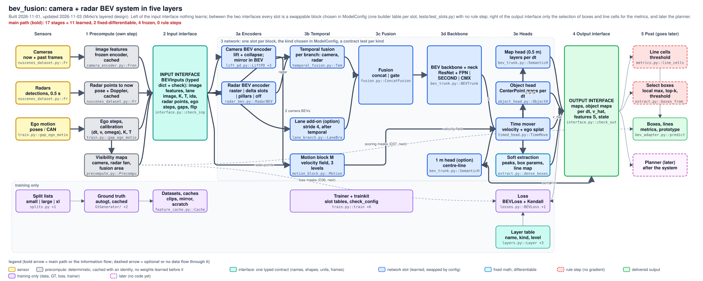

# bev_fusion: camera + radar BEV system (base chain t8_ctl, variant t10_dual)

Front camera + radar detections + ego motion -> timed map layers, object maps, boxes, lines. Learned between the cached camera features and the head outputs; red = a rule step on the path.

<!-- archdraw:begin: generated from architecture.json by autoresearch/tools/archdraw.py; edit the spec, then `archdraw.py render` -->
## File map: every box and the code it stands for

| box | kind | code | note |
|---|---|---|---|
| Front camera now + 2 past frames | input | `training/nuscenes_dataset.py::FrontRadarDataset` | CAM_FRONT 1600 x 900 at 12 Hz, resized and cropped to 256 x 704 (cached features: the image is never read in training) |
| Radar detections all 5 radars, 0.5 s | input | `training/nuscenes_dataset.py::FrontRadarDataset._radar` | position, range, Doppler, RCS, age per detection |
| Ground truth (autogt) | training only (data, GT, loss) | `autogt/` | layers, boxes, radar-corrected velocity, masks at -0.5 / 0 / +0.5 s; signature = sha1 of the generator files |
| Data and caches | training only (data, GT, loss) | `training/feature_cache.py::FeatureStore`, `training/nuscenes_dataset.py`, `training/augment.py`, `training/gt_cache_build.py`, `training/cache_bevfusion_features.py` | camera feature cache, radar cache, GT cache, mirror augmentation |
| Scratch hygiene tmpdir, cached, dump | training only (data, GT, loss) | `training/scratch.py` | keeps bev_fusion/temp small: a fresh folder per smoke run removed on exit, list caches that are reused or deleted, dumps keyed by what they hold (written after C: was full with 18 GB of scratch) |
| Frozen camera heads DualBEV R50 + depth | frozen / cached (no gradient) | `training/camera_encoder.py::FrontCameraEncoder`, `training/bevfusion_camera.py::BEVFusionImageSide`, `training/feature_cache.py::CachedBEVFusionModel` | pre-trained, run once offline and cached (float16: 118 depth probabilities + 80 context channels at stride 16); t10_dual adds the BEVFusion Swin-T side at stride 8 |
| Sweeps to now ego pose + Doppler | rule step (no gradient) | `training/nuscenes_dataset.py::FrontRadarDataset._radar` | all sweeps of the last 0.5 s moved to the camera time with exact poses, Doppler shifted along the ray; runs in the data loader and is cached |
| Losses BEVLoss + Kendall | training only (data, GT, loss) | `training/losses.py::BEVLoss`, `training/loss_extras.py` | areas, lines, objects, motion in four groups with learned weights; the gradient reaches every module from the camera reduce onward |
| Trainer EMA, resume, stop | training only (data, GT, loss) | `training/train.py` | AdamW + cosine, gradient accumulation, EMA 0.999, checkpoint before evaluation, resume, CONTROL / STOPPED |
| Lift PD depth-weighted gather | fixed math, differentiable | `training/lift_pd.py::lift_pd`, `training/lift_pd.py::LiftPD` | two grid_sample gathers per frame through a calibration table (voxel -> pixel + depth bin), feature x p(depth); the table is a detached constant with a hard validity mask |
| Hard raster floor + mean per cell | rule step (no gradient) | `training/radar_bev.py::rasterize` | 14 channels per cell: count, mean of range, bearing, six Doppler harmonics, RCS, age, sub-cell offset |
| Line cells | delivered output | `evaluation/metrics.py::line_cells` | scored in the evaluation as map lines |
| Boxes pose, size, yaw, velocity | delivered output | `evaluation/bev_adapter.py::predictions` | boxes of the three groups vehicle, two_wheeler, pedestrian (circle) |
| Height collapse 640 -> 64 channels | learned network (gradient flows) | `training/model.py::BEVFusionModel` | 1 x 1 conv + BN + ReLU (cam_reduce; t10_dual: a second one and cam_merge) |
| Radar convs 14 -> 32 channels | learned network (gradient flows) | `training/radar_bev.py::RadarBEV` | two 3 x 3 convs after the raster |
| Line extraction zero crossing | rule step (no gradient) | `evaluation/metrics.py::line_cells` | consumer side |
| Box decode peak, top-k, threshold | rule step (no gradient) | `training/object_head.py::decode` | consumer side; evaluation k = 100 and score 0.05, model.boxes k = 50 and 0.2 |
| Memory re-centre round + roll | rule step (no gradient) | `training/temporal_fusion.py::recentre` | moves the memory window by whole cells when the ego drifts |
| Camera temporal fusion window + world memory | learned network (gradient flows) | `training/temporal_fusion.py::TemporalFusion`, `training/splat.py::splat_window` | 2 past frames splatted to now with the ego motion and a learned velocity field, plus a world-aligned memory read by grid_sample |
| Map layers 12 channels per dt | delivered output | `training/model.py::BEVFusionModel` | logits from the semantic head: network layers only |
| Object maps hm off size rot vel dir | delivered output | `training/object_head.py::ObjectHead` | dense, network layers only; the box velocity is the vel branch read at a peak |
| Alternatives in ModelConfig | alternative block (ModelConfig switch, not in the base chain) | `training/blocks_new.py::RadarPillars`, `training/fallbacks.py::EgoWarpGRU`, `training/lane_branch.py` | RadarPillars, second trunk, CMX / gate fusion, GRU temporal, LiftS, the t7 lane branch: control arms and add-ons |
| Concat fusion modality dropout 0.2 | learned network (gradient flows) | `training/fusion.py::ConcatFusion` | camera (64) + radar (32) -> 3 x 3 conv -> 80 channels; one of the two sensors is blanked per sample in training |
| Semantic head per dt | learned network (gradient flows) | `training/timed_head.py::TimedHead`, `training/bev_trunk.py::SemanticHead` | FiLM(dt) refine block + conv head: 5 areas, 2 line masks, 2 line distance fields, 3 object footprints |
| Object head CenterPoint, per dt | learned network (gradient flows) | `training/object_head.py::ObjectHead` | heatmap, sub-cell offset, size, rotation, radius, velocity (vx, vy), direction logit: conv branches |
| BEV trunk ResNet + FPN + detail | learned network (gradient flows) | `training/bev_trunk.py::BEVTrunk` | 3-stage ResNet + FPN_LSS + stride-1 detail path, initialised from DualBEV and trained; head reduction to 96 channels follows |
| TimeMover velocity + ego splat | learned network (gradient flows) | `training/timed_head.py::TimeMover`, `training/splat.py::splat_bev` | moves the feature state to dt = -0.5 / 0 / +0.5 s: learned velocity field (zero start) + exact ego warp, bilinear softmax splat with a mass channel |
| Ego motion (v, omega, gap) | input | `training/train.py::gap_ego_motion` | for the +-0.5 s outputs composed from the ground-truth poses of the target keyframe, in training AND in evaluation (evaluation/bev_adapter.py calls the same forward_loss); a deployed system has to supply odometry itself |

## Arrows

| from | to | carries |
|---|---|---|
| Frozen camera heads DualBEV R50 + depth | Lift PD depth-weighted gather | prob, ctx |
| Camera temporal fusion window + world memory | Memory re-centre round + roll | state |
| Ground truth (autogt) | Losses BEVLoss + Kendall | targets |

## Main path from input to output

main path (bold): 15 stages = 8 learned, 1 fixed-differentiable, 1 frozen, 5 rule steps.

| stage | class | code |
|---|---|---|
| Frozen camera heads DualBEV R50 + depth | frozen | `training/camera_encoder.py::FrontCameraEncoder`, `training/bevfusion_camera.py::BEVFusionImageSide`, `training/feature_cache.py::CachedBEVFusionModel` |
| Sweeps to now ego pose + Doppler | rule step | `training/nuscenes_dataset.py::FrontRadarDataset._radar` |
| Lift PD depth-weighted gather | fixed-differentiable | `training/lift_pd.py::lift_pd`, `training/lift_pd.py::LiftPD` |
| Hard raster floor + mean per cell | rule step | `training/radar_bev.py::rasterize` |
| Height collapse 640 -> 64 channels | learned | `training/model.py::BEVFusionModel` |
| Radar convs 14 -> 32 channels | learned | `training/radar_bev.py::RadarBEV` |
| Memory re-centre round + roll | rule step | `training/temporal_fusion.py::recentre` |
| Concat fusion modality dropout 0.2 | learned | `training/fusion.py::ConcatFusion` |
| TimeMover velocity + ego splat | learned | `training/timed_head.py::TimeMover`, `training/splat.py::splat_bev` |
| Camera temporal fusion window + world memory | learned | `training/temporal_fusion.py::TemporalFusion`, `training/splat.py::splat_window` |
| BEV trunk ResNet + FPN + detail | learned | `training/bev_trunk.py::BEVTrunk` |
| Line extraction zero crossing | rule step | `evaluation/metrics.py::line_cells` |
| Semantic head per dt | learned | `training/timed_head.py::TimedHead`, `training/bev_trunk.py::SemanticHead` |
| Box decode peak, top-k, threshold | rule step | `training/object_head.py::decode` |
| Object head CenterPoint, per dt | learned | `training/object_head.py::ObjectHead` |

## Where the path is not end to end, and what could stand in for it

| step | class | what it does and what it carries | building block that emulates it differentiably | catch |
|---|---|---|---|---|
| Frozen camera heads DualBEV R50 + depth | frozen | the whole image evidence enters as cached features; no config sets freeze_camera false, so no loss reaches the image network (only t3_adapter / t3_cam_adapter add a trainable block in front of the lift) | train the image side: unfreeze (card t9 encoder 2 x 2, decision D26), a small adapter or LoRA on the frozen backbone, or distillation of a larger frozen teacher into a trainable student | the cache no longer applies (images are read and encoded at train time, a multiple of the cost on one 12 GB GPU) and a trainable encoder can drift from the depth prior it came with |
| Sweeps to now ego pose + Doppler | rule step | classical geometry on numpy points before the network (devkit point-cloud reader, rigid transform, Doppler shift); outside the gradient path | feed the raw sweeps with their relative poses and ages as a set and let a point encoder (PointNet / transformer over points) absorb the motion compensation | exact rigid motion is cheap to compute and easy to get wrong when learned; keep it as a fixed transform unless the odometry itself is learned |
| Hard raster floor + mean per cell | rule step | each detection goes into the one cell it falls in (floor, index_add_, mean); nothing trainable sits upstream, so no gradient is lost, but all detail inside a cell is averaged away before any weight sees it | a learned point encoder (PointPillars-style PFN + scatter, already in the repo as RadarPillars, radar_kind pillars, arm t2_radar_pillars), a bilinear soft splat of point features, or cross-attention from BEV cells to the nearest detections | scatter still needs a cell index; attention costs time per frame (latency budget); the pillars arm has been tried once and is not the base |
| Memory re-centre round + roll | rule step | integer shift of the stored state (round, int, roll, zero strip): no gradient in the pose; the learned parts read the memory through grid_sample, so training still reaches them | a fixed world grid larger than the view (ring buffer, nothing shifted) or a sub-cell bilinear shift of the state | memory size and cost; the effect on quality is small (a storage detail), listed because it is on the path |
| Line extraction zero crossing | rule step | cells that are a local minimum of the line distance field along x or y and below half a cell; lines stay pixel and field based, not vectors | deliver the distance field itself (differentiable, a planner can read its gradient) or a learned vectorisation (point-set queries per polyline, MapTR-style) | a vector head is a new head with its own matching-free loss; the field is the cheaper, already trained deliverable |
| Box decode peak, top-k, threshold | rule step | 3 x 3 max-pool equality keeps local maxima, top-k and a score threshold pick the detections, then exp(size), atan2(rot), a yaw fold by the direction logit and the velocity read at the chosen cell; no IoU NMS anywhere; dense losses train the maps, so this selection costs no gradient in training | keep the dense maps as the deliverable for a downstream network; or a learned selection: soft top-k (optimal transport), a learned NMS (relation network), or set prediction with queries (DETR3D family, trained with Sinkhorn / Hungarian matching) | the matching-based set losses are a rule step of their own during training; a downstream consumer of dense maps needs a planner interface for them |
<!-- archdraw:end -->
