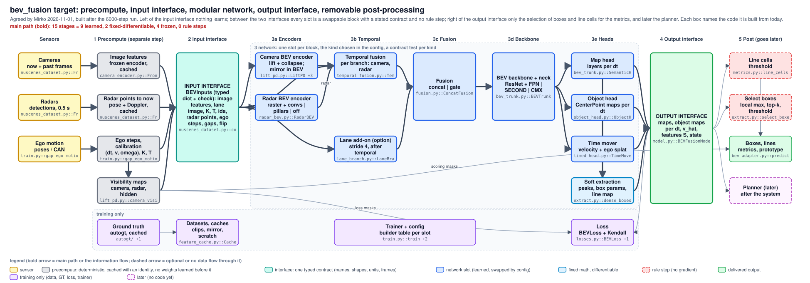

# bev_fusion target architecture (agreed by Mirko 2026-11-01, built after the 6000-step run)

Today's chain is drawn in `architecture.svg`; this page proposes the clean form for experimenting. `archdraw.py check` confirms that the code every box names exists; it does not check the wiring between the boxes. Corrected after a fresh critic pass (2026-11-01) against the code.

## Five layers
| layer | what is in it | its rule |
|---|---|---|
| 1 Precompute | frozen image features (DualBEV / BEVFusion heads), radar detections of 0.5 s compensated to now (points), ego steps from every past frame, the true gap to the target time, the memory step between calls, camera and radar calibration, the image crop; for training the GT (autogt) | everything before the first learned weight: deterministic, no gradient needed, cached under an identity (a `meta.json` per feature cache, as the GT and radar caches already have through their keys) |
| 2 Input interface | `BEVInputs`: a typed dict with a `check()` (names, shapes, units, frames), replacing today's batch dict plus the forward arguments `dts`, `state`, `step`, `ego` | the only thing the network reads; the per-sample `flip` flag travels with it (the mirror itself is a BEV operation after the camera slot: cached perspective features cannot be mirrored) |
| 3 Network | slots: camera encoder, radar encoder, temporal fusion (per branch), lane add-on (option), fusion, backbone + neck, heads (maps, objects, time mover), soft extraction | each slot has a stated contract and several kinds; the base chain has no rule step between the two interfaces |
| 4 Output interface | `BEVOutputs`: maps and object maps per dt, the dense box output (peak weight + box parameters per cell), the soft line map, the velocity field `v_hat`, features S, the temporal state | dense and differentiable: the one loss module, the post-processing and later the planner read only this |
| 5 Post-processing | select boxes (local maximum, top-k, threshold) and threshold the line map: a few lines | for the metrics and the prototype only |

The **planner** is not part of the system: it comes after it and reads the output interface. Because that interface is dense and differentiable, a later joint training lets the planner's loss flow back into the fusion (the deep connection).

## Slots and their contracts (including today's couplings)
| slot | contract | kinds today |
|---|---|---|
| camera encoder | `BEVInputs` -> BEVs (B, F, C_cam, X, Y) + visibility (B, 1, X, Y); mirrored in BEV for flipped samples | dualbev, bevfusion, dual |
| radar encoder | radar points -> (B, C_rad, X, Y); the raster is its first op, before any weight | raster + convs, pillars, off |
| temporal fusion | (BEV now, past BEVs with their ego steps, state, step since the last call, coverage) -> (BEV, state); the memory re-centre is a whole-cell roll, so the gradient passes; the same block for both branches | camera: window + world memory, ego GRU, none; radar: none today, world memory as the first arm (memory only: its 0.5 s history is already in the points) |
| lane add-on | (lane image, K, T, ida, the camera slot's depth of the current frame) -> a BEV added after the temporal block, mirrored on its own | stride-4 branch, off |
| fusion | (camera BEV, radar BEV) -> (B, C_fuse, X, Y); modality dropout (off when a sensor is off) | concat, gate |
| backbone + neck | fused BEV -> S (B, C, X, Y), the optional 1x1 head reduction included | ResNet + FPN (DualBEV init), SECOND; CMX takes both branch BEVs and replaces fusion and backbone together |
| heads | S, moved to each dt by the shared time mover -> their keys of `BEVOutputs`; the aux heads (training only) read the branch BEVs | maps, objects (refiner option), time mover |
| soft extraction | head maps -> dense box output + soft line map (fixed math, differentiable) | below |

## Differentiable extraction, tiny post-processing
- **Boxes.** Per cell a peak weight `w = hm x exp(-beta (maxpool3(hm) - hm))` (equal to the heatmap at a local maximum, smoothly lower elsewhere) and the box parameters the head already predicts densely: centre = cell + offset, size, yaw from (sin, cos) with the direction class as a soft sign (`tanh` of its logit instead of a hard flip), velocity x `sigmoid(moving)` instead of a hard zero. The post-processing only selects cells (hard local maximum, top-k, threshold) and reads their parameters; with the hard gate it returns exactly today's boxes, so every stored detection number stays comparable (a test checks equality with today's `decode`).
- **Lines.** A soft line map from the predicted distance field: near zero (`sigmoid(k (res/2 - d))`) times a soft local minimum along x or y. The post-processing thresholds it; the metric keeps `evaluation/metrics.py::line_cells` as its definition, and a test checks that the threshold of the soft map gives the same cells.
- **No new loss** at first: the extraction is a reparametrisation of what the heads are trained on; a loss on the dense box output (or the planner's) is a later experiment.

## The simplest shape that gives the experimenting comfort
- **Keep the files and the flat `ModelConfig`.** The blocks are already in their own files. What makes a swap risky today is the constructor: a dozen if-chains and `ValueError`s for the combinations. They become one `{kind: builder}` table per slot and one build check of the combination. Attribute names stay, so every checkpoint and the pre-trained loading keep their keys; no converter is needed.
- **One loss module.** `BEVLoss` keeps the Kendall weights and the cross-head terms (motion and time consistency, refine); a head only declares its output keys.
- **A contract test per kind:** shapes, finite outputs, the gradient reaches every parameter, on a tiny grid in seconds. A new kind is a builder entry plus that test.
- **Equivalence check per step:** the forward outputs of the `t10_dual_s0` checkpoint on 50 val frames, eval mode, equal within 1e-5 (scatter / index_add is not bit-exact).
- **Old numbers:** runs that carry their code snapshot are evaluated from it and do not change. 11 older runs have no snapshot (t3_img_*, t3_eval_r4soa, t4_dualbev_front, distill_*); they would be evaluated on the new code, which the equivalence check covers.

## End to end
The base chain has no rule step between the input and the output interface (the drawing's main path counts them). The refiner option has one on the training path (top-k decode and GT matching); it stays an option. What remains outside is the selection of boxes and line cells for the metrics.

## Not proposed
Moving files into slot folders (changes checkpoint keys), a nested config with a converter, a per-head loss (breaks the shared Kendall balance), six cameras now (lift, visibility, feature cache, lane branch are single-camera per sample: a project of its own).

## Build (Mirko, 2026-11-01: "Build it into this shape after the run"; `training/*.py` and `evaluation/` stay frozen until the 6000-step run and its evaluation are done, about 17:30)
1. `BEVInputs` as a typed dict with `check()` around today's batch and forward arguments; `BEVOutputs` the same for the result.
2. The builder table per slot and the one build check in `model.py`, replacing the if-chains; radar temporal through the same builder.
3. The soft extraction (dense boxes, soft line map) and the select step; the equality tests with today's `decode` and `line_cells`.
4. The contract test per kind.
Each step: the tests green and the equivalence check above. Then new kinds are experiments: radar world memory first.

<!-- archdraw:begin: generated from architecture_target.json by autoresearch/tools/archdraw.py; edit the spec, then `archdraw.py render` -->
## File map: every box and the code it stands for

| box | kind | code | note |
|---|---|---|---|
| Cameras now + past frames | sensor | `training/nuscenes_dataset.py::FrontRadarDataset` | today the front camera; six cameras are one more entry of the interface, not a new chain |
| Radars detections, 0.5 s | sensor | `training/nuscenes_dataset.py::FrontRadarDataset._radar` | all five radars |
| Ego motion poses / CAN | sensor | `training/train.py::gap_ego_motion` | from the poses in nuScenes; a deployed system supplies its own odometry |
| Image features frozen encoder, cached | precompute: deterministic, cached with an identity, no weights learned before it | `training/camera_encoder.py::FrontCameraEncoder`, `training/bevfusion_camera.py`, `training/feature_cache.py::FeatureStore`, `training/cache_bevfusion_features.py` | frozen DualBEV / BEVFusion image heads: depth probabilities + context per pixel; while frozen they are a cache (with a meta.json identity), once unfrozen the image encoder becomes the first network slot |
| Radar points to now pose + Doppler, cached | precompute: deterministic, cached with an identity, no weights learned before it | `training/nuscenes_dataset.py::FrontRadarDataset._radar`, `training/feature_cache.py::build_radar_cache` | the sweeps of 0.5 s compensated to the current time and cached as points (not as a grid): the radar slot keeps the choice of raster or point encoder |
| Ego steps, calibration (dt, v, omega), K, T | precompute: deterministic, cached with an identity, no weights learned before it | `training/train.py::gap_ego_motion`, `training/train.py::batch_ego`, `training/train.py::clip_step`, `training/nuscenes_dataset.py::FrontRadarDataset` | the ego step from every past frame to now, the true gap to the target time, the memory step between calls, camera and radar calibration, the image crop; today partly built in train.py from the GT meta (also at evaluation) |
| Ground truth autogt, cached | training only (data, GT, loss, trainer) | `../autogt/`, `training/gt_cache_build.py` |  |
| INPUT INTERFACE BEVInputs (typed dict + check): image features, lane image, K, T, ida, radar points, ego steps, gaps, flip | interface: one typed contract (names, shapes, units, frames) | `training/nuscenes_dataset.py::collate`, `training/feature_cache.py::collate_cached` | today an untyped batch dict plus the forward arguments dts, state, step and ego; proposed: one typed dict with names, shapes, units and frames and a check(); the per-sample flip flag travels with it (the mirror itself happens in BEV, after the camera slot) |
| Datasets, caches clips, mirror, scratch | training only (data, GT, loss, trainer) | `training/feature_cache.py::CachedFrontRadarDataset`, `training/train.py::ClipDataset`, `training/augment.py::flip_batch`, `training/scratch.py` |  |
| Camera BEV encoder lift + collapse; mirror in BEV | network slot (learned, swapped by config) | `training/lift_pd.py::LiftPD`, `training/model.py::BEVFusionModel.camera_bevs`, `training/model.py::BEVFusionModel.camera_visibility`, `training/blocks_new.py::ZSumReduce` | contract: BEVInputs -> (BEVs (B, F, C_cam, X, Y), visibility (B, 1, X, Y)), mirrored in BEV for flipped samples (cached perspective features cannot be mirrored); kinds dualbev, bevfusion, dual |
| Radar BEV encoder raster + convs \| pillars \| off | network slot (learned, swapped by config) | `training/radar_bev.py::RadarBEV`, `training/radar_bev.py::rasterize`, `training/blocks_new.py::RadarPillars` | contract: radar points -> (B, C_rad, X, Y); the raster is the first op, before any weight, so it costs no gradient; radar history is the sweeps inside the points |
| Temporal fusion per branch: camera, radar | network slot (learned, swapped by config) | `training/temporal_fusion.py::TemporalFusion`, `training/temporal_fusion.py::recentre`, `training/splat.py::splat_window`, `training/fallbacks.py::EgoWarpGRU` | the same block for both branches (TemporalFusion takes channels and grid); camera: window + world memory; radar: none today, world memory as the first arm (its 0.5 s history is in the points); contract: (BEV now, past BEVs with their ego steps, state, step since the last call, coverage) -> (BEV, state); the re-centre is a whole-cell roll, the gradient passes |
| Lane add-on (option) stride 4, after temporal | network slot (learned, swapped by config) | `training/lane_branch.py::LaneBranch` | reads the lane image, K, T, ida and the DualBEV depth of the current frame; its BEV is added to the camera BEV after the temporal block; mirrored on its own |
| Trainer + config builder table per slot | training only (data, GT, loss, trainer) | `training/train.py::train`, `training/model.py::ModelConfig`, `training/feature_cache.py::CachedBEVFusionModel` | proposed: the flat ModelConfig stays; the if-chains of the constructor become one {kind: builder} table per slot and one build check |
| Fusion concat \| gate | network slot (learned, swapped by config) | `training/fusion.py::ConcatFusion`, `training/fusion.py::GateFusion`, `training/fusion.py::drop_modality` | contract: (camera BEV, radar BEV) -> (B, C_fuse, X, Y); modality dropout lives here (off when a sensor is off) |
| BEV backbone + neck ResNet + FPN \| SECOND \| CMX | network slot (learned, swapped by config) | `training/bev_trunk.py::BEVTrunk`, `training/blocks_new.py::SecondTrunk`, `training/fallbacks.py::CMXTrunk` | contract: (B, C_fuse, X, Y) -> features S (B, C, X, Y), the optional 1x1 head reduction included; CMX replaces fusion and backbone together (a kind of this slot that takes both branch BEVs) |
| Map head layers per dt | network slot (learned, swapped by config) | `training/bev_trunk.py::SemanticHead`, `training/timed_head.py::TimedHead` | contract: (S moved to dt) -> map probabilities (B, L, X, Y); the aux heads read the branch BEVs, not S (training only) |
| Object head CenterPoint maps per dt | network slot (learned, swapped by config) | `training/object_head.py::ObjectHead`, `training/object_head.py::BoxRefiner` | contract: (S moved to dt) -> heatmap, offset, size, yaw, velocity, moving maps; the refiner (option, off in the base chain) decodes top-k and matches the GT inside the training path: a rule step when it is on |
| Time mover velocity + ego splat | network slot (learned, swapped by config) | `training/timed_head.py::TimeMover`, `training/splat.py::splat_bev` | moves S to a target time dt for every head (shared) and gives the velocity field v_hat at dt = 0 |
| Soft extraction peaks, box params, line map | fixed math, differentiable | `training/object_head.py::decode`, `evaluation/metrics.py::line_cells` | built from today's decode and line extraction: per cell a peak weight (heatmap x exp(-beta (maxpool - heatmap))), the box parameters (centre with offset, size, yaw with a soft direction sign, velocity x sigmoid(moving)) and a soft line map (near-zero distance x soft local minimum); fixed math, differentiable |
| Loss BEVLoss + Kendall | training only (data, GT, loss, trainer) | `training/losses.py::BEVLoss`, `training/loss_extras.py` | one module: the Kendall weights and the cross-head terms (motion and time consistency, refine) stay together; heads declare their output keys |
| OUTPUT INTERFACE maps, object maps per dt, v_hat, features S, state | delivered output | `training/model.py::BEVFusionModel.forward` | what the planner, the one loss module (BEVLoss) and the post-processing read: dense and differentiable |
| Line cells threshold | rule step (no gradient) | `evaluation/metrics.py::line_cells` | thresholds the soft line map for the line metric; the metric's reference line_cells stays the definition and a test checks the two agree |
| Select boxes local max, top-k, threshold | rule step (no gradient) | `training/object_head.py::decode` | the only box step left outside the network: picks cells of the dense box output for the metrics and the prototype; with the hard local maximum it gives exactly today's boxes |
| Boxes, lines metrics, prototype | delivered output | `evaluation/bev_adapter.py::predictions`, `evaluation/board.py` |  |
| Planner (later) after the system | later (no code yet) |  | a consumer of the output interface, not part of the system; the outputs are dense and differentiable, so a later joint training lets its loss flow back into the fusion |

## Arrows

| from | to | carries |
|---|---|---|
| Camera BEV encoder lift + collapse; mirror in BEV | Temporal fusion per branch: camera, radar | visibility |
| Radar BEV encoder raster + convs \| pillars \| off | Temporal fusion per branch: camera, radar | radar |
| OUTPUT INTERFACE maps, object maps per dt, v_hat, features S, state | Planner (later) after the system | dense, differentiable |

## Main path from input to output

main path (bold): 14 stages = 9 learned, 2 fixed-differentiable, 3 frozen, 0 rule steps.

| stage | class | code |
|---|---|---|
| Image features frozen encoder, cached | frozen | `training/camera_encoder.py::FrontCameraEncoder`, `training/bevfusion_camera.py`, `training/feature_cache.py::FeatureStore`, `training/cache_bevfusion_features.py` |
| Radar points to now pose + Doppler, cached | frozen | `training/nuscenes_dataset.py::FrontRadarDataset._radar`, `training/feature_cache.py::build_radar_cache` |
| Ego steps, calibration (dt, v, omega), K, T | frozen | `training/train.py::gap_ego_motion`, `training/train.py::batch_ego`, `training/train.py::clip_step`, `training/nuscenes_dataset.py::FrontRadarDataset` |
| INPUT INTERFACE BEVInputs (typed dict + check): image features, lane image, K, T, ida, radar points, ego steps, gaps, flip | fixed-differentiable | `training/nuscenes_dataset.py::collate`, `training/feature_cache.py::collate_cached` |
| Camera BEV encoder lift + collapse; mirror in BEV | learned | `training/lift_pd.py::LiftPD`, `training/model.py::BEVFusionModel.camera_bevs`, `training/model.py::BEVFusionModel.camera_visibility`, `training/blocks_new.py::ZSumReduce` |
| Radar BEV encoder raster + convs \| pillars \| off | learned | `training/radar_bev.py::RadarBEV`, `training/radar_bev.py::rasterize`, `training/blocks_new.py::RadarPillars` |
| Lane add-on (option) stride 4, after temporal | learned | `training/lane_branch.py::LaneBranch` |
| Temporal fusion per branch: camera, radar | learned | `training/temporal_fusion.py::TemporalFusion`, `training/temporal_fusion.py::recentre`, `training/splat.py::splat_window`, `training/fallbacks.py::EgoWarpGRU` |
| Fusion concat \| gate | learned | `training/fusion.py::ConcatFusion`, `training/fusion.py::GateFusion`, `training/fusion.py::drop_modality` |
| BEV backbone + neck ResNet + FPN \| SECOND \| CMX | learned | `training/bev_trunk.py::BEVTrunk`, `training/blocks_new.py::SecondTrunk`, `training/fallbacks.py::CMXTrunk` |
| Map head layers per dt | learned | `training/bev_trunk.py::SemanticHead`, `training/timed_head.py::TimedHead` |
| Object head CenterPoint maps per dt | learned | `training/object_head.py::ObjectHead`, `training/object_head.py::BoxRefiner` |
| Time mover velocity + ego splat | learned | `training/timed_head.py::TimeMover`, `training/splat.py::splat_bev` |
| Soft extraction peaks, box params, line map | fixed-differentiable | `training/object_head.py::decode`, `evaluation/metrics.py::line_cells` |

## Where the path is not end to end, and what could stand in for it

| step | class | what it does and what it carries | building block that emulates it differentiably | catch |
|---|---|---|---|---|
| Image features frozen encoder, cached | frozen |  |  |  |
| Radar points to now pose + Doppler, cached | frozen |  |  |  |
| Ego steps, calibration (dt, v, omega), K, T | frozen |  |  |  |

## Rule steps outside the main path

| step | what it does | catch |
|---|---|---|
| Line cells threshold |  |  |
| Select boxes local max, top-k, threshold |  |  |
<!-- archdraw:end -->
