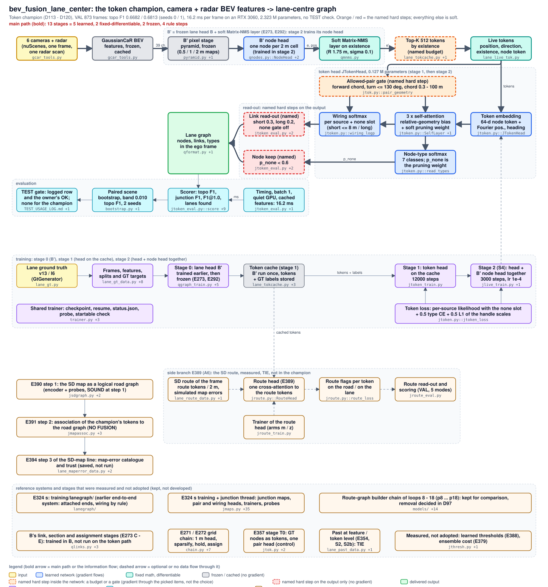

# bev_fusion_lane_center

- Lane centre-line graph from camera + radar BEV features (nuScenes): the problem of this folder, one of the problems of the research system around it (`../autoresearch/`)
- Target: a fully differentiable chain, one frame and one radar scan -> lane graph, later attached to an SD-map route -> planner; short graphs, correct graphs, fast
- Status (the numbers are in PROBLEM.md, the state in HANDOVER.md): the system of record is the **token champion** (D113 - D120): frozen GaussianCaR features -> the frozen lane head B' -> its predicted nodes as tokens -> one token head (the attention is the wiring) -> a read-out by four named thresholds. VAL, 873 frames, two seeds: topo F1 0.668 / 0.681, 16.2 ms per frame (whole path, RTX 3060, quiet GPU), 2.3 M parameters; no TEST check of it exists. The earlier end-to-end system E324 s (five rule steps) is 0.02 topo F1 higher at 19.7 ms and is kept as a reference. The map association (E389: one cross-attention from the tokens to the SD route) reads the map but missed its pre-registered bar (TIE, no gain, not safe under a wrong map) and is not in the delivered chain; the next step is the SD map as a logical road graph (E390, D130, D135)
- New chat: read HANDOVER.md
- The problem: PROBLEM.md (goal, chain, metrics, current best, gaps, problem groups, foundation topics); paths for the tools: project.json
- The design spec: DESIGN.md (the modules of the chain and the rules it obeys, small; the code is the detail spec); the coder is given it with the card's Design delta
- The research system around it: `../autoresearch/` (METHOD.md, agents, templates, prompts, tools); rules for an AI session: CLAUDE.md
- Folder tree with sizes on demand: `tools/maintenance/make_structure.py` (writes temp/STRUCTURE.md, scratch, not in git); structure and document check: `../autoresearch/tools/check_structure.py`

The delivered chain of the token champion, drawn from the code ([file map, the named hard steps and what is learned](training/architecture.md)). `python ../autoresearch/tools/archdraw.py check training/architecture.json` fails when picture and code disagree.

## Where things are
- the owner's decisions and permissions: `experiment_execution/DECISIONS.md` (one file, D<n>); the experiment list: the cards `experiments/E<id>_<slug>/experiment.md`; every run: `experiment_execution/LEDGER.md` (from `LEDGER.csv`)
- the code of the champion: `training/grid/jtoken.py` (token head), `training/data/lane_tokcache.py` and `lane_live_tok.py` (tokens), `training/train/jtoken_train.py` and `jlive_train.py` (the two training stages), `evaluation/jtoken_eval.py` (decode, score, timing); the lane head B': `training/grid/qgraph.py`, `pyramid.py`
- the winner and its code: `winner/e372_s4_champion/` (the champion's source snapshot with the commands, the numbers to reproduce and where the weights are; no weights; `winner/README.md`, D139 / D140)
- the reference systems: `training/lanegraph/` (E324 s, bit-identical re-implementation) and the route-graph builder chain of loops 8 - 18 (`training/models/p16_*`, `training/train/p16_train.py`, `training/pipeline/p16_pipeline.py`, scored by `evaluation/evaluate.py`)
- outside this folder, in the workspace root: `../GtGenerator/` (the ground truth), `../data/NuScenes/` (the dataset family); the result packages and report pages of this project are in `results/`
- the code that was removed in the clean-ups of 2026-11 (the junction-thread bundle, the old p8 - p13 chain pieces, data-prep scripts that no recipe names, the `experiments/E*/code` folders) is only in the git history: `git log --stat -- <path>`

## Folders (by role in the method)
- research - `literature/`: OVERVIEW.md (why, nine axes, findings, gaps), CATALOGUE.md (the one reference for the papers), papers.csv (the one table to edit), papers/ (the notes), deep/ + code/ (extractions), register.md (K ids)
- execution state - `experiment_execution/`: LEDGER.md (every run), DECISIONS.md (the owner's permissions and orders, D129: one file), grants.csv (TEST and gate grants), keep3.json (the best three networks), runs/ (run records), plans/ (design documents), history/
- experiment records - `experiments/`: one folder per experiment, E<id>_<slug> (card, detail plan, summary); `results/`: the result packages, figures and report pages of runs (not the cards); `reports/`: weekly/ (the weekly reports, decks), build/ (builders), source/ (figures and number digests)
- training - `training/`: the product (grid/ = the lane head B', the token head and its tests, data/ = loaders and caches, train/ = the trainers, models/ and pipeline/ = the reference chain, lanegraph/ = E324 s, configs/), trainer.py with checkpoint + resume
- evaluation - `evaluation/`: evaluate.py (one entry point for named models, names in models/registry.json), jtoken_eval.py (the token system), metrics and protocol (sparse_lanes, lane_grid, lane_task), drivers/, loops/, tests
- `tools/`: problem-specific helpers: env launchers, viz, video, literature, maintenance (make_structure.py, run_all_tests.sh, CLEANUP_LIST.md); the general tools are in `../autoresearch/tools/`
- `temp/`: short-lived work (not in git); `runs/`: raw outputs (not in git except the metric cards); `models/`: checkpoint registry; `data/`: splits and the data registry; `_to_delete/`: staged for the owner (not in git)

## Scripts you need over time
- run a script (retry on CUDA errors): `tools/env/_py14.sh <script>` (`_pyr.sh`)
- launch with record, ledger row and code tag: `../autoresearch/tools/run.py` (the git tag `lcr/<run id>`)
- train with checkpoint + resume: `training/trainer.py`; the token champion: `training/train/jtoken_train.py` (stage 1), `jlive_train.py` (stage 2)
- evaluate the token system (dump, score, sweep, timing): `evaluation/jtoken_eval.py`; evaluate a named model (all metrics, paired comparison): `evaluation/evaluate.py <name> [--compare <name>]` (names in `models/registry.json`); metric code: `evaluation/sparse_lanes`, dense maps: `evaluation/lane_grid`
- reference chain: `training/train/p16_train.py`, `p10_route_train.py`, `p14_chain_consumer.py`; whole chain: `training/pipeline/p16_pipeline.py`; final, fast, timing evaluation: `evaluation/drivers/p16_final_eval.py`, `p16_timing.py`
- images, videos, tables, reports: `tools/viz/render.py`, `tools/video/make_video.py`, `reports/build/`

## Run
- `wsl bash tools/env/_py14.sh p16_fast_check.py --n 20` (the fast path of the reference chain = reference graphs, 2 min)
- `wsl bash tools/env/_py14.sh sparse_lanes/selftest.py` (metric self-tests)
- all tests of the code folders: `wsl bash tools/maintenance/run_all_tests.sh`

## Setting of all numbers
- exact poses, simulated ADASIS-like SD map
- scene-disjoint splits: TRAIN 8,414 / VAL 873 / TEST 833 frames
- nuScenes, non-commercial
