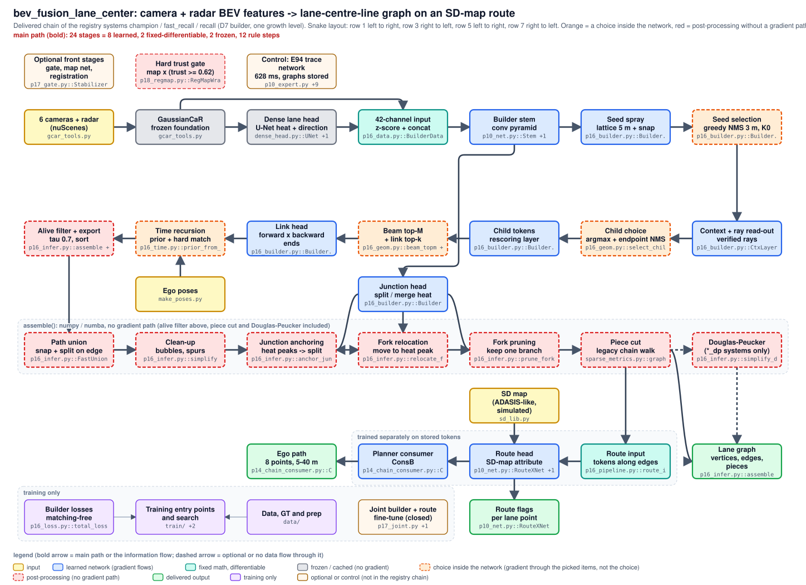

<!-- generated by autoresearch/tools/archdraw.py from architecture.json: edit the JSON, then `archdraw.py render`; `archdraw.py check` fails when this file is stale -->
# bev_fusion_lane_center: camera + radar BEV features -> lane-centre-line graph on an SD-map route

Delivered chain of the registry systems champion / fast_recall / recall (D7 builder, one growth level). Snake layout: row 1 left to right, row 3 right to left, row 5 left to right, row 7 right to left. Orange = a choice inside the network, red = post-processing without a gradient path.

## File map: every box and the code it stands for

| box | kind | code | note |
|---|---|---|---|
| Optional front stages gate, map net, registration | optional or control (not in the registry chain) | `training/train/p17_gate.py::Stabilizer`, `training/models/p17_mapnet.py`, `training/models/p18_regis.py::SoftRegister` | learned memory gate (2.1 ms, not in the timed total), SD map as five extra channels, soft FFT registration + trust; evaluated on failure series, no registry entry |
| 6 cameras + radar (nuScenes) | input | `training/data/prep/gcar_tools.py` | 255 scenes, scene-disjoint splits TRAIN 8,414 / VAL 873 / TEST 833 frames |
| Alive filter + export tau 0.7, sort | post-processing (no gradient path) | `training/pipeline/p16_infer.py::assemble`, `training/pipeline/p16_runtime.py::FastBuilder` | first step of assemble(): CUDA-graph replay, copy to numpy, then numpy / numba |
| Path union snap + split on edge | post-processing (no gradient path) | `training/pipeline/p16_infer.py::FastUnion`, `training/pipeline/p18_union_nb.py::NumbaUnion` | 16 % of the assembly time; the numba kernels are bit-identical to the python version (E216) |
| Builder losses matching-free | training only | `training/losses/p16_loss.py::total_loss` | per head and per level on network outputs: ray verification, child position, child validity, edge precision + soft-min recall, junction, link; no loss sees the assembled graph |
| Hard trust gate map x (trust >= 0.62) | post-processing (no gradient path) | `training/models/p18_regmap.py::RegMapWrap` | optional, off the delivered chain |
| GaussianCaR frozen foundation | frozen / cached (no gradient) | `training/data/prep/gcar_tools.py` | camera + radar BEV features, decoder PCA 32 + 7 map logits = 39 channels at 200 x 200, 0.5 m, cached |
| Time recursion prior + hard match | choice inside the network (gradient through the picked items, not the choice) | `training/models/p16_time.py::prior_from_prev`, `training/models/p16_builder.py::Builder.fuse_prior` | champion and recall only; fast_recall runs without it |
| Ego poses | input | `training/data/prep/make_poses.py` | exact nuScenes poses; feed the time recursion and the consumer |
| Clean-up bubbles, spurs | post-processing (no gradient path) | `training/pipeline/p16_infer.py::simplify` | E259.b0: switched off on 7 models it adds 0.44 to 0.73 vertices per 100 m, so it stays |
| Training entry points and search | training only | `training/train/`, `training/trainer.py`, `training/search/p16_triage.py` | builder, dense head, route head and consumer are trained in separate pieces |
| Control: E94 trace network 628 ms, graphs stored | optional or control (not in the registry chain) | `training/models/p10_expert.py`, `training/models/p10_wave.py`, `training/models/p13_jhead.py`, `training/models/p13_junction.py`, `training/models/p13_phead.py`, `training/models/p15_refine.py`, `training/models/p8_assign.py`, `training/models/p8_seg.py`, `training/pipeline/graph_from_dense.py`, `training/pipeline/line_tracer.py` | the matched reference of every comparison (registry kind graphs) and the earlier rule systems; not part of the delivered chain |
| Dense lane head U-Net heat + direction | frozen / cached (no gradient) | `training/train/dense_head.py::UNet`, `training/pipeline/p10_infer.py::load_maps` | trained separately, train rows from 3-fold out-of-fold heads, cached; its forward is not run by evaluate.py or the timing driver (old cost 5-8 ms) |
| Link head forward x backward ends | learned network (gradient flows) | `training/models/p16_builder.py::Builder.link_head` | link logit between ends of different seeds, connector verification |
| Junction anchoring heat peaks -> split | post-processing (no gradient path) | `training/pipeline/p16_infer.py::anchor_junctions_fast` | E258.a0: off costs Q -0.0004 and J -0.0042 on fast_recall (about 1.0 ms saved): registry fast_recall_na runs without it |
| Ego path 8 points, 5-40 m | delivered output | `training/train/p14_chain_consumer.py::ConsB` |  |
| Data, GT and prep | training only | `training/data/` | features, ground-truth fields, splits, SD-map library, route targets |
| 42-channel input z-score + concat | fixed math, differentiable | `training/data/p16_data.py::BuilderData._x_of` | 39 normalised channels + heat + direction |
| Beam top-M + link top-k | choice inside the network (gradient through the picked items, not the choice) | `training/models/p16_geom.py::beam_topm`, `training/models/p16_builder.py::Builder.link_head` | M = 288 / 144 seeds (champion, recall) or 192 / 96 (fast_recall) |
| Junction head split / merge heat | learned network (gradient flows) | `training/models/p16_builder.py::Builder` | reads the stem features; its heat travels with the raw tree to anchoring, relocation and pruning (heat peaks alone find forks about as well as the control: split F1 0.42 against 0.35, E123) |
| Fork relocation move to heat peak | post-processing (no gradient path) | `training/pipeline/p16_infer.py::relocate_forks` | E258.a0: off costs Q -0.0111 and J -0.054 on fast_recall |
| Planner consumer ConsB | learned network (gradient flows) | `training/train/p14_chain_consumer.py::ConsB` | 6 m edge tokens + route probability + ego motion -> 8 ego-path points; path error floor 0.27 m whatever the graph (gap 3) |
| Joint builder + route fine-tune (closed) | optional or control (not in the registry chain) | `training/train/p17_joint.py`, `training/train/p18_joint.py` | the one end-to-end attempt: the assembly runs inside the loop and the route loss reaches the node tokens only, not positions, validity or edges; negative three times (E202, E214, E232), not adopted |
| Builder stem conv pyramid | learned network (gradient flows) | `training/models/p10_net.py::Stem`, `training/models/p16_builder.py::Builder.encode` | initialised from the control run e94_a, fine-tuned at 0.3x learning rate; features at 200, 100 and 50 cells |
| Child tokens rescoring layer | learned network (gradient flows) | `training/models/p16_builder.py::Builder.rescore` | a transformer layer over parent and siblings re-scores the child validity (stage_c) |
| Fork pruning keep one branch | post-processing (no gradient path) | `training/pipeline/p16_infer.py::prune_forks` | E215: J 0.265 -> 0.409, Q 0.701 -> 0.735, S 0.746 -> 0.769, F1@1 and lanes found unchanged: the largest measured gain of any rule step |
| SD map (ADASIS-like, simulated) | input | `training/data/sd_lib.py` | rasterised to 5 channels; the timing driver uses the exact map |
| Route head SD-map attribute | learned network (gradient flows) | `training/models/p10_net.py::RouteXNet`, `training/pipeline/p16_pipeline.py::FastRoute` | route success champion 0.894 / 0.891 -> 0.899 / 0.900 with fork pruning (E215); builder frozen, tokens stored |
| Route flags per lane point | delivered output | `training/models/p10_net.py::RouteXNet` | lane-level assignment to the SD-map route, road level as fallback |
| Seed spray lattice 5 m + snap | learned network (gradient flows) | `training/models/p16_builder.py::Builder.seed_candidates` | fixed lattice, 25 offset samples per node, learned validity, snap and direction |
| Child choice argmax + endpoint NMS | choice inside the network (gradient through the picked items, not the choice) | `training/models/p16_geom.py::select_children`, `training/models/p16_builder.py::Builder.level` | b = 3 children per tip |
| Piece cut legacy chain walk | post-processing (no gradient path) | `evaluation/sparse_lanes/sparse_metrics.py::graph_from_vertices` | the legacy cut is kept because the route head and the consumer were trained on it (D24 open item) |
| Route input tokens along edges | fixed math, differentiable | `training/pipeline/p16_pipeline.py::route_input`, `training/pipeline/p16_tok_resample.py::resample_item`, `training/models/p16_tokens.py::cross_section` | gather and interpolation in numpy; each vertex takes the node of highest validity (hard); the route head is trained on stored token files |
| Seed selection greedy NMS 3 m, K0 | choice inside the network (gradient through the picked items, not the choice) | `training/models/p16_builder.py::Builder.seeds_select` | K0 = 96 or 144 seeds |
| Context + ray read-out verified rays | learned network (gradient flows) | `training/models/p16_builder.py::CtxLayer`, `training/models/p16_builder.py::Builder.read_rays`, `training/models/p16_geom.py::survival` | graph-biased self-attention over all tips, 12 rays x <= 5 samples per tip, survival T = cumprod of the verification probabilities |
| Douglas-Peucker (*_dp systems only) | post-processing (no gradient path) | `training/pipeline/p16_infer.py::simplify_dp` | champion 14.8 -> 9.5, fast_recall 15.0 -> 9.9 node ids per 100 m, Q -0.0005 (E257, D20); off by default, not in the timed chain |
| Lane graph vertices, edges, pieces | delivered output | `training/pipeline/p16_infer.py::assemble` | the output of the piece cut (of Douglas-Peucker for *_dp); a function of the post-processing rules |

## Main path from input to output

main path (bold): 24 stages = 8 learned, 2 fixed-differentiable, 2 frozen, 12 rule steps.

| stage | class | code |
|---|---|---|
| GaussianCaR frozen foundation | frozen | `training/data/prep/gcar_tools.py` |
| Dense lane head U-Net heat + direction | frozen | `training/train/dense_head.py::UNet`, `training/pipeline/p10_infer.py::load_maps` |
| 42-channel input z-score + concat | fixed-differentiable | `training/data/p16_data.py::BuilderData._x_of` |
| Builder stem conv pyramid | learned | `training/models/p10_net.py::Stem`, `training/models/p16_builder.py::Builder.encode` |
| Seed spray lattice 5 m + snap | learned | `training/models/p16_builder.py::Builder.seed_candidates` |
| Junction head split / merge heat | learned | `training/models/p16_builder.py::Builder` |
| Seed selection greedy NMS 3 m, K0 | rule step | `training/models/p16_builder.py::Builder.seeds_select` |
| Context + ray read-out verified rays | learned | `training/models/p16_builder.py::CtxLayer`, `training/models/p16_builder.py::Builder.read_rays`, `training/models/p16_geom.py::survival` |
| Child choice argmax + endpoint NMS | rule step | `training/models/p16_geom.py::select_children`, `training/models/p16_builder.py::Builder.level` |
| Child tokens rescoring layer | learned | `training/models/p16_builder.py::Builder.rescore` |
| Beam top-M + link top-k | rule step | `training/models/p16_geom.py::beam_topm`, `training/models/p16_builder.py::Builder.link_head` |
| Link head forward x backward ends | learned | `training/models/p16_builder.py::Builder.link_head` |
| Time recursion prior + hard match | rule step | `training/models/p16_time.py::prior_from_prev`, `training/models/p16_builder.py::Builder.fuse_prior` |
| Alive filter + export tau 0.7, sort | rule step | `training/pipeline/p16_infer.py::assemble`, `training/pipeline/p16_runtime.py::FastBuilder` |
| Path union snap + split on edge | rule step | `training/pipeline/p16_infer.py::FastUnion`, `training/pipeline/p18_union_nb.py::NumbaUnion` |
| Clean-up bubbles, spurs | rule step | `training/pipeline/p16_infer.py::simplify` |
| Junction anchoring heat peaks -> split | rule step | `training/pipeline/p16_infer.py::anchor_junctions_fast` |
| Fork relocation move to heat peak | rule step | `training/pipeline/p16_infer.py::relocate_forks` |
| Fork pruning keep one branch | rule step | `training/pipeline/p16_infer.py::prune_forks` |
| Piece cut legacy chain walk | rule step | `evaluation/sparse_lanes/sparse_metrics.py::graph_from_vertices` |
| Douglas-Peucker (*_dp systems only) | rule step | `training/pipeline/p16_infer.py::simplify_dp` |
| Route input tokens along edges | fixed-differentiable | `training/pipeline/p16_pipeline.py::route_input`, `training/pipeline/p16_tok_resample.py::resample_item`, `training/models/p16_tokens.py::cross_section` |
| Route head SD-map attribute | learned | `training/models/p10_net.py::RouteXNet`, `training/pipeline/p16_pipeline.py::FastRoute` |
| Planner consumer ConsB | learned | `training/train/p14_chain_consumer.py::ConsB` |

## Where the path is not end to end, and what could stand in for it

| step | class | what it does and what it carries | building block that emulates it differentiably | catch |
|---|---|---|---|---|
| GaussianCaR frozen foundation | frozen | extracted once with frozen weights (about 0.4 s per frame on the RTX 3060); the 17-24 ms of the chain start from the cached features, so the delivered system from raw sensors is not that fast | an image-radar BEV encoder trained inside the chain, or a small student distilled from GaussianCaR (the same direction as D26 for bev_fusion: the image features become trainable) | any replacement has to fit the speed budget or the headline claim changes; the cache is what makes the loop cheap |
| Dense lane head U-Net heat + direction | frozen | its maps are stored arrays; no gradient from the builder or the graph ever reaches it | fold it into the builder stem and train both together, the dense loss kept as an auxiliary | the builder was tuned on out-of-fold maps; joint training has to keep train rows from seeing their own labels |
| Seed selection greedy NMS 3 m, K0 | rule step | a greedy distance NMS with an argmax loop on detached scores (p16_builder.py:289-295) | a learned objectness gate under a budget loss, or a Gumbel top-k with a straight-through estimate; or no selection: every lattice seed grows a gated branch | K0 sets the frame time; soft gating over all lattice seeds costs a multiple of the compute |
| Child choice argmax + endpoint NMS | rule step | last verified sample per ray by argmax, then dominance and a greedy endpoint NMS (p16_geom.py:104, 135-140); inputs detached | a softmax / sparsemax or straight-through Gumbel over the ray samples, and a learned suppression score instead of the greedy endpoint NMS | the picked items already carry gradient (header of p16_builder.py); a soft choice mainly changes credit assignment, at the cost of gradients for every sample |
| Beam top-M + link top-k | rule step | topk(M) on detached path validity (p16_geom.py:153) keeps M nodes per direction; the link head sees only the 6 nearest ends inside a cone (p16_builder.py:541-546) | soft top-k by optimal transport (Xie et al. 2020), or a learned keep gate trained with the vertex-budget loss (vc_penalty exists, weight 0) | M sets the frame time; a soft budget has to be annealed to a hard cut at test time unless the gate trains to saturate |
| Time recursion prior + hard match | rule step | the previous frame is run through the same builder, its top 64 nodes are warped by the ego motion and fused when a hard test (1.5 m, 30 deg) matches; costs +5.9 ms; the repo says its value is stability, not the single-frame score (E123, E132, E196) | carry the previous node tokens as a recurrent state and attend to them (the learned memory gate is the pixel-level version) instead of re-running the builder and matching | no measured gain to protect, so the replacement only has to be cheaper and no less stable |
| Alive filter + export tau 0.7, sort | rule step | nodes with validity > 0 and path validity >= 0.7 are kept and sorted (p16_infer.py:564-577); tau 0.7 was fixed on VAL | a keep gate trained to saturate (the survival loss exists), so the threshold is the gate's own 0.5 | calibration of the gate under failure (cameras off, wrong map) |
| Path union snap + split on edge | rule step | merges the beam nodes into one graph: reuse a vertex within 1.5 m, else snap onto the nearest edge within 0.5 m and split it, else a new vertex; link probability >= 0.5 makes an edge | learned node merging: a soft assignment of nodes to vertices (differentiable clustering or graph coarsening) with the link head predicting same-vertex; the snap itself stays as the differentiable closest-point projection onto a segment, with soft radius gates | exact edge splitting at foot points is geometry and should stay exact; learn only the merge decision |
| Clean-up bubbles, spurs | rule step | graph walks remove duplicate bubbles under 2.5 m and spurs under 5 m, keeping the branch of highest mean validity | an edge-keep head (message passing over the union graph) trained with the graph losses, plus the duplicate penalty (dup_geo) so that the builder stops emitting bubbles | the vertex budget is part of the headline, so the learned step has to match the 14.3 per 100 m |
| Junction anchoring heat peaks -> split | rule step | junction-heat peaks (maximum filter 9) split the nearest edge at the foot point and link free ends within 8 m and 100 deg | give the junction heat to the link head as a feature and let the learned link decide | carries almost nothing on fast_recall, so it is the first rule to drop, not to replace; champion is not covered by that measurement |
| Fork relocation move to heat peak | rule step | moves a fork vertex up the trunk (at most 12 m) to the nearest junction-heat peak | regress the fork position from the junction head (a sub-cell offset as in CenterPoint) and let the builder place the fork: a learned fork decision inside the builder | needs a fork-position loss on the GT junction landmarks; the heat peak is also what the metric rewards |
| Fork pruning keep one branch | rule step | at forks whose 3 x 3 junction heat is below 0.3 (champion) / 0.4 (recall) one branch keeps its continuation and the others get a copied vertex, geometry unchanged | a learned continuation head: score continuation pairs at every junction and assign branches by a soft assignment (Sinkhorn), trained with the graph losses | the replacement has to reproduce J 0.409 first; the rule is the reference to beat |
| Piece cut legacy chain walk | rule step | degree-based chain walk turns vertices and edges into polyline pieces | tokens per edge by message passing over the vertex-edge graph, so that the route head reads the graph and no cut is needed | route head and consumer have to be retrained on the new tokens and route success measured again |
| Douglas-Peucker (*_dp systems only) | rule step | polylines simplified with a 0.2 m tolerance, ends and junction ids kept | a learned vertex gate under a vertex-count loss | the budget of 14.3 per 100 m is on the per-piece basis; node-id counts are quoted separately (D25) |

## Rule steps outside the main path

| step | what it does | catch |
|---|---|---|
| Hard trust gate map x (trust >= 0.62) | the SD-map raster is multiplied by 1 or 0 depending on a threshold on the learned trust (p18_regmap.py:46-47); registration recovers about half of the gap between no map and an exact map (E213) | the soft version has to be trained with map faults in the loop (wrong map 10 %, no map 10 %) or it over-trusts a wrong map |
