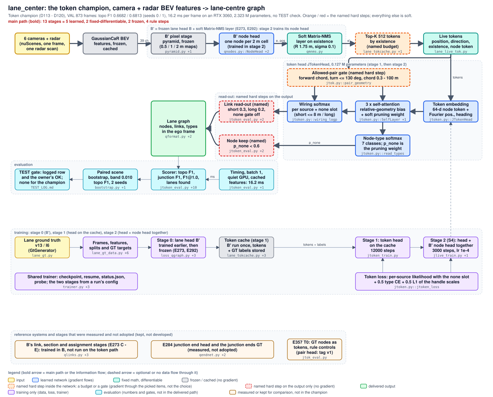

# lane_center: the token champion, camera + radar BEV features -> lane-centre graph



The drawing shows the system of record of the lane project, the **token champion** (D113 - D120): one frame of six cameras and one radar scan go through the frozen GaussianCaR features and the lane head B' to a set of predicted nodes; these nodes are the tokens of one attention head whose attention weights are the wiring of the lane graph. VAL, 873 frames, seeds 0 / 1: topo F1 0.6682 / 0.6813, junction F1 0.2538 / 0.2481, F1@1.0 0.8459 / 0.8476, lanes found 0.7232 / 0.7214; 16.2 ms per frame for the whole path on an RTX 3060 (batch 1, cached features, quiet GPU); 2.323 M parameters (B' 2.196 M, token head 0.127 M). No TEST check of the champion exists. The numbers are those of `../PROBLEM.md` (current best); the design rules behind the picture are in `../DESIGN.md` (R1 - R12), the owner's permissions and decisions in `../DECISIONS.md` (decisions are cited as D<n>).

## How to read the picture

The picture has five sections, top to bottom. Arrows are data flow; a **bold** arrow lies on the main path from the sensors to the lane graph, a thin arrow does not, a **dashed** arrow is a training-time or optional link (no data flows through it in the delivered chain). The grey frames group boxes that belong together. Every box names the file (and where useful the symbol) it stands for; the file map below lists all of them.

1. **Front of the chain (first row).** Six cameras and the radar (nuScenes, one frame and one radar scan per step, D91) -> the frozen GaussianCaR foundation (39 channels at 200 x 200 cells of 0.5 m, cached) -> the **pixel stage of B'** (the pyramid with three taps, frozen) -> the **node head of B'** (one node slot per 2 m cell: existence, offset, direction, flags, a 64-d node token) -> the **soft Matrix-NMS layer** on the existence (no parameters, differentiable, replaces the hard close-node step of the earlier system) -> the **top-K 512** choice -> the **live tokens** (position, direction, existence, node token of the K chosen cells).
2. **Token head and read-out (second and third row).** The tokens go through the embedding and three self-attention layers whose attention logit carries a learned bias of 13 relative-geometry features of the token pair and a key weight (the soft pruning: 1 - p_none of the head's own node-type softmax after the first 1000 steps, sigmoid of the B' existence before). The **allowed-pair gate** (a hard mask on the pairs) feeds the attention bias and the wiring. On top of the last layer the **wiring softmax** (per source token a softmax over the allowed destination tokens and one learned none slot, for short links up to 8 m and long links above, which are the junction connectors) and a **seven-way node-type softmax** are read. The **read-out** (named, output only) turns the probabilities into the **lane graph**: nodes, links with their connector curves, node types, in the ego frame (`qformat` contract).
3. **Evaluation (fourth row).** The dump of the head is decoded with the named thresholds, scored by one scorer (topo F1, junction F1, F1@1.0, lanes found), compared with the paired scene bootstrap (noise band 0.010 topo F1, two seeds) and timed (batch 1, cached features, idle GPU). The TEST gate lies behind it: TEST only with a logged row and the owner's recorded OK (R12); the champion has none yet.
4. **Training (fifth section).** Ground truth (GtGenerator lane GT, version l6 / v13) -> frames, features, splits and targets -> stage 0 (the lane head B', trained earlier and frozen) -> the token cache -> stage 1 -> stage 2, with the token loss and the shared trainer beside them (details below).
5. **Reference stages that were measured and not adopted (bottom).** Boxes in the "alt" colour: kept for comparison, not developed, not part of the delivered chain (see below).

## What is learned and what is not

| part | status | where it is trained |
|---|---|---|
| GaussianCaR foundation | frozen, cached | not here (extracted once and stored under `<data>/lane_center/b123`; the extraction code is in the tag `v1`) |
| B' pyramid | frozen in both stages | stage 0 (E273 stage A, then E292) |
| B' node head | learned in stage 2 | stage 0, then stage 2 together with the head |
| Matrix-NMS layer, live token selection | fixed math, differentiable (no parameters); the selection is an index choice, see the hard steps | - |
| token embedding, three self-attention layers, wiring softmax with the none slot, node-type softmax, handle scales | learned | stage 1, then stage 2 |
| top-K, allowed-pair gate, read-out thresholds | named hard steps, no parameters | - |

## The named hard steps

The design rule R1 (end-to-end differentiable, hard selection only on the output and named) is met up to these named items, which the picture draws as orange (inside the network) and red (on the output) dashed boxes. The tool counts boxes, so the badge of the picture says "4 rule steps": top-K, the gate, the link read-out and the node keep; the read-out boxes hold the four numbers.

| step | what | why it stays (see the generated table below) |
|---|---|---|
| top-K 512 | the K = 512 cells with the largest existence logit become tokens (a stable argsort); cells with sigmoid(e) <= 0.05 are padding (B''s own active threshold) | a named compute budget (R5); K 384 is faster but loses node coverage (E383) |
| allowed-pair gate | forward along the chord, turn <= 130 degrees, chord 0.3 - 100 m; attention bias and wiring range over the allowed pairs | at K = 512 it lets 94.3 % of the GT links through; the pair attention itself is the thing to replace (R5) |
| link thresholds | link short (chord <= 8 m) 0.3, link long 0.2, none gate off | hand-tuned on TRAIN (D115, E375), named (R7): E388 learned them with a soft-F1 surrogate and lost |
| node keep | a token is a node when p_none < 0.6 | the same |

The four thresholds are the constant `D115 = (0.3, 0.2, 0.6, False)` of `../evaluation/jtoken_eval.py` (link short, link long, keep, none gate).

## The training stages

- **Stage 0, the lane head B'** (E273 / E292; its trainer `qgraph_train.py` is in the tag `v1`): pixel maps, then nodes, then (in B, not on the token path) links, sections and map assignment, each phase with a gate; phase 9 puts the Matrix-NMS layer into the forward path. Its checkpoint `runs/e292_a_s<seed>` is the B' of the champion and is frozen from here on (stage 1) or only its node head moves (stage 2).
- **The token cache** (`../net/prep/lane_tokcache.py`, `../net/prep/lane_ptok_data.py`, `../net/prep/lane_tok_data.py`): B' is run once on every TRAIN and VAL frame; the K = 512 tokens and the labels of every token (assignment to the GT nodes, contracted link targets) are stored. Derived data, not in git. In the picture the cache box has no incoming arrow because it is made by `-m lane_center.net.prep.lane_tokcache build` from the frozen B', not by the delivered path.
- **Stage 1** (`train/jtoken_train.py`): the token head on the cache, 12000 steps, batch 8, learning rate 1e-3, none weight 0.25. No gradient reaches B' (it is cached).
- **Stage 2, S4** (`train/jlive_train.py`, D120): B' runs inside the step (`../net/model/lane_net.py`: `LaneNet.tokens`, the live tokens), the same top-K, the graph kept; the head and the node head of B' train together, 3000 steps, learning rate 1e-4, through the token loss plus B''s own node loss. The dashed arrow from stage 2 to the embedding stands for "trains the head and, through the live tokens, the node head". The inference network is the same as in stage 1 (only the weights of the node head changed), so ms per frame and parameters do not change.
- **The token loss** (`../net/loss/loss_jtoken.py::jtoken_loss`): per class (short, long) and per source token the negative log of the summed probability of the GT successors, or of the none slot when there is none, 0.5 x node-type cross-entropy, 0.5 x L1 of the handle scales on the long links. Matching inside the loss only (D55); no gradient goes through the top-K, the gate or the thresholds.

## Not in the delivered chain, and not here

The side lines that were measured and not adopted left the tree with the restructure (D154) and are in the tag `v1`: E389 (the SD-route association, TIE), E390 / E391 / E394 (the SD map as a logical road graph and its association), the past at feature or token level (E354, S2 E368, S2b E387: no gain, so the champion has no state, R2), E324 s with the junction thread (E285 - E363), the route-graph builder chain of loops 8 - 18, the E271 / E272 grid chain, E388 (learned thresholds) and E379 (a plain ensemble).

## Reference stages (kept for comparison, not developed)

- **B's link, section and assignment stages** (E273 C - E): trained in B, not run on the token path.
- **The ends of the junction GT** (`qends`): the maneuver count of the read-out reads `qends.cluster`.
- **E357 stage T0** (the GT nodes as tokens, the control and oracle stage of the token design, D105): its code is in the tag `v1`; `../net/model/jtok.py` holds only the pair geometry the champion uses.

## What is not drawn

`covers` lists every `.py` file of `net/`, `training/`, `evaluation/` and `tools/`; a file that is in no box must be in `not_drawn` of the spec with a reason (shown in the spec, not repeated here): tests of the modules (`../net/tests/`, `../evaluation/tests/`), helpers (`bflc_paths.py`, `pmap.py`, `gpu_gate.py`) and the picture tools (`../tools/`).

## Keeping the drawing and the code in step

The spec `architecture.json` is hand-written; `architecture.svg` and the file map below the marker line are generated from it. From the problem folder:

```
python3 ../../autoresearch/reporter/archdraw.py render training/architecture.json     # rewrite the svg and the generated part of this file
python3 ../../autoresearch/reporter/archdraw.py check training/architecture.json      # exit 1: a box names a file or symbol that is gone, a file is in no box and not in not_drawn, or svg / md are stale
```

When code moves or is added, change the box or `not_drawn` entry in the spec, render, and check; text outside the markers is kept as written.

<!-- archdraw:begin: generated from architecture.json by autoresearch/reporter/archdraw.py; edit the spec, then `archdraw.py render` -->
## File map: every box and the code it stands for

| box | kind | code | note |
|---|---|---|---|
| 6 cameras + radar (nuScenes, one frame, one radar scan) | input |  | 255 scenes, scene-disjoint TRAIN 8,414 / VAL 873 / TEST 833 frames (data/splits.json); one frame and one radar scan per step (D91) |
| TEST gate: logged row and the owner's OK; none for the champion | evaluation (numbers and gates, not in the delivered path) | `TEST_LOG.md` | select and tune on TRAIN / VAL only; TEST once per finished design (R12); the champion has no TEST check yet |
| Lane ground truth v13 / l6 (GtGenerator) | input | `../../GtGenerator/lane_gt.py` | lane GT per keyframe from the nuScenes map: pieces, nodes, links, junction layers; the signature changes with every edit of the generator |
| Shared trainer: checkpoint, resume, status.json, probe; the stages from a run's config | training only (data, loss, trainer) | `training/trainer.py`, `../../autoresearch/trainkit/control.py`, `../../autoresearch/trainkit/probe.py`, `training/train/lane_train.py` | every stage trains and resumes through trainer.fit (the run-directory contract of the research worker; the stop protocol and the probes are trainkit's); lane_train.py starts the stages (stage 0, tokens, stage 1, stage 2) from a run's config |
| B's link, section and assignment stages (E273 C - E): trained in B, not run on the token path | measured or kept for comparison, not in the champion | `net/model/qlinks.py`, `net/model/sections.py`, `net/loss/loss_sections.py`, `net/model/qassign.py`, `net/prep/map_sim.py` | the lane head B is trained with these stages (phases 4 - 6); the token head replaces them; the map side simulates lane-level maps with errors |
| GaussianCaR BEV features, frozen, cached | frozen / cached (no gradient) | `net/prep/foundation/gcar_features.py`, `net/prep/foundation/check_features.py` | camera + radar -> 39 channels at 200 x 200 cells of 0.5 m (decoder PCA 32 + 7 map logits), extracted once; the champion starts from the cached features. The code makes them again from raw nuScenes with the foundation's code and weights from outside the repository; a new extraction is close, not bit-identical (net/prep/foundation/README.md) |
| Paired scene bootstrap, band 0.010 topo F1, 2 seeds | evaluation (numbers and gates, not in the delivered path) | `evaluation/sparse_lanes/bootstrap.py`, `evaluation/jtoken_eval.py::paired_junction` | scene-level resampling of paired frames; the D115 cell (batch 4, 873 VAL frames) |
| Frames, features, splits and GT targets | training only (data, loss, trainer) | `net/prep/lane_gt_data.py`, `net/prep/frames.py`, `net/prep/polylines.py`, `net/prep/qtargets.py`, `net/prep/qraster.py` | the 39 frozen channels of a frame and the targets drawn from the lane GT (nodes on a 2 m grid, links, pixel maps); rows, normalisation and the stored per-part files come through net/prep/frames.py, which the old chain reads too (p16_data, p8_lib) |
| B' pixel stage pyramid, frozen (0.5 / 1 / 2 m maps) | frozen / cached (no gradient) | `net/model/pyramid.py::PyramidHead`, `net/model/head.py` | one encoder-decoder with three taps: 0.5 m lines, 1 m centres + event heats, 2 m road / intersection; features of the node grid; frozen in both stages |
| Lane graph nodes, links, types in the ego frame | delivered output | `net/model/qformat.py`, `net/prep/lane_ptok_data.py::to_pred`, `evaluation/lane_predict.py` | the qformat prediction of a frame: nodes (position, direction, existence, flags), links with their Hermite connectors, node types; no GT field |
| Scorer: topo F1, junction F1, F1@1.0, lanes found | evaluation (numbers and gates, not in the delivered path) | `evaluation/jtoken_eval.py::score`, `evaluation/lane_dump.py::read_dump`, `evaluation/jtoken_eval.py::sweep`, `evaluation/jtoken_eval.py::choose_cell`, `evaluation/qgraph_eval.py`, `evaluation/sparse_lanes/`, `evaluation/lane_suite.py`, `evaluation/lane_task/`, `evaluation/jmaneuver.py`, `evaluation/adapter.py` | dump (the head's output per frame) -> a decode of the dump -> the qformat prediction -> the scorer; one definition of every metric, never a private one |
| Stage 0: lane head B' E271 -> E273 -> E292 (off: the stored B') | training only (data, loss, trainer) | `training/train/qgraph_train.py`, `training/train/qgates.py`, `net/prep/grid_data.py`, `net/loss/loss_qgraph.py::qgraph_loss`, `net/loss/losses.py`, `net/model/soft_lines.py`, `net/prep/targets.py` | from random weights, phase by phase with a gate each: the E271 grid head (phase 1), pixel maps, nodes, links, sections, assignment, jointly (E273 phases 2 - 7), then phases 3 4 5 6 9 with the Matrix-NMS layer (E292); the step stage0 with stage0.enabled, else the stored checkpoint runs/e292_a_s<seed> (the B' of the champion) |
| The ends of the junction GT of E284 (measured, not adopted) | measured or kept for comparison, not in the champion | `net/prep/qends.py` | the ends of the junction GT (qends) of E284, measured and not adopted; the maneuver count of the read-out (qends.cluster) still reads them; the E284 end head and the rest of the junction thread (E285 - E363) are in the tag v1 |
| B' node head one node per 2 m cell (trained in stage 2) | learned network (gradient flows) | `net/model/qnodes.py::NodeHead`, `net/model/qgraph.py::QGraph`, `net/model/qpredict.py` | per cell: existence logit, offset, direction, 8 flag logits, section-start and long-link scores, a 64-d node token; in stage 2 the loss of the token head reaches it (D120), B' keeps its own node loss |
| Link read-out (named) short 0.3, long 0.2, none gate off | named hard step on the output only (no gradient) | `net/model/lane_readout.py::decode_variant`, `evaluation/jtoken_eval.py::D115`, `net/model/jtoken.py::decode` | a link is delivered when its probability reaches the threshold of its class (short: chord <= 8 m, long: above) and both ends are kept; three of the four named thresholds |
| Node keep (named) p_none < 0.6 | named hard step on the output only (no gradient) | `net/model/lane_readout.py::node_e`, `net/model/lane_readout.py::frame_prediction`, `net/prep/lane_ptok_data.py::to_pred` | a token becomes a node of the graph when the none probability of its own type softmax is below 0.6; the fourth named threshold |
| Cost per run: ms, peak memory, parameters | evaluation (numbers and gates, not in the delivered path) | `evaluation/lane_predict.py::measure_cost`, `evaluation/lane_cost.py`, `evaluation/jtoken_eval.py::timing`, `evaluation/jtiming.py` | every run's predict step times the whole path at batch 1 (CUDA events, cached features), reads the peak GPU memory and counts the parameters; times compare only between quiet runs (GPU and host idle) |
| Token cache (stage 1) B' run once, tokens + GT labels stored | frozen / cached (no gradient) | `net/prep/lane_tokcache.py`, `net/prep/lane_ptok_data.py`, `net/prep/lane_tok_data.py`, `net/prep/lane_tok_data.py::sub_table` | derived data, not in git: the K = 512 tokens of the frozen B' on every TRAIN and VAL frame with the labels of every token (assignment to the GT nodes, contracted link targets); the loader batches it. The stored cache of runs/e292_a_s<seed>, or (the step tokens, tokens.enabled) the run's own in <run>/tokens |
| Soft Matrix-NMS layer on existence (R 1.75 m, sigma 0.1) | fixed math, differentiable | `net/model/qmnms.py::matrix_nms_logit` | E292: the close-node suppression as a layer of the forward path, no parameters, computed in log space so the gradient is alive; replaces the hard close-node step of the earlier system |
| Allowed-pair gate (named hard step) forward chord, turn <= 130 deg, chord 0.3 - 100 m | named hard step inside the network: a budget or a gate (gradient through the picked items, not the choice) | `net/model/jtok.py::pair_geometry` | also the source of the 13 pair features of the attention bias; the attention bias and the wiring softmax range over the allowed pairs only |
| Wiring softmax per source + none slot (short <= 8 m / long) | learned network (gradient flows) | `net/model/jtoken.py::wiring_logp`, `net/model/jtoken.py::JTokenHead` | the wiring IS the attention of the last layer: per source and class a softmax over the allowed destinations and one learned none slot; two handle scales per pair give the connector curve |
| Top-K 512 tokens by existence (named budget) | named hard step inside the network: a budget or a gate (gradient through the picked items, not the choice) | `net/prep/lane_tokcache.py::select_tokens`, `net/model/lane_net.py::live_tokens` | the K = 512 cells with the largest existence logit (a stable argsort) become tokens; cells with sigmoid(e) <= 0.05 are padding |
| 3 x self-attention relative-geometry bias + soft pruning weight | learned network (gradient flows) | `net/model/jtoken.py::SelfLayer`, `net/model/jtoken.py::pair_mlp` | d 64, 4 heads, FFN 128; logit = q.k / 4 + bias(13 pair features) + log(key weight); the key weight is sigmoid(e) of B' for the first 1000 steps, then 1 - p_none of the head itself: no token is dropped inside |
| Node-type softmax 7 classes; p_none is the pruning weight | learned network (gradient flows) | `net/model/jtoken.py::JTokenHead.read_types` | none, lane point, fork, merge, junction entry, junction exit, boundary; read after layer 1 and after layer 3 by the same linear layer |
| Stage 1: token head on the cache 12000 steps | training only (data, loss, trainer) | `training/train/jtoken_train.py` | batch 8, lr 1e-3 (5 % warm-up, cosine), AdamW, none weight 0.25; no gradient reaches B' (cached) |
| Token loss: per-source likelihood with the none slot + 0.5 type CE + 0.5 L1 of the handle scales | training only (data, loss, trainer) | `net/loss/loss_jtoken.py::jtoken_loss` | per class and per source the negative log of the summed probability of the GT successors (the none slot when there is none); the none target and class weighted 0.25 in the champion; matching inside the loss only (D55) |
| Live tokens position, direction, existence, node token | fixed math, differentiable | `net/model/lane_net.py::LaneNet`, `net/prep/lane_live_data.py` | the delivered path and stage 2: B' runs inside the step, the K tokens are made from its live output with the graph kept (token rounded to float16 as the cache stores it, gradient passed straight through) |
| Token embedding 64-d node token + Fourier pos., heading | learned network (gradient flows) | `net/model/jtoken.py::JTokenHead`, `net/model/jtoken.py::fourier` | x0 = LayerNorm(Linear(tok) + MLP(Fourier(pos), dirv, e, e_raw, flags, s, uout, uin)); 0.127 M parameters in the whole head |
| Stage 2 (S4): head + B' node head together 3000 steps, lr 1e-4 | training only (data, loss, trainer) | `training/train/jlive_train.py`, `net/loss/loss_qgraph.py::node_loss` | B' runs in the step (live tokens), its node head trains on the token loss plus its own node loss; the champion recipe of D120 (E372), no past block, no map block |

## Arrows

| from | to | carries |
|---|---|---|
| GaussianCaR BEV features, frozen, cached | B' pixel stage pyramid, frozen (0.5 / 1 / 2 m maps) | 39 ch |
| B' pixel stage pyramid, frozen (0.5 / 1 / 2 m maps) | B' node head one node per 2 m cell (trained in stage 2) | features |
| B' node head one node per 2 m cell (trained in stage 2) | Soft Matrix-NMS layer on existence (R 1.75 m, sigma 0.1) | e, pos |
| Soft Matrix-NMS layer on existence (R 1.75 m, sigma 0.1) | Top-K 512 tokens by existence (named budget) | e' |
| Live tokens position, direction, existence, node token | Token embedding 64-d node token + Fourier pos., heading | tokens |
| Wiring softmax per source + none slot (short <= 8 m / long) | Link read-out (named) short 0.3, long 0.2, none gate off | p(link) |
| Node-type softmax 7 classes; p_none is the pruning weight | Node keep (named) p_none < 0.6 | p_none |
| Cost per run: ms, peak memory, parameters | Scorer: topo F1, junction F1, F1@1.0, lanes found | ms |
| Stage 0: lane head B' E271 -> E273 -> E292 (off: the stored B') | Token cache (stage 1) B' run once, tokens + GT labels stored | B' frozen |
| Token cache (stage 1) B' run once, tokens + GT labels stored | Stage 1: token head on the cache 12000 steps | tokens + labels |
| Stage 1: token head on the cache 12000 steps | Stage 2 (S4): head + B' node head together 3000 steps, lr 1e-4 | head weights |
| Stage 2 (S4): head + B' node head together 3000 steps, lr 1e-4 | Token embedding 64-d node token + Fourier pos., heading | trains head + node head (no data flow in training) |

## Main path from input to output

main path (bold): 13 stages = 5 learned, 2 fixed-differentiable, 2 frozen, 4 rule steps.

| stage | class | code |
|---|---|---|
| GaussianCaR BEV features, frozen, cached | frozen | `net/prep/foundation/gcar_features.py`, `net/prep/foundation/check_features.py` |
| B' pixel stage pyramid, frozen (0.5 / 1 / 2 m maps) | frozen | `net/model/pyramid.py::PyramidHead`, `net/model/head.py` |
| B' node head one node per 2 m cell (trained in stage 2) | learned | `net/model/qnodes.py::NodeHead`, `net/model/qgraph.py::QGraph`, `net/model/qpredict.py` |
| Soft Matrix-NMS layer on existence (R 1.75 m, sigma 0.1) | fixed-differentiable | `net/model/qmnms.py::matrix_nms_logit` |
| Top-K 512 tokens by existence (named budget) | rule step | `net/prep/lane_tokcache.py::select_tokens`, `net/model/lane_net.py::live_tokens` |
| Live tokens position, direction, existence, node token | fixed-differentiable | `net/model/lane_net.py::LaneNet`, `net/prep/lane_live_data.py` |
| Allowed-pair gate (named hard step) forward chord, turn <= 130 deg, chord 0.3 - 100 m | rule step | `net/model/jtok.py::pair_geometry` |
| Token embedding 64-d node token + Fourier pos., heading | learned | `net/model/jtoken.py::JTokenHead`, `net/model/jtoken.py::fourier` |
| 3 x self-attention relative-geometry bias + soft pruning weight | learned | `net/model/jtoken.py::SelfLayer`, `net/model/jtoken.py::pair_mlp` |
| Wiring softmax per source + none slot (short <= 8 m / long) | learned | `net/model/jtoken.py::wiring_logp`, `net/model/jtoken.py::JTokenHead` |
| Node-type softmax 7 classes; p_none is the pruning weight | learned | `net/model/jtoken.py::JTokenHead.read_types` |
| Link read-out (named) short 0.3, long 0.2, none gate off | rule step | `net/model/lane_readout.py::decode_variant`, `evaluation/jtoken_eval.py::D115`, `net/model/jtoken.py::decode` |
| Node keep (named) p_none < 0.6 | rule step | `net/model/lane_readout.py::node_e`, `net/model/lane_readout.py::frame_prediction`, `net/prep/lane_ptok_data.py::to_pred` |

## Where the path is not end to end, and what could stand in for it

| step | class | what it does and what it carries | building block that emulates it differentiably | catch |
|---|---|---|---|---|
| GaussianCaR BEV features, frozen, cached | frozen | extracted once with frozen weights (about 0.4 s per frame on the RTX 3060): the 16.2 ms of the chain start from the cached features, so the delivered system from raw sensors is not that fast | an image-radar BEV encoder trained inside the chain, or a small student distilled from GaussianCaR (the direction of the bev_fusion student encoder) | any replacement has to fit the speed budget (R3); the cache is what keeps the loop cheap; R1 names it as frozen today |
| B' pixel stage pyramid, frozen (0.5 / 1 / 2 m maps) | frozen | the pixel stage of the lane head B' (E273 stage A, trained before, checkpoint runs/e292_a_s<seed>) is frozen: in stage 2 only its node head trains | train the pyramid with the token loss in stage 2 as well | measured, no gain: E393 (2026-11-25, VAL, seeds 0 / 1, card in tag v1) trained the pyramid with the token loss from the champion; against the same recipe with the pyramid frozen (B''s node loss off in both) topo F1 changed by +0.0012 / -0.0004, both intervals include 0, so it stays frozen; with the node loss kept it gained +0.0016 on seed 0 (below the 0.010 bar; seed 1 invalid) |
| Top-K 512 tokens by existence (named budget) | rule step | a hard index choice on the existence of B' (the named compute budget of R5): no gradient goes through the choice, the picked tokens carry the gradient to the node head in stage 2 | an attention cheap enough for all 2,500 cells of the node grid, or a sparser pair set that keeps the ground-truth links | K 384 is faster but loses node coverage (E383: GT node coverage 0.9878 against the written 0.99), so K 512 stays; K sets the time of the head |
| Allowed-pair gate (named hard step) forward chord, turn <= 130 deg, chord 0.3 - 100 m | rule step | a geometric mask on the token pairs of a frame (forward along the chord, turn at most 130 degrees, chord between 0.3 and 100 m); at K = 512 the gate and the token set let 94.3 % of the GT links through (E365 manifest, VAL, B' seed 0) | no mask: the geometry bias alone over all K x K pairs | costs compute and probably precision; the mask also bounds the wiring softmax; 5.7 % of the GT links lie outside the gate or the token set |
| Link read-out (named) short 0.3, long 0.2, none gate off | rule step | hand-tuned on TRAIN and named (R7, D115): the decode of the champion is link short 0.3, link long 0.2, node keep p_none < 0.6, none gate off | learn the thresholds with a loss that sees the graph metric (delivered lanes, junction precision) | E388: a soft-F1 surrogate loses (-0.025 / -0.028 topo F1, -0.11 junction F1 on VAL; it loses on TRAIN too), so the thresholds stay named |
| Node keep (named) p_none < 0.6 | rule step | the same hand-tuned and named read-out (R7, D115); the existence written for a kept node is 1 - p_none shifted by keep_thr - 0.5 | a kept-node loss on the graph metric | as above: the surrogate of E388 lost, and the cell is chosen on TRAIN before the single VAL score (E375) |
<!-- archdraw:end -->
