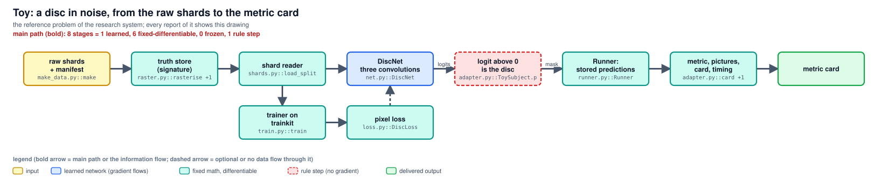

# Toy: a disc in noise, from the raw shards to the result

the reference problem of the research system; every report of it shows this drawing

<!-- archdraw:begin: generated from architecture.json by autoresearch/reporter/archdraw.py; edit the spec, then `archdraw.py render` -->
## File map: every box and the code it stands for

| box | kind | code | note |
|---|---|---|---|
| raw shards + manifest | input | `dataset/make_data.py::make` |  |
| ground truth (signature) | fixed math, differentiable | `gt/raster.py::rasterise`, `gt/generate.py::generate` |  |
| shard reader | fixed math, differentiable | `net/prep/shards.py::load_split` |  |
| trainer on trainkit | fixed math, differentiable | `training/train.py::train` |  |
| DiscNet three convolutions | learned network (gradient flows) | `net/model/net.py::DiscNet` |  |
| pixel loss | fixed math, differentiable | `net/loss/loss.py::DiscLoss` |  |
| logit above 0 is the disc | rule step (no gradient) | `evaluation/adapter.py::ToySubject.predict` |  |
| core Runner: stored predictions | fixed math, differentiable |  |  |
| metric, picture, timing (core step) | fixed math, differentiable | `evaluation/adapter.py::SegIoU`, `evaluation/adapter.py::Overview` |  |
| result.json | delivered output |  |  |

## Arrows

| from | to | carries |
|---|---|---|
| raw shards + manifest | ground truth (signature) | annotation |
| shard reader | DiscNet three convolutions | pictures |
| DiscNet three convolutions | logit above 0 is the disc | logits |
| logit above 0 is the disc | core Runner: stored predictions | mask |
| pixel loss | DiscNet three convolutions | gradient (no data flow in training) |

## Main path from input to output

main path (bold): 8 stages = 1 learned, 6 fixed-differentiable, 0 frozen, 1 rule step.

| stage | class | code |
|---|---|---|
| ground truth (signature) | fixed-differentiable | `gt/raster.py::rasterise`, `gt/generate.py::generate` |
| shard reader | fixed-differentiable | `net/prep/shards.py::load_split` |
| trainer on trainkit | fixed-differentiable | `training/train.py::train` |
| pixel loss | fixed-differentiable | `net/loss/loss.py::DiscLoss` |
| DiscNet three convolutions | learned | `net/model/net.py::DiscNet` |
| logit above 0 is the disc | rule step | `evaluation/adapter.py::ToySubject.predict` |
| core Runner: stored predictions | fixed-differentiable |  |
| metric, picture, timing (core step) | fixed-differentiable | `evaluation/adapter.py::SegIoU`, `evaluation/adapter.py::Overview` |

## Where the path is not end to end, and what could stand in for it

| step | class | what it does and what it carries | building block that emulates it differentiably | catch |
|---|---|---|---|---|
| logit above 0 is the disc | rule step | a pixel decision that makes the delivered mask | nothing: the mask is the output |  |
<!-- archdraw:end -->
